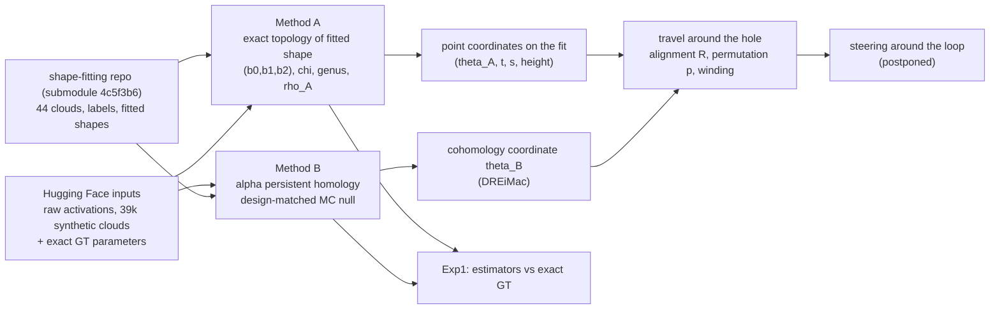

# Topology of neural geometry

**Status (2026-11-15):** all preregistered topology analyses are done. They use only stored activations; no model inference was run. Model steering and simulated steering are preregistered and **postponed by the author**.

**Links:** [paper (PDF)](paper/main.pdf) · [interactive explorer](https://burnycoder.github.io/topology-of-neural-geometry-in-llm-mechanistic-interpretability/) · [inputs and results on Hugging Face](https://huggingface.co/datasets/BurnyCoder/topology-of-neural-geometry) · [preregistration](reports/preregistration.md) · [summary of all experiments](reports/summary.md)

Interpretability research keeps finding **shapes** in neural activations:
- circles for weekdays and months ([Engels et al. 2024](https://arxiv.org/abs/2405.14860));
- a helix for GPT-2 positions ([Yedidia 2023](https://www.lesswrong.com/posts/qvWP3aBDBaqXvPNhS/gpt-2-s-positional-embedding-matrix-is-a-helix));
- circles of residues in grokked modular addition ([Nanda et al. 2023](https://arxiv.org/abs/2301.05217)).

The sibling project [shape-fitting](https://github.com/BurnyCoder/shape-fitting-in-neural-geometry-in-llm-mechanistic-interpretability) fits one of 13 uniquely parametrised shapes to the **top-3 PCA coordinates** of 44 such activation and weight clouds.

**This project asks the topological question behind the hypothesis.** Does a concept have a **hole you can travel around**, and does the concept's semantic cycle (Monday → … → Sunday → Monday) go around it exactly once? Steering activations around such a loop should then be semantically meaningful. That idea comes from **manifold steering** ([Wurgaft et al. 2026](https://arxiv.org/abs/2605.05115); [Goodfire](https://www.goodfire.com/research/manifold-steering); the [Neural Geometry series](https://www.goodfire.com/research/neural-geometry)).

We answer it in two independent ways:
1. **Method A, exact topology of the fitted shape.** The shapes are uniquely parametrised, so Betti numbers, Euler characteristic and genus are exact. A *margin ratio* ρ_A says whether the data's noise can resolve that topology. Every point is projected onto its fitted shape, and we test whether the concepts are ordered along it.
2. **Method B, persistent homology of the cloud.** We use alpha complexes with a design-matched Monte Carlo null. The circle-valued coordinate of the hole comes from persistent cohomology via [DREiMac](https://github.com/scikit-tda/DREiMac).


## Highlights (all numbers generated from `results/`)

- **Clear semantic loops: colours (hue) and grokked residues.**
  - **Colours:** a significant hole (persistence ratio π = 5.02 vs null 95th percentile 2.38, p = 0.001). Hue goes **once around it in order**, in the persistent-cohomology coordinate (R = 0.95, p < 1e-4, winding -1) and in the fitted cone's azimuth (R = 0.98). It is the only loop that persists beyond the top-3 PCs: Rips π = 2.67 in the top-10 PCs and 4.22 in full-dimensional cosine distance.
  - **Grokked residues:** a significant hole (π = 2.45 vs 1.83, p = 0.001). Residues mod 113 wind once around it at Fourier frequency 20 (Holm-adjusted p = 6.0e-05).
- **Months: a significant hole under the cluster-aware null** (π = 1.72 vs 1.44, p = 0.002). It is robust to removing the prompt-offset means (p = 0.003). Post hoc, with a relaxed circular-coordinate setting, the months go once around it (R = 0.72, winding 1).
  - On the fitted shape, the months sit around the helix axis in order (R = 0.93, winding 1), and the helix almost closes (closure gap 0.04 radii).
  - Post hoc: their position along the axis follows the 2nd Fourier harmonic (R² = 0.83 vs 0.10 for the 1st). The months lie on a closed saddle-shaped loop, a circle that the helix family can only approximate.
- **Weekdays: no detectable hole** (π = 1.32 vs 1.36, p = 0.094). This holds across seeds and after offset removal. Yet on the fitted helix the days sit around its axis in exact cyclic order (exact p = 0.003, the minimum possible, winding 1).
- **Specificity:** none of the 6 ordinal concepts and none of the 20 random-walk / Gaussian-process controls has a loop the concept travels around.
  - Ordinal concepts with a significant loop: 0 of 6 (positions, counts, years, temperature, age). Controls: 0 of 20.
  - Ordinal concepts are instead ordered *along* open curves: character counts |ρ| = 0.999, temperature -0.997, GPT-2 positions pole-to-pole 0.978.
- **Fitted helices are not evidence of open curves.** The helix fits of weekdays, months and residues have margin ratios of only 0.11, 0.11 and 0.23, so their "openness" is within the noise.
  - The axial winding of helix fits is *not* specific: 8 of 8 smooth random-process controls fitted as helices also wind (R = 0.86–0.98).
  - Closure separates them: the controls' closure gaps are 0.33–2.20 radii.
- **Preregistered co-primary verdicts:**
  - **H1-A**, a hole in the fitted shape plus traversal: 0/3 cyclic sets pass. All three are fitted as helices, which have no hole.
  - **H1-B**, persistent homology plus traversal plus robustness: 0/3 pass. Weekdays have no loop. For months, the preregistered DREiMac setting yields no coordinate. The residues fail only the top-10-PC check.
  - **H2, specificity:** not falsified.
- **Instrument check on 39,000 synthetic clouds with exact ground-truth topology** (30114 resolvable clouds):
  - The preregistered estimator (alpha complex + universal null) recovers the exact Betti vector for 0.618 [0.610, 0.626] (macro average). That is worse than a fixed-threshold baseline (0.714) and than reading topology off the fitter's predicted family (0.812).
  - All persistent-homology estimators beat the family label once the topology is well resolved (ρ_A ≥ 4): 0.94 vs 0.86.
  - They separate open from closed arcs, and caps from full spheres, which a family label cannot.

**In plain words.**
- Topology finds the loops that semantics predicts for colours, residues and months. It finds none for ordinal concepts or random controls.
- The shape fitter calls the cyclic sets "helices", but within noise those helices are closed loops.
- Weekdays are the exception. They are ordered around a circle on the fitted shape, but the 7 prompt clusters do not form a statistically detectable hole.
- Whether steering *around* these loops changes the model's answers in semantic order is the next experiment. It is designed, and postponed by the author.


## Results

### Method A: exact topology of the 44 fitted shapes (Exp0)

- 2 fitted shapes have a hole (b1 = 1; both are cones) and 1 has a void (b2 = 1: GPT-2 W_pos, a closed sphere).
- 27 of the 44 fitted topologies are resolvable at the data's noise scale (ρ_A ≥ 1).
- The analytic rules agree with persistent homology of dense noise-free shape samples for 0.970 of 234 shapes.
- Full tables: [reports/exp0_analytic.md](reports/exp0_analytic.md); point coordinates on the shapes: [reports/coords_check.md](reports/coords_check.md).


### Method B: persistent homology of the clouds (Exp2) and the cyclic tests (Exp3)

| Dataset | top H1 π | null q95 | p (loop) | traversal: R, winding (θ_B, preregistered) | traversal post hoc, 3D (relaxed range) | Rips π in top-10 PCs |
|---|---|---|---|---|---|---|
| colours (hue) | 5.02 | 2.38 | 0.001 | 0.95, -1 | 0.94, -1 | 2.67 |
| grokked residues (k = 20) | 2.45 | 1.83 | 0.001 | 0.97, -1 | 0.96, -1 | 1.16 |
| months | 1.72 | 1.44 | 0.002 | no coordinate | 0.72, 1 | 1.13 |
| days with times (day) | 2.01 | 1.87 | 0.013 | no coordinate | 0.18, 0 | 1.48 |
| weekdays | 1.32 | 1.36 | 0.094 | no coordinate | 0.06, 0 | 1.22 |
| years | 1.63 | 1.94 | 0.775 | no coordinate | 0.21, 0 | 1.39 |
| GPT-2 positions | 1.22 | 2.16 | 1.000 | no coordinate | 0.30, 0 | 1.01 |

**How to read the table:**
- The null is a cluster-centre null for prompt-template designs and a full-dimensional matched Gaussian otherwise, with 999 draws.
- "No coordinate" means DREiMac's preregistered setting, which requires Rips death ≥ 2 × birth, built no circular coordinate.

All 44 clouds: [reports/exp2_invariants.md](reports/exp2_invariants.md). Hypothesis tests: [reports/exp3_cyclic.md](reports/exp3_cyclic.md).

### Instrument validation on synthetic clouds with exact topology (Exp1)

| Estimator | exact (b0,b1,b2) accuracy, macro over 13 families [95% CI] |
|---|---|
| P: alpha + universal null (preregistered primary) | 0.618 [0.610, 0.626] |
| S: Rips H1 + universal null (deviation D1) | 0.660 [0.651, 0.670] |
| Ba: fixed π thresholds (tuned on validation) | 0.714 [0.703, 0.725] |
| Bb: family-implied (fitter's label → modal Betti vector) | 0.812 [0.807, 0.816] |
| Bc: majority vector | 0.555 [0.553, 0.557] |

**Better or worse, in plain words:**
- The persistent-homology estimators are **worse** than the family label overall. They miss thin loops (ellipse: 0.51 vs 0.99) and tori (0.11 vs 1.00).
- They are **better** where the label is topologically ambiguous: arcs, open or closed (0.79 vs 0.58), and spheres, cap or full (0.76 vs 0.61).
- They are **better** wherever the topology is well resolved.
- They rarely invent holes: 0.019–0.054 false positives on contractible shapes.


## Architecture



## What happens when you run it

```text
run.py <phase>
  fetch        download inputs/ from the Hugging Face dataset at the pinned revision, verify SHA-256
  exp0         Method A: exact topology + margin of the 44 fits and 40,560 synthetic GT shapes; theta_A tests
  coords       where the labelled points sit on their fitted shapes (curve parameter, azimuth, height, clusters)
  power        validation-stream tuning (b0 rule, baseline thresholds) and the power simulation
  exp1         synthetic validation of the persistent-homology Betti estimators against exact GT topology
  exp2         persistent homology of the 44 clouds with 999-draw design-matched nulls (cached in results/nulls)
  exp3         preregistered cyclic hypotheses H1-H4 (theta_B, top-10-PC check, Holm)
  exp3posthoc  post hoc: theta_B with DREiMac standard_range=False (deviation D5)
  exp4         bottleneck distances between clouds and ideal templates
  exp5         robustness: Rips vs alpha, top-k PCs, full-D cosine, offset removal, seeds, noise scale
  report       regenerate every table, figure and number in README / reports / paper from results/
  site         GitHub Pages explorer (docs/index.html)
  all          everything above, CPU only (about 1.5 h on 16 cores)
  exp6sim, exp6  simulated / LLM steering around the loops (postponed; exp6 needs a GPU and Llama-3.1-8B)
```

## Installation and usage

Requirements: [uv](https://docs.astral.sh/uv/). Python 3.11 is installed by uv; it is pinned because DREiMac requires Python below 3.12. No GPU is needed.

```bash
git clone --recursive https://github.com/BurnyCoder/topology-of-neural-geometry-in-llm-mechanistic-interpretability.git
```

```bash
cd topology-of-neural-geometry-in-llm-mechanistic-interpretability && uv sync
```

```bash
uv run python run.py all
```

Run the tests:

```bash
uv run pytest
```

Regenerate the documentation numbers and figures from the committed results without recomputing:

```bash
uv run python run.py report site
```

Reproducing the inputs from scratch, which needs a GPU and the source project, is described in [docs/reproduce_inputs.md](docs/reproduce_inputs.md).

## Features

- Exact topology (Betti numbers, χ, genus, boundary, margin) of the source's 13 parametrised shape families, with tests against persistent homology of dense samples.
- Intrinsic coordinates of points on fitted shapes. The numpy parametrisations reproduce the source's fitted shapes to 1e-5.
- Alpha and Rips persistence, the universal null, and design-matched Monte Carlo nulls (cluster-centre and full-dimensional Gaussian, sampled through the Gram matrix).
- Circular coordinates from persistent cohomology, and the travel-around-the-hole statistics: exact permutation tests, winding, cyclic order.
- Validation against exact ground truth on 39,000 synthetic clouds, with cluster-bootstrap CIs.
- Reproducible from GitHub + Hugging Face: pinned revision, SHA-256 manifest, bit-exact regeneration of the synthetic ground truth.
- Every documentation number is generated from `results/`.

## Repository layout

- `src/neurotopo/`:
  - `analytic/`: Method A rules and coordinates.
  - `tda/`: diagrams, nulls, invariants, circular coordinates.
  - `stats/`: alignment and tests.
  - `experiments/`: one module per phase.
  - `steering/`: postponed steering code.
  - `report/`: tables, figures, site, numbers.
- `external/shape-fitting/`: the source project (git submodule, commit 4c5f3b6).
- `reports/`: literature and state-of-the-art reviews, preregistration (with addendum and amendment), deviations, plan, one report per experiment, summary. `reports/templates/` holds the report sources; `reports/generated/` holds generated tables.
- `docs/`: [methodology](docs/methodology.md), [exact topology of the families](docs/analytic_topology.md), [reproducing the inputs](docs/reproduce_inputs.md), figures, explorer.
- `paper/`: LaTeX source and PDF.
- `results/`: machine-readable results of every phase.
- `logs/`: timestamped run logs.

## Technologies

uv, Python 3.11, NumPy, SciPy, scikit-learn, pandas, [GUDHI](https://gudhi.inria.fr) (alpha complexes, bottleneck), [ripser.py](https://github.com/scikit-tda/ripser.py), [persim](https://github.com/scikit-tda/persim), [DREiMac](https://github.com/scikit-tda/DREiMac), matplotlib, plotly.js (explorer), Hugging Face Hub, pytest.

## To do

- **Steering around the detected loops** (preregistered, postponed by the author):
  - simulated steering with cross-validated decoders, then
  - Llama-3.1-8B steering of weekdays, months, days and colours;
  - steering of the grokked modular-addition model, retrained with the source recipe.
- A loop test for weekdays with more prompt templates per day: 7 clusters of 7 points are close to the power limit.
- A distance for comparing clouds that is not dominated by absolute scale (Exp4 was uninformative). For example, bottleneck distance in log-π coordinates.
- Torus and thin-loop detection: the synthetic accuracy for tori is near zero at our sample sizes.

## License

MIT ([LICENSE](LICENSE)). GUDHI's alpha complex is GPL-3.0 through CGAL; see [NOTICE](NOTICE).
