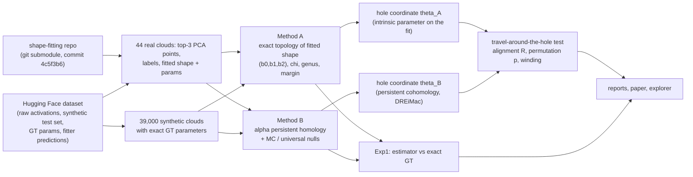

# Topology of neural geometry

**Status:** preregistered; no results yet. The hypotheses, metrics and falsification criteria are in [reports/preregistration.md](reports/preregistration.md); progress is tracked in [reports/plan.md](reports/plan.md).

Interpretability research keeps finding low-dimensional **shapes** in neural activations:
- circles for weekdays and months ([Engels et al. 2024](https://arxiv.org/abs/2405.14860));
- a helix for GPT-2 positions ([Yedidia 2023](https://www.lesswrong.com/posts/qvWP3aBDBaqXvPNhS/gpt-2-s-positional-embedding-matrix-is-a-helix));
- circles of residues in grokked modular addition ([Nanda et al. 2023](https://arxiv.org/abs/2301.05217)).

The sibling project [shape-fitting](https://github.com/BurnyCoder/shape-fitting-in-neural-geometry-in-llm-mechanistic-interpretability) fits one of 13 uniquely parametrised shape families to the **top-3 PCA coordinates** of such activations. It covers 44 activation and weight clouds from GPT-2, Llama-3.1-8B, Pythia, a grokked modular-addition transformer and toy models of superposition.

A shape label such as "helix" does not say whether a concept has a **hole you can travel around**. This project measures exactly that, in two independent ways:

1. **Method A, exact topology of the fitted shape.** Every fitted shape is uniquely parametrised, so its topology follows from family and parameters:
   - Betti numbers b0, b1, b2;
   - Euler characteristic and genus;
   - boundary components.

   We also report a **topological margin**: how far the parameters are from a change in topology, relative to the cloud's noise. Examples: a torus with R > r > 0 is genus 1 with Betti numbers (1,2,1); a closed arc is a circle (1,1,0); a helix is contractible (1,0,0).
2. **Method B, persistent homology of the cloud itself.** Alpha-complex persistence in ℝ³, with two significance tests:
   - a design-matched Monte Carlo null;
   - the universal null of [Bobrowski & Skraba 2023](https://doi.org/10.1038/s41598-023-37842-2).

   No fit is involved.

**Primary hypothesis.** Semantically cyclic concepts (days of the week, months, residues mod 113) have a hole, and **the semantic cycle travels around it exactly once**. Non-cyclic ordinal concepts (years, temperatures, ages, positions, character counts) and random-init controls do not.

How the travel is tested:
- A circle-valued coordinate is read off each point, from the fitted shape's own parametrisation (Method A) and from persistent cohomology ([de Silva et al. 2011](https://doi.org/10.1007/s00454-011-9344-x), via [DREiMac](https://github.com/scikit-tda/DREiMac); Method B).
- We test whether the concepts' order along it matches the semantic cycle: permutation test, winding number ±1.
- This "travel around the hole" test is inspired by **manifold steering** ([Wurgaft et al. 2026, arXiv:2605.05115](https://arxiv.org/abs/2605.05115); [Goodfire blog](https://www.goodfire.com/research/manifold-steering)), which moves Llama-3.1-8B activations along a fitted day-of-week manifold so that the output steps Monday → Tuesday → …. It also draws on Goodfire's [Neural Geometry series](https://www.goodfire.com/research/neural-geometry).
- Manifold steering is a causal statement about travelling *along* a manifold. This project asks the observational, topological question: is there a hole, and does the semantic order go around it once?

**Novelty (as far as our [literature review](reports/state-of-the-art-review.md) found):**
- The first preregistered, null-controlled test that cyclic concepts' representations have a 1-cycle aligned with the semantic order.
- Exact topology of fitted parametric shapes compared with persistent homology of the same clouds.
- A Betti-number estimator validated against exact ground-truth topology on 39,000 synthetic clouds.

No training and no model inference are needed: everything uses the source project's published clouds, fits and synthetic test set.

## Results

_Not yet available._ Tables and figures will be generated here by `uv run python run.py report` between the markers below.

<!-- BEGIN:headline -->
<!-- END:headline -->

## Architecture



## What happens when you run it

```text
run.py <phase>
  fetch     download inputs from the Hugging Face dataset (pinned revision, SHA-256 checked) -> data/source/
  exp0      Method A on all real fits and synthetic GT shapes; travel-around-the-hole with theta_A
  power     synthetic power / false-positive simulation for the decision rules
  exp1      synthetic validation of the persistent-homology Betti estimator against exact GT topology
  exp2      persistent-homology invariants of all 44 real clouds (+ subsample stability)
  exp3      cyclic-concept hypotheses H1-B, H2, H3, H4 (theta_B, design-matched nulls, top-10-PC check)
  exp4      topological similarity: bottleneck distances, MDS, dendrogram, ideal templates
  exp5      robustness: Rips vs alpha, top-k PCs, offset removal, seeds, noise-scale definition
  report    regenerate every table, figure and number in README / reports / paper from results/
  site      GitHub Pages explorer
  all       fetch .. site (CPU only; no local files needed)
```

## Installation and usage (planned interface; implemented in the next step)

Requirements: [uv](https://docs.astral.sh/uv/). Python 3.11 is installed by uv; it is pinned because DREiMac requires Python below 3.12. No GPU is needed.

```bash
git clone --recursive https://github.com/BurnyCoder/topology-of-neural-geometry-in-llm-mechanistic-interpretability.git
```

```bash
cd topology-of-neural-geometry-in-llm-mechanistic-interpretability && uv sync
```

```bash
uv run python run.py all
```

## Repository layout

- `src/neurotopo/`: the package.
  - `analytic`: Method A.
  - `tda`: Method B.
  - `stats`: alignment and tests.
  - `data`, `geometry`, `experiments`, `report`.
- `external/shape-fitting/`: the source project, as a git submodule pinned to commit 4c5f3b6.
- `reports/`: the review, preregistration, plan, deviations, and per-experiment reports.
- `docs/`, `paper/`, `tests/`, `configs/`, `scripts/`.

## Technologies

uv, Python 3.11, NumPy, SciPy, scikit-learn, pandas, [GUDHI](https://gudhi.inria.fr) (alpha complexes), [ripser.py](https://github.com/scikit-tda/ripser.py) and [persim](https://github.com/scikit-tda/persim), [DREiMac](https://github.com/scikit-tda/DREiMac), matplotlib, Hugging Face Hub, pytest.

## To do

See [reports/plan.md](reports/plan.md). Planned future work beyond this project:
- Causal follow-up: steer activations around a detected hole, in the spirit of manifold steering, and check that the output steps through the semantic cycle.

## License

MIT ([LICENSE](LICENSE)). GUDHI's alpha complex is GPL-3.0 through CGAL; see [NOTICE](NOTICE).
