# Topology of neural geometry

Do concepts that are cyclic in meaning (days, months, colours, residues mod n) occupy a region of activation space with a **hole that the concept goes around**? This repository answers that question with exact topology and persistent homology, for 44 activation and weight clouds from language models and toy networks.

**Status (2026-11-15):** all preregistered topology analyses are done. They use only stored activations; no model inference was run. A second and a third independent audit added post hoc checks and corrected several plain-language claims; no preregistered verdict changed ([reports/exp7_audit.md](reports/exp7_audit.md), [reports/exp8_audit3.md](reports/exp8_audit3.md)). Model steering and simulated steering are preregistered and **postponed by the author**.

**Links:** [paper (PDF)](paper/main.pdf) · [interactive explorer](https://burnycoder.github.io/topology-of-neural-geometry-in-llm-mechanistic-interpretability/) · [how the example results were made (interactive)](https://burnycoder.github.io/topology-of-neural-geometry-in-llm-mechanistic-interpretability/examples.html) · [worked example of the method](docs/worked_example.md) ([interactive](https://burnycoder.github.io/topology-of-neural-geometry-in-llm-mechanistic-interpretability/worked_example.html)) · [method and terms](docs/glossary.md) · [inputs and results on Hugging Face](https://huggingface.co/datasets/BurnyCoder/topology-of-neural-geometry) · [preregistration](reports/preregistration.md) · [summary of all experiments](reports/summary.md)

## What we found, in plain words

For each concept we ask two questions:
1. Do its activations form a **loop** that is more persistent than in random Gaussian clouds of the same spread, and does that loop run through the concepts (rather than being a small loop inside one concept's cluster of prompts)?
2. Does walking through the concept in order (Monday → Tuesday → … → Sunday → Monday) **go around that loop exactly once**?

A loop alone does not prove a hole. The loop test also flags many hole-free shapes, such as curved sheets and caps ([third audit, D9](reports/exp8_audit3.md)). So we call a loop a **ring** only when the concept also goes around it once.

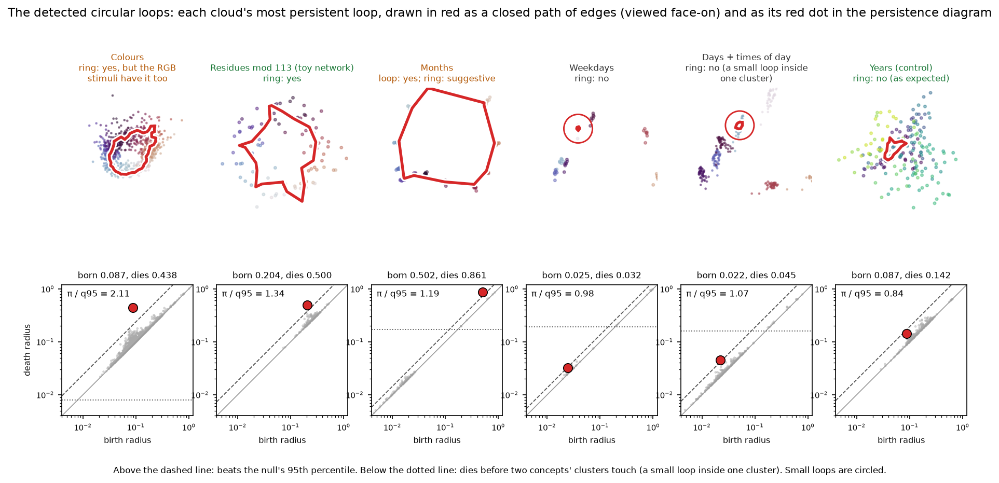

*The detected circular loops.* For each example cloud, the red ring is the cloud's most persistent loop: one closed path of edges that carries it ([representative loop](docs/glossary.md#representative-loop)), seen face-on.
- **Bottom:** the same loop as a red dot (birth radius, death radius) in the persistence diagram.
- **Colours, residues and months:** a large ring that runs through the concepts.
- **Weekdays and days with times:** the most persistent loop is a small loop inside one cluster (circled). It dies below the dotted line, before two days' clusters touch.
- **Years:** a small loop that does not beat the null (below the dashed line).

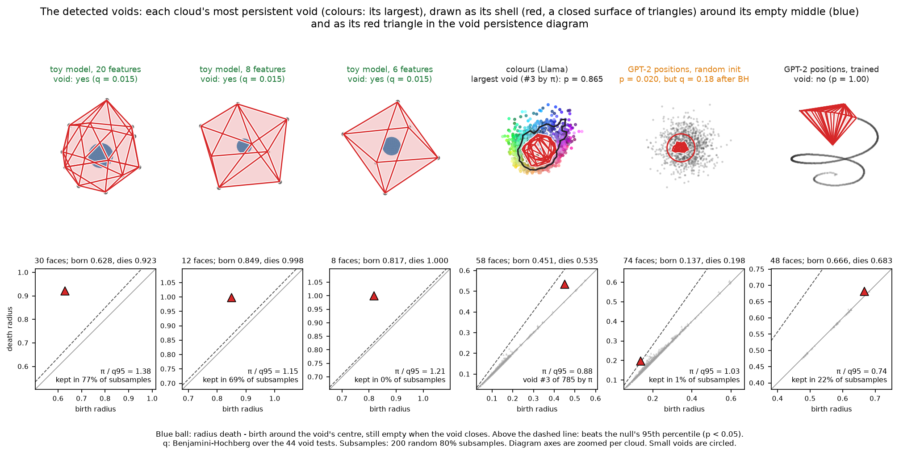

*The detected voids*, drawn the same way. A void is an empty region walled in by a closed surface, like the inside of a hollow ball. It is the next kind of hole after a loop (an H2 bar instead of an H1 bar).
- **Top:** the red edges are the shell of a void: one closed surface of triangles that carries it ([representative void](docs/glossary.md#representative-void)). Each cloud shows its most persistent void, except colours, which shows its largest.
  - The blue ball is the void's empty middle. No point is closer to its centre than the void's death radius, so when the void closes (at its birth radius) a ball of radius death − birth there is still not covered.
- **Bottom:** the same void as a red triangle in the void persistence diagram (axes zoomed per cloud).
- **Toy models of superposition** ([Elhage et al. 2022](https://transformer-circuits.pub/2022/toy_model/index.html)), green: each point is one feature's direction in a 3-dimensional hidden layer.
  - They are the only 3 of the 44 clouds whose most persistent void survives Benjamini–Hochberg (q = 0.015). Here the void matches both the cloud's shape and its meaning: the features sit on or near the corners of a polytope, so the shell spans the whole cloud and the empty middle is the space the features keep clear.
  - The void of 20 features is the strongest of all 44 clouds: π = 1.47 against the null's 95th percentile of 1.06, and it comes back in 77% of random 80% subsamples (69% with 8 features).
  - With 6 features the shell is the 8 faces of an octahedron. Its persistence ratio π = 1.224 is close to that of a regular octahedron, √(3/2) ≈ 1.225. A subsample keeps only 5 of the 6 corners, and the void came back in 0% of them.
  - These clouds have only 6–20 points and were [preregistered](reports/preregistration.md) as exploratory, descriptive sets.
- **Colours** (chosen after browsing the [explorer](https://burnycoder.github.io/topology-of-neural-geometry-in-llm-mechanistic-interpretability/), so post hoc), black: each point is painted in its prompt's own colour, and the dark line is the hue ring (the cloud's most persistent loop), seen face-on.
  - The panel shows the void with the largest empty middle (#3 of 785 by π). Its shell's corners cover 21 of the 36 hues, and the hue ring winds around its centre once.
  - It closes at radius 0.451, right after the hue ring is filled in (0.438), and fills at 0.535. This suggests the ring's middle is not a flat disc: filling it in walls off a pocket.
  - It is not significant: π = 1.19, below the null's 95th percentile (1.35; p = 0.865). Random Gaussian clouds of the same design usually have a more persistent void. The farthest 2% of the points are left out of the panel so the ring fills it.
- **GPT-2 positions at random init**, orange: a small void (circled) with p = 0.020, but q = 0.18 after the correction, and it comes back in only 1% of subsamples. We read it as a chance hit among 44 tests.
- **Trained GPT-2 positions**, black: the shape fitter calls this cloud a closed sphere, which has a void, but the data has none. Its most persistent void is a thin one (π = 1.02, below the null's 95th percentile of 1.39). The positions trace a spiral curve, not a surface.
- **None of the other 14 trained-model clouds** (the language-model concepts and the grokking network) has a significant void, even before correction (0 at p < 0.05).
- Explore any loop or void of any of the 44 clouds in the [explorer](https://burnycoder.github.io/topology-of-neural-geometry-in-llm-mechanistic-interpretability/): set the radius, then pick a loop or void, or click its marker. Voids are drawn as see-through shells.

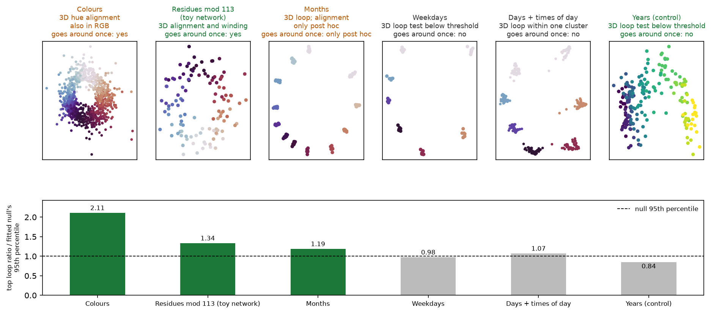

*How to read.*
- **Top:** each concept's activations, flattened to two dimensions and coloured by position in its cycle (years: by value). Green titles are results that came out as hoped, orange titles are partial, black titles are failures.
- **Bottom:** the persistence of each cloud's most persistent loop, divided by the 95th percentile of the same statistic in random Gaussian clouds of the same design. Above the dashed line means a significant loop (p < 0.05).
  - A significant loop is not always a ring of the concepts: for days with times it is a small loop inside one day's cluster (grey bar).
  - A significant loop is not by itself a hole either (D9).
- **A flat picture can mislead.** The weekdays look round here, but the 7 day centres form only a weak loop even in this plane (persistence ratio 1.19, with a large Sunday → Monday gap) and none in 3D (1.05). A regular 7-gon gives 1/sin(π/7) ≈ 2.3.
- **Every step behind this figure**, with numbers, is worked through on a 21-point toy week in [docs/worked_example.md](docs/worked_example.md) ([interactive version](https://burnycoder.github.io/topology-of-neural-geometry-in-llm-mechanistic-interpretability/worked_example.html)).

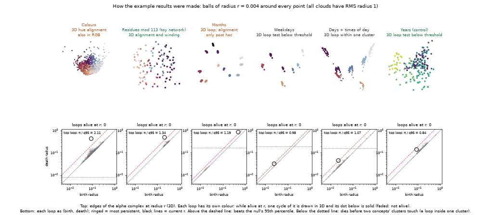

*How the results were made (animation).* Balls of radius r grow around every point of each example cloud. r is the same for all clouds, which all have RMS radius 1.
- **Top:** the edges of the alpha complex present at radius r, in 3D. Its holes are exactly the holes of the union of the balls.
- **Bottom:** each loop as a dot (birth radius, death radius) on log axes. The ringed dot is the most persistent loop.
- **Each loop has its own colour.** While a loop is alive at the current r, its dot is solid and one closed path of edges that carries it ([representative loop](docs/glossary.md#representative-loop)) is drawn in the same colour in the 3D view. Faded dots are loops not alive at r.
  - Dots above the dashed red line beat the null's 95th percentile.
  - Dots below the dotted line die before two concepts' clusters touch, so they lie inside one cluster.
- **Try it yourself** with the radius slider in the [explorer](https://burnycoder.github.io/topology-of-neural-geometry-in-llm-mechanistic-interpretability/) (all 44 clouds, with their loops and voids; you can also show one at a time), or, together with the null distribution and the travel around the hole, on the [examples page](https://burnycoder.github.io/topology-of-neural-geometry-in-llm-mechanistic-interpretability/examples.html). Every term is defined in [docs/glossary.md](docs/glossary.md), which the explorer also shows.

**What worked**
- **Colours form a ring that hue goes around once, but the stimuli already have that ring.**
  - The model's colour representations form a clear loop: its persistence is 2.1× the null's 95th percentile, and it is found in 100% of 200 random subsamples.
  - Walking through the hues in order (red, yellow, green, blue, purple, back to red) goes around it exactly once. In a check added after the first results, this still holds with 10 dimensions instead of 3.
  - **Confounder (found in the second audit, D8):** the 900 prompts' own RGB values already form this loop (2.9× the null's 95th percentile, p = 0.001), and the 36 hue means go around it once (measured by their angle in the RGB cloud's first two PCs).
    - The stimuli were generated with saturation ≥ 0.4, so the stimulus colours surround the grey axis.
    - The model reads hex codes, not RGB vectors, so its loop is not trivial. But any representation that encodes the colour continuously would have this loop.
    - So the result shows that the model *keeps* the hue circle of its stimuli. It does not show that the model *builds* a hue circle of its own.
- **Residues mod 113 behave like a clock with 113 hours.**
  - In a small network trained to add numbers modulo 113, the number embeddings form a loop (1.3× the null's 95th percentile).
  - The numbers go around it once, ordered not as 0, 1, 2, … but by 20 × number (mod 113). This is the kind of Fourier-frequency order such networks are known to learn ([Nanda et al. 2023](https://arxiv.org/abs/2301.05217)). This traversal, tested against shuffled residues, is the evidence for a ring here; the loop test alone would not be (D9).
  - Caveat: the 3-dimensional view is unstable. The embeddings use 5 Fourier frequencies (20, 21, 3, 15, 31) with similar shares of the variance (0.16–0.22 each), so the top principal components have nearly equal variance and the top-3 view mixes frequencies. This likely explains why the loop shows up in only 26% of subsamples (33% against a threshold matched to the subsample size) and vanishes in 10 dimensions, where the 5 circles combine and no single loop dominates.
- **Months: a loop through the month clusters; a ring is suggestive, not shown.**
  - The 12 months form a loop (1.2× the null's 95th percentile, in 90% of subsamples) that runs through the month clusters.
  - In simulations, evenly spread hole-free arrangements of 12 centres reached the months' loop strength in 0 of 320 replicates (third audit, D9), so a hole-free sheet of month centres is an unlikely explanation.
  - The loop test cannot tell a closed ring from a nearly closed arc, and the December → January step is the largest of the 12 (1.9× the median step).
  - The months go around it in calendar order, but only with an analysis setting we relaxed after seeing the first results, and only in 3 dimensions.
- **The random-init controls behaved as chance predicts.** One of 3 random-init networks has a loop at p = 0.046, about what the 5% level predicts, and nothing goes around it.
  - The ordinal concepts (0 of 6) and 20 random walks and smooth curves (0 of 20) showed no loop either. They were never at risk, though: they are open curves, whose most persistent loops (ratio 1.00–1.63) stay far below the thresholds that blob-like random clouds set (1.79–2.16).

**What did not work**
- **Weekdays: no ring of days.**
  - We expected a 7-hour clock. In 3D the 7 day centres form no loop (ratio 1.05; p = 0.731 as a 7-point set), and the Sunday → Monday step is the largest (1.9× the median step).
  - The cloud's most persistent loop (p = 0.094) is a small loop inside one day's cluster: it dies at radius 0.032, before any two days' clusters touch (radius 0.19).
  - A weekday ring outside the top 3 dimensions, or with more prompts per day, is not ruled out. In simulations, the loop test detects a ring of 7 clusters in only 21% of cases at the weekdays' variance (95% CI of the nearest simulated cell 6–30%), but those simulated clusters are tighter than the real ones.
  - The days do sit in order around the axis of their fitted helix, but random-curve controls do that too, so it proves nothing.
- **Days with times of day: no ring of days.** The significant loop (p = 0.013; q = 0.082 after Benjamini–Hochberg over 44 tests) is a small loop inside one day's cluster: it dies at radius 0.045, before any two days' clusters touch (0.16). It appears in only 3% of subsamples, and the 7 day centres alone form no loop (ratio 1.11).
- **Our strictest, pre-committed test passed for nothing.** For weekdays, months and residues we committed in advance to three conditions: a ring, going around once, and surviving with 10 dimensions. None passed (0 of 3), and neither did the fitted-shape version (0 of 3).
- **With 10 dimensions, a loop alone means little.** Years, ages, temperatures and counts also form loops there, and their values do not go around them. Of the cyclic concepts, only colours still go around once in 10 dimensions; months, residues, weekdays and days with times do not.
- **"Helix or closed ring?" cannot be decided.** The shape fitter called weekdays, months and residues helices (open curves). At this noise level, a helix and a closed ring look the same.
- **Our hole detector was less accurate than the shape label.**
  - The test bed was 39,000 synthetic shapes with known holes. The pre-committed detector counted the pieces, holes and voids exactly right 62% of the time (averaged over shape families). Reading the count off the fitter's shape label scored 81%. The label comes from a fitter trained on the same 13 synthetic families, so this comparison is in-distribution for the label.
  - On clouds far from any change of topology (ρ_A ≥ 4, a cut chosen after the results), a tuned version of the detector does best: 92% vs 82% for the label. No torus reaches that cut, and 49% of those clouds are blobs, discs or paraboloids, which have no hole.

All statistics behind these sentences are in [Results](#results). The words are chosen to match them:
- "loop" means p < 0.05 against the design-matched Gaussian null, which also rejects many hole-free shapes ([audit, D9](reports/exp8_audit3.md));
- "ring" additionally means that the loop runs through the concept clusters, not inside one ([audit, D8](reports/exp7_audit.md)), and that the concept goes around it once in the preregistered analysis ("suggestive" if only post hoc);
- "goes around once" means winding number ±1 with significant alignment.

## At a glance

- **What it is.** A topological analysis of the point clouds that the sibling project [shape-fitting](https://github.com/BurnyCoder/shape-fitting-in-neural-geometry-in-llm-mechanistic-interpretability) classified into 13 geometric shape families. Each cloud is the **top-3 PCA coordinates** of activations or weights for one concept, for example the residual stream of Llama-3.1-8B at the token of each weekday.
- **Motivation.**
  - Interpretability research keeps finding shapes in activations: circles for weekdays and months ([Engels et al. 2024](https://arxiv.org/abs/2405.14860)), a helix for GPT-2 positions ([Yedidia 2023](https://www.lesswrong.com/posts/qvWP3aBDBaqXvPNhS/gpt-2-s-positional-embedding-matrix-is-a-helix)), circles of residues in grokked modular addition ([Nanda et al. 2023](https://arxiv.org/abs/2301.05217)), and loops for colours and dates ([Modell et al. 2025](https://arxiv.org/abs/2505.18235)).
  - Manifold steering moves activations *along* such a curved manifold and changes the model's answer in semantic order (Monday → Tuesday → …) ([Wurgaft et al. 2026](https://arxiv.org/abs/2605.05115); [Goodfire](https://www.goodfire.com/research/manifold-steering); the [Neural Geometry series](https://www.goodfire.com/research/neural-geometry)).
  - The topological question behind that: is there a hole you can travel around, and does the semantic cycle go around it exactly once? If so, steering around the loop should be semantically meaningful, and topology should help find where to steer.
- **How it works.** Two independent methods, then one shared test:
  1. **Method A, exact topology of the fitted shape.** The source's shapes are uniquely parametrised, so Betti numbers, Euler characteristic and genus follow exactly from the fitted parameters ([Hatcher](https://pi.math.cornell.edu/~hatcher/AT/AT.pdf)). A margin ratio ρ_A says whether the data's noise can resolve that topology.
  2. **Method B, persistent homology of the cloud itself.** The idea of counting holes this way (grow balls around the points and keep the holes that persist) is explained in the primary reference [What is...persistent homology?](https://www.youtube.com/watch?v=w6Jx1vFp_Gk) (VisualMath). We use alpha complexes ([GUDHI](https://gudhi.inria.fr)), the persistence ratio π = death/birth with a universal null ([Bobrowski & Skraba 2023](https://doi.org/10.1038/s41598-023-37842-2)), and a design-matched Monte Carlo max-statistic null (as in [Gardner et al. 2022](https://doi.org/10.1038/s41586-021-04268-7)).
  3. **Travel around the hole.** Each point gets a circle-valued coordinate: its position on the fitted shape (θ_A), or a persistent-cohomology coordinate ([de Silva et al. 2011](https://doi.org/10.1007/s00454-011-9344-x), via [DREiMac](https://github.com/scikit-tda/DREiMac)) (θ_B). We test whether the concepts are ordered around it (alignment R with exact or Monte Carlo permutation tests) and wind around it exactly once (winding number ±1).
- **Methodology.**
  - **Preregistered:** hypotheses, metrics, nulls and decision rules were pushed before any topology was computed ([preregistration](reports/preregistration.md)). All later changes are logged as dated deviations ([deviations](reports/deviations.md)).
  - **Controls:** six ordinal concepts, random-init networks and 20 random processes.
  - **Multiple testing:** Holm correction over the primary tests, Benjamini–Hochberg for exploratory ones.
  - **Instrument check:** the preregistered Betti estimator is validated on 39,000 synthetic clouds with exact ground-truth topology. The Monte Carlo loop test used on the real data was scored only on a 3,120-cloud subset, where it flags a loop on 17% of hole-free clouds ([D9](reports/exp8_audit3.md)).
- **Results.** Positive and negative examples are in plain words above; every statistic, table and figure is in [Results](#results).
- **Novelty**, as far as our [state-of-the-art review](reports/state-of-the-art-review.md) found:
  - **Exact topology of uniquely parametrised fitted shapes,** compared with persistent homology of the same clouds.
  - **A preregistered, null-controlled test** that a loop exists *and* that the semantic cycle winds around it once, with design-matched negative controls. Prior work counts Betti numbers without a null ([Moisescu-Pareja et al.](https://arxiv.org/abs/2512.25060); [Tang et al.](https://arxiv.org/abs/2605.06352)), judges loops by eye ([Modell et al.](https://arxiv.org/abs/2505.18235)), or tests centroids of imposed cycles ([David & Fomin](https://arxiv.org/abs/2607.24425)).
  - **Validation of a Betti-number estimator** against exact topology on 39,000 synthetic clouds of 13 families.
- **Features and technologies.**
  - **Pipeline:** one command (`run.py all`), CPU only. Inputs are pinned and hash-verified on Hugging Face, and a clean-room replication passed.
  - **Outputs:** every number in the documentation is generated from `results/`. A GitHub Pages explorer shows the results.
  - **Tools:** Python 3.11 with uv, GUDHI, ripser.py, persim, DREiMac, NumPy/SciPy, matplotlib and plotly.js ([details](#features)).

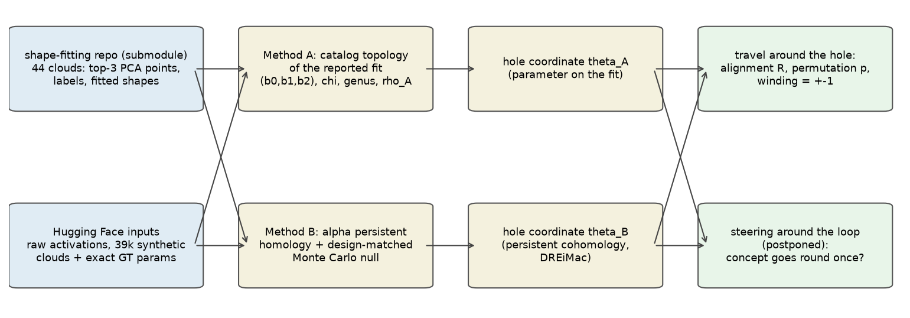

*Architecture.* The inputs (left) feed two independent methods.
- Method A reads the topology off the fitted shape's parameters.
- Method B computes persistent homology of the cloud itself, with no fit involved.

Each method gives a circle-valued coordinate for the hole (θ_A, θ_B), and both go through the same travel-around-the-hole statistics. Steering around the loop (right) is designed and postponed.

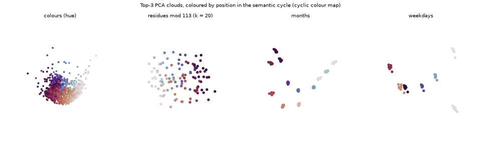

*Four clouds in their top-3 PCs, rotating.* Points are coloured by their position in the semantic cycle, using a cyclic colour map.
- The colour cloud wraps around a hole.
- Residues mod 113 form a loop when ordered by k·r mod 113 (k = 20, the frequency found by θ_B).
- Months and weekdays form tight clusters, one per month or day, each made of that concept's prompts. The months' clusters are arranged around a loop; the 7 weekday clusters show no loop that persistent homology can detect.

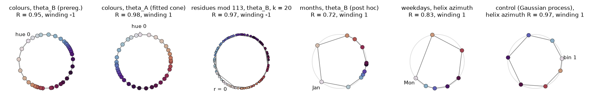

*Does the concept go around the hole?*
- **How to read:** each dot is one concept (a hue bin, a residue, a month, a weekday), placed at the circular mean of its points' hole angle and coloured by its position in the semantic cycle. Chords join consecutive concepts.
- If the concept goes around the hole once and in order, the colours run around the circle like a rainbow and the chords form one non-crossing polygon (winding ±1; the sign is only the direction).
- **Panels:**
  - Method B (θ_B): colours, residues, and months (post hoc).
  - Method A (θ_A, the fitted cone's azimuth): colours.
  - A warning case: the weekdays' helix azimuth.
  - A control: a Gaussian-process cloud that was also fitted as a helix. It winds too (8 of 8 such controls do), so winding around a helix axis is not evidence of a cyclic concept.

## Results

### Evaluation scores: method vs baselines, controls and ablations

**Real data: test sets vs controls.** Each column counts the sets that pass one step. "Goes around" means alignment p < 0.05 and winding ±1 for the concept variable. Ordinal sets use 7 or 12 equal-width value bins.

<!-- BEGIN:readme_roles -->
| role | sets | loop in top-3 PCs (MC null, p < 0.05) | A: resolvable fitted hole, goes around | B: loop, goes around (θ_B, 3D) | B + top-10 check (full H1-B rule) | goes around once, post hoc (3D) |
|---|---|---|---|---|---|---|
| test: cyclic, primary (H1) | weekdays, months, grokking_WE | 2/3 | 0/3 | 1/3 | 0/3 | 2/3 |
| test: cyclic, secondary (H3) | days_time | 1/1 | 0/1 | 0/1 | 0/1 | 0/1 |
| test: cyclic, exploratory | colors | 1/1 | 1/1 | 1/1 | 0/1 | 1/1 |
| negative control: ordinal concepts (H2) | gpt2_wpos, counting, pythia_counting, years, temperature, age | 0/6 | 0/6 | 0/6 | 0/6 | 0/6 |
| control: random-init networks (H2) | C3_weekdays_init, C3_months_init, C3_grokking_WE_init | 1/3 | 0/3 | 0/3 | 0/3 | 0/3 |
| control: random walks / Gaussian processes (H2) | 20 sets | 0/20 | 0/20 | 0/20 | 0/20 | 0/20 |
<!-- END:readme_roles -->

**Synthetic validation (Exp1): does persistent homology recover the exact topology?** These are 39,000 clouds of 13 families with exact ground-truth Betti numbers. Scores are exact (b0, b1, b2) accuracy, macro-averaged over families, with 95% cluster-bootstrap CIs over generator chunks.

| Role | Estimator | Resolvable clouds (30114) | Far from a topology change, ρ_A ≥ 4, post hoc (18454; no tori) | False holes on contractible outlier clouds |
|---|---|---|---|---|
| method (preregistered) | P: alpha complex + universal null | 0.618 [0.610, 0.626] | 0.751 [0.739, 0.763] | 0.065 |
| ablation: Rips instead of alpha (D1) | S: Rips H1 + universal null | 0.660 [0.651, 0.670] | 0.852 [0.838, 0.866] | 0.085 |
| ablation: Monte Carlo instead of universal null | MC: 3D matched-Gaussian null (3,120-cloud subset) | 0.594 [0.561, 0.629] | – | – |
| baseline | Ba: fixed π thresholds tuned on validation | 0.714 [0.703, 0.725] | 0.923 [0.915, 0.931] | 0.017 |
| baseline | Bb: fitter's family label → modal Betti vector | 0.812 [0.807, 0.816] | 0.820 [0.812, 0.829] | 0.014 |
| control (trivial) | Bc: majority Betti vector | 0.555 [0.553, 0.557] | 0.600 [0.595, 0.605] | 0.000 |

**Ablations and robustness checks on the real data.**

| What was changed | Result |
|---|---|
| Alpha complex → Rips complex (3D, top H1 π) | colours 5.02 → 4.97; months 1.72 → 1.57; weekdays 1.32 → 1.30 |
| Top-3 → top-10 PCs, matched null (post hoc) | significant loops among 14 key sets: 5 → 6 (R5c_llama_days_time, R4_llama_counting, R6_llama_years, R8a_llama_temperature, R8b_llama_age, R7_llama_colors) |
| 3D Euclidean → full-dimensional cosine distance (Rips π) | colours 4.97 → 4.22; residues 2.31 → 1.31; months 1.57 → 1.24 |
| Prompt-offset means removed ("k days from …") | loop p: months 0.002 → 0.003; weekdays 0.094 → 0.391 |
| Monte Carlo seed 0 → 1, 2 | loop p: months 0.002 → 0.001, 0.001; residues 0.001 → 0.001, 0.001; weekdays 0.094 → 0.116, 0.122 |
| 200 subsamples of 80% of the points | loop kept in: colours 1.00, months 0.90, residues 0.26, days_time 0.03 |
| Subsample threshold matched to the subsample size (audit, D8) | loop kept in: colours 1.00, months 0.93, residues 0.33, days_time 0.07 |
| Loop test on synthetic clouds of known topology (audit, D9) | the design-(b) Gaussian null detects 0.84 of true holes, but also flags 0.17 of hole-free clouds (spheres and caps 0.73, paraboloids 0.37, helices 0.20; blobs, its own model, 0.06) |
| Cluster-centre null on hole-free concept centres (audit, D9) | at the real variance structure, rings pass 5/40 and hole-free caps 4/40 (12 clusters), so the result is undetermined; hole-free caps and lattices pass at most 0.100 in any cell, rings up to 1.00 |
| Colour activations → the prompts' own RGB values (audit, D8) | top H1 π 5.02 → 8.01 (null q95 2.76, p = 0.001); the 36 hue means wind once around the RGB loop (angle in PC1–PC2) |
| Noise scale ν of Method A: main → median term only → doubled coverage term | resolvable fits: 27 → 41 → 24 of 44 |
| DREiMac `standard_range` True → False (post hoc, D5) | months: no coordinate → winding 1 (R = 0.72); days_time: no coordinate → winding 0 |
| Synthetic clouds with vs without outliers (D7) | P's false holes: 0.031 → 0.065; DTM filtration not required (threshold 0.10); outlier-proxy factor 4 and 8 instead of 6: 0.050–0.074 |

**Better or worse, in plain words.**
- **Test sets vs controls:**
  - A loop test pass is not by itself a hole: the Gaussian nulls also reject many hole-free shapes (D9). The ring claims rest on the traversal (colours, residues), and the months' traversal is post hoc.
  - Colours pass every step except the preregistered top-10 check, which they pass only post hoc.
  - Residues and months have loops, and the concept goes around them, but only residues do so in the preregistered setting, and both lose the loop in the top-10 PCs.
  - No ordinal concept and no random process has a top-3 loop, but as open curves they were never near the threshold. One random-init network has a borderline loop (p = 0.046), but nothing goes around it.
  - The colour loop is already in the colour prompts' RGB values, so it does not show that the model builds a hue circle.
  - Because no cyclic set passed the full preregistered rule, the controls' failures are weak evidence of specificity.
- **Method vs baselines (synthetic):**
  - The preregistered estimator P is **worse** than both the fixed-threshold baseline (Ba) and the family label (Bb), overall and on well-resolved clouds.
  - The family label (Bb) is the most accurate estimator overall. On well-resolved clouds, the tuned persistence baseline Ba is the most accurate: 0.923 [0.915, 0.931] vs 0.820 [0.812, 0.829] for the label.
  - Persistent homology (Ba) is **better** than the family label where the label cannot fix the topology: arcs, open or closed (0.79 vs 0.58), and spheres, cap or full (0.76 vs 0.61). It is also better on polytopes (0.50 vs 0.35).
  - It is **worse** on thin loops (ellipses 0.51 vs 0.99), cones (0.53 vs 0.94), tori (0.11 vs 1.00) and helices (0.86 vs 0.99).
  - The preregistered P rarely finds a true hole: it detects 0.16 of them (false loops 0.02). The Monte Carlo loop test used on the real data detects 0.84, but also flags 0.17 of hole-free clouds (D9).
  - Every estimator scores above the majority-vector control.
- **Ablations:**
  - Switching the complex from alpha to Rips changes little.
  - Moving to 10 dimensions makes loops appear in ordinal sets, so a loop alone stops being specific.
  - The months and residue loops are strongest in the top-3 PCs.
  - Conclusions do not depend on the Monte Carlo seed, the prompt-offset nuisance factor, or the outlier proxy.

### Output examples: test sets, controls and the null

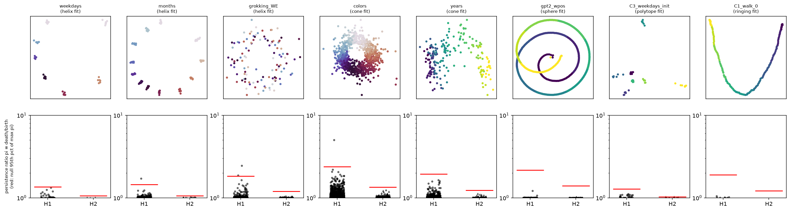

*Method B output on test sets (weekdays, months, residues, colours) and controls (years, GPT-2 positions, a random-init network, a random walk).*
- **Top row:** each cloud in its first two principal components, coloured by concept. The fitted family is in the title.
- **Bottom row:** the persistence ratio π of every H1 bar (loops, circles) and H2 bar (voids, triangles), on a log scale. Red: the 95th percentile of the null distribution of the largest ratio. A bar above it is a significant hole.

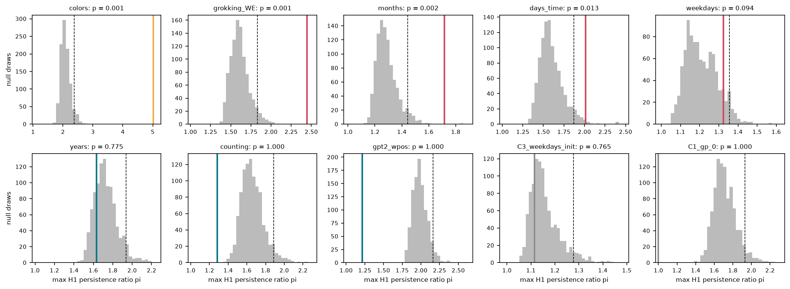

*The loop test against its null, dataset by dataset.*
- **How to read:**
  - Grey: the largest H1 ratio in each of 999 Gaussian surrogate clouds with the same design. Prompt-template sets use a cluster-centre null; the others use a full-dimensional matched Gaussian. Being beyond this null means "more persistent than a Gaussian of the same spread", not necessarily a hole (D9).
  - Dashed: the null's 95th percentile. Solid: the observed value.
- **Results:**
  - Colours, residues, months and days_time lie beyond the null. The days_time loop is a small loop inside one day's cluster, not a ring of days (audit, D8).
  - Weekdays fall just short (p = 0.094).
  - Ordinal sets and controls lie inside the null or below it.

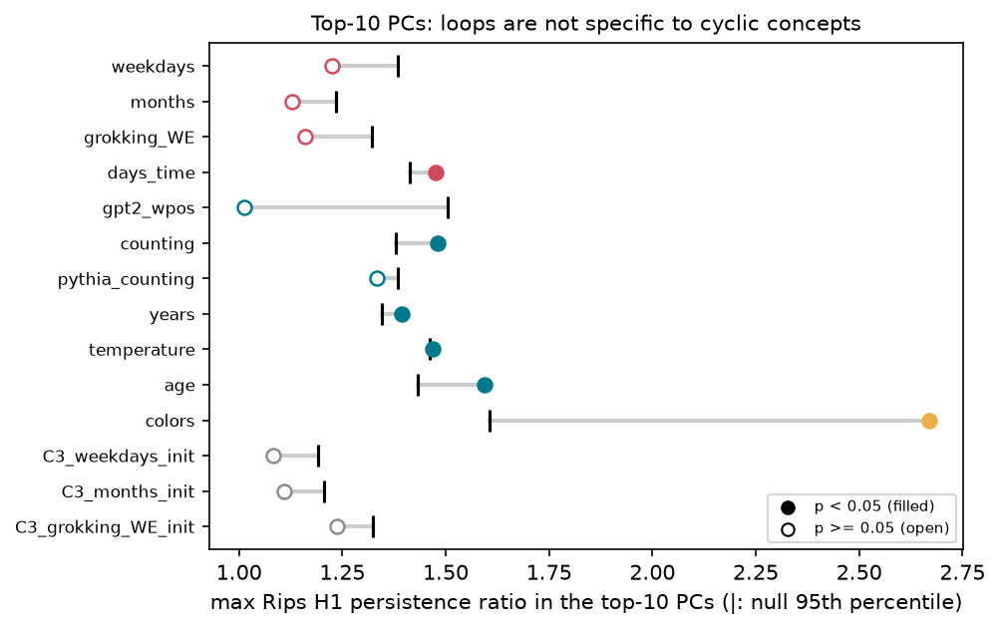

*Loops beyond the top-3 PCs (post hoc).* The observed largest Rips H1 ratio in the top-10 principal components (dot) is compared with a matched null's 95th percentile (bar). A filled dot means p < 0.05. In 10 dimensions, ordinal sets also get loops, as expected from Fourier-like features of numbers; colours keep by far the strongest one.

### Preregistered verdicts and findings per dataset

The per-dataset findings, with every statistic, are in [reports/findings_per_dataset.md](reports/findings_per_dataset.md); the key numbers are in the Method B table below.

- **Preregistered verdicts:**
  - H1-A (fitted-shape hole + traversal): 0/3.
  - H1-B (persistent homology + traversal + top-10 robustness): 0/3.
  - H3 (days_time): fail.
  - H4: balanced accuracy 0.50 for every criterion. No criterion identified any cyclic set, so the "found more easily" comparison is uninformative.
  - H2 (specificity) is not falsified. That is weak evidence: sensitivity is zero, and the ordinal and random-process controls, being open curves, never come near the null threshold.

### Method B on key clouds (Exp2, Exp3)

| Dataset | top H1 π | null q95 | p (loop) | BH q | traversal: R, winding (θ_B, preregistered) | traversal post hoc, 3D (relaxed range) | top-10 PCs: Rips π vs null q95, p (post hoc) |
|---|---|---|---|---|---|---|---|
| colours (hue) | 5.02 | 2.38 | 0.001 | 0.011 | 0.95, -1 | 0.94, -1 | 2.67 vs 1.61, p = 0.005 |
| grokked residues (k = 20) | 2.45 | 1.83 | 0.001 | 0.011 | 0.97, -1 | 0.96, -1 | 1.16 vs 1.32, p = 1.000 |
| months | 1.72 | 1.44 | 0.002 | 0.018 | no coordinate | 0.72, 1 | 1.13 vs 1.23, p = 0.550 |
| days with times (day) | 2.01 | 1.87 | 0.013 | 0.082 | no coordinate | 0.18, 0 | 1.48 vs 1.41, p = 0.010 |
| weekdays | 1.32 | 1.36 | 0.094 | 0.376 | no coordinate | 0.06, 0 | 1.22 vs 1.39, p = 0.945 |
| years | 1.63 | 1.94 | 0.775 | 1.000 | no coordinate | 0.21, 0 | 1.39 vs 1.35, p = 0.005 |
| GPT-2 positions | 1.22 | 2.16 | 1.000 | 1.000 | no coordinate | 0.30, 0 | 1.01 vs 1.51, p = 1.000 |

"No coordinate" means DREiMac's preregistered setting, which requires Rips death ≥ 2 × birth, built no circular coordinate. The weekday and days_time loops die before any two day clusters touch, so they are loops inside one cluster (audit, D8). The post hoc days_time coordinate is built on a different, non-significant class ([0.40, 0.43]), which does not overlap the significant loop. All 44 clouds: [reports/exp2_invariants.md](reports/exp2_invariants.md). Hypothesis tests: [reports/exp3_cyclic.md](reports/exp3_cyclic.md).

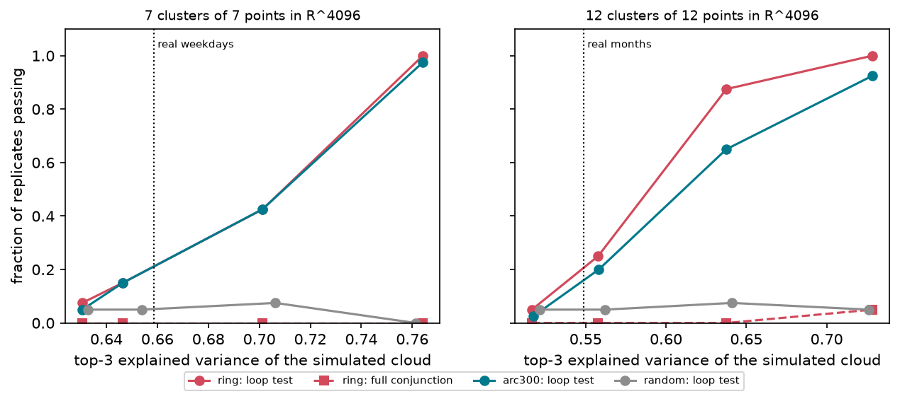

*How often the loop test detects simulated rings (corrected power simulation, post hoc).*
- **Setup:** 7 or 12 concept clusters in ℝ⁴⁰⁹⁶, matched to the real sets' second-order statistics. Plotted against the simulated top-3 explained variance:
  - the fraction of clouds that pass the loop test (solid);
  - for rings only, the fraction that pass the full preregistered conjunction (dashed).
  - The dotted line marks the real weekdays and months.
- **Results:**
  - In the simulated cell closest to the weekdays' variance (top-3 share 0.646 vs the real 0.659), a ring passes the loop test in 6 of 40 replicates (0.15; exact 95% CI 0.06–0.30; 0.21 interpolated to the real share). The simulated clusters are tighter than the real ones, and the real day centres show no loop at all, so low power is not the only explanation for the weekdays. Random placements pass at most 0.075, close to the nominal 5%. The full conjunction passes in at most 0.00, because the circular-coordinate step rarely builds a coordinate on such small loops.
  - **The loop test alone cannot tell a ring from a nearly closed arc.** With 7 clusters, an open 300° arc (50° steps and a 60° gap) is almost a ring and passes as often as one. With 12 clusters (a gap of 2.2 steps) the ring passes more often, but the arc still passes often. Only the traversal conditions separate them.

### Method A: exact topology of the 44 fitted shapes (Exp0)

- 2 fitted shapes have a hole (b1 = 1; both are cones), and 1 has a void (b2 = 1: GPT-2 W_pos, a closed sphere).
- 27 of the 44 fitted topologies are resolvable at the data's noise scale (ρ_A ≥ 1).
- The analytic rules agree with persistent homology of dense noise-free shape samples for 0.970 of 234 shapes.
- Full tables: [reports/exp0_analytic.md](reports/exp0_analytic.md). Point coordinates on the shapes: [reports/coords_check.md](reports/coords_check.md).

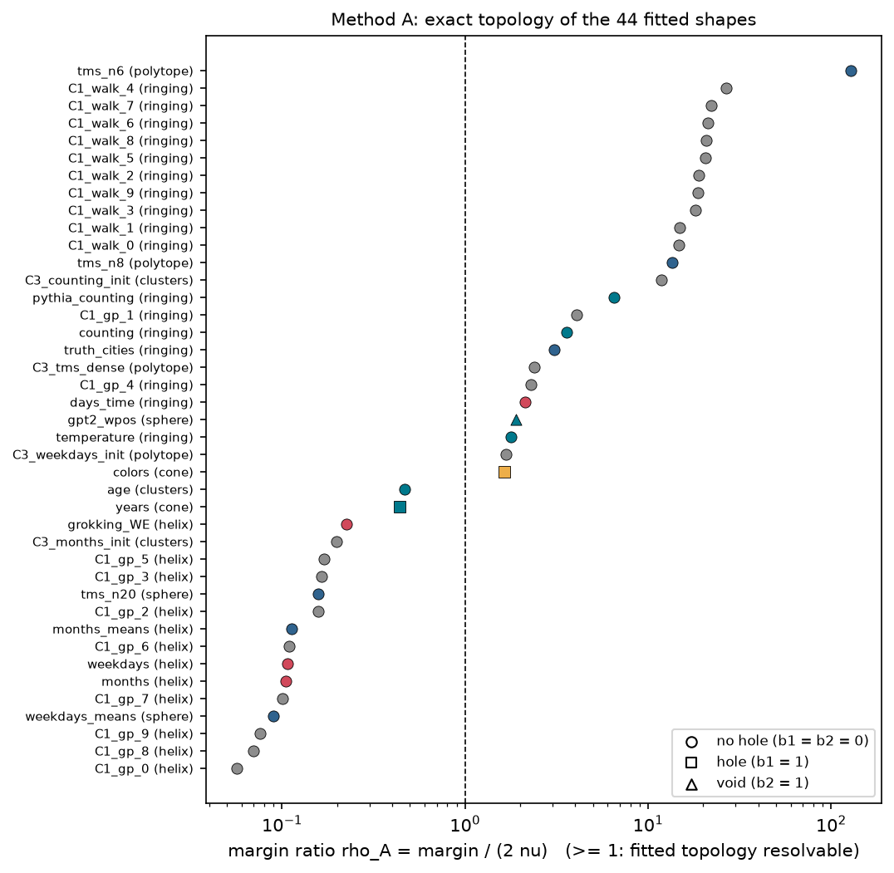

*Exact topology of every fitted shape.*
- Marker shape gives the fitted shape's Betti vector: circle = no hole, square = a hole (b1 = 1), triangle = a void (b2 = 1).
- The x-axis is the margin ratio ρ_A: the smallest parameter change that would alter the topology, divided by twice the data's noise scale (log scale).
- Right of the dashed line (ρ_A ≥ 1), the fitted topology is resolvable. Fits whose topology cannot change (blob, disc, paraboloid; ρ_A = ∞) are omitted.
- The cyclic sets' helices lie left of the line: whether those curves are open or closed cannot be decided from the data.

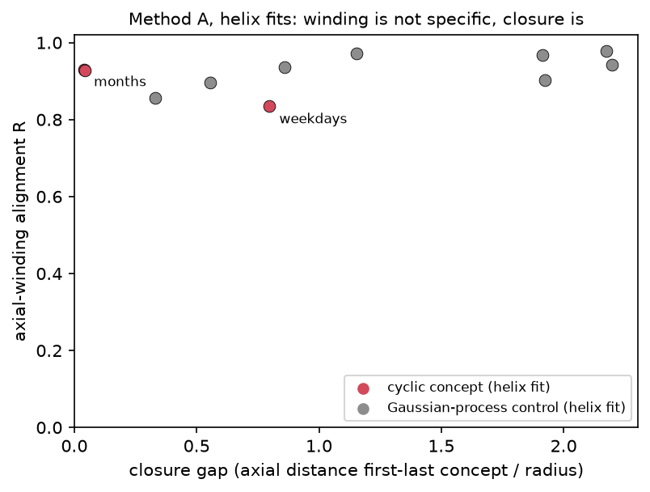

*Helix fits.*
- The x-axis is the closure gap: the axial distance between the first and last concept, in units of the helix radius. A closed loop has gap 0.
- The y-axis is how well the concepts line up with the helix azimuth.
- Cyclic concepts (red) wind about as well as Gaussian-process controls fitted as helices (grey).
- Only the months' closure gap (0.04 radii) is below every control's. The weekdays' gap (0.80) lies inside the controls' range (0.33–2.20).

### Instrument validation on synthetic clouds (Exp1)

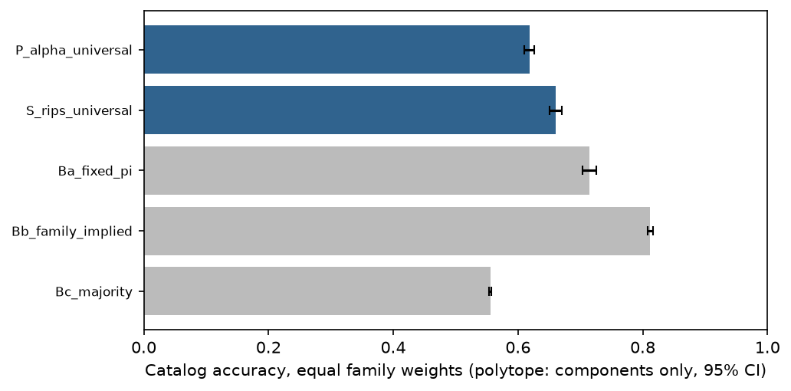

*Exact Betti-vector accuracy on resolvable synthetic clouds* (the table above, as a chart). Blue: persistent-homology estimators. Grey: baselines and the majority control.

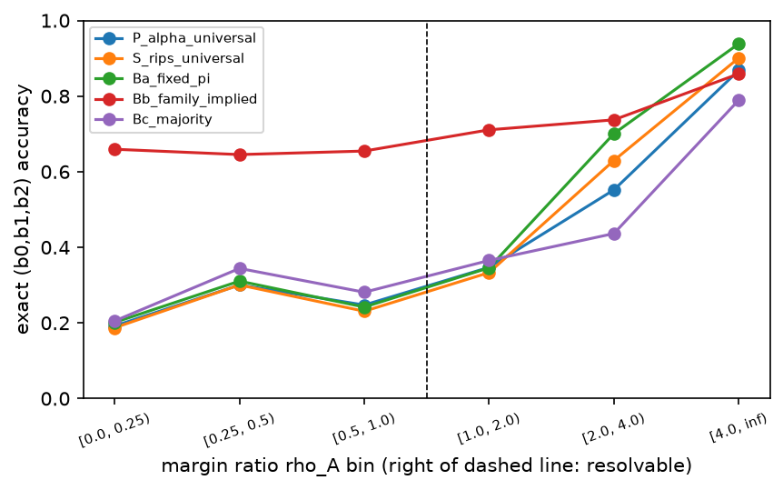

*Accuracy against the margin ratio ρ_A, over all 39,000 clouds.*
- The persistence estimators fail on clouds whose topology is unresolvable (left of the dashed line). The family label degrades less, because it reads the topology off the label rather than off the data.
- This is why accuracies are scored on resolvable clouds, and why the unresolvable helix fits of the real cyclic sets cannot be called open or closed.

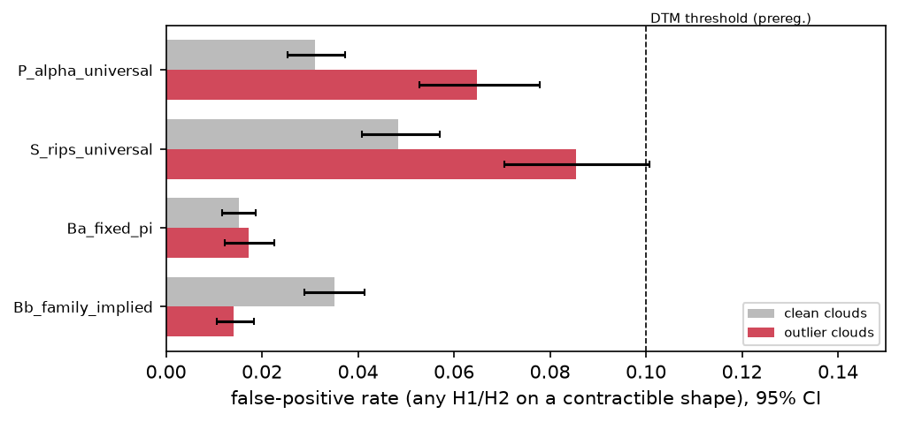

*False holes on contractible shapes, with and without outliers (deviation D7).*
- The source generator gives a fraction 0.30 of the clouds uniform outliers, replacing up to a fraction 0.10 of their points. A cloud counts as an outlier cloud if a point lies more than 6 median distances from the true shape.
- Outliers roughly double the false positives of the universal-null estimators (P, S); the tuned fixed threshold (Ba) is unaffected. For P: 0.065 [0.053, 0.078] with outliers vs 0.031 [0.025, 0.037] without.
- P stays below the preregistered threshold of 0.10 (dashed), so the planned distance-to-measure (DTM) ablation is **not required**.

Full report: [reports/exp1_synthetic.md](reports/exp1_synthetic.md).

### Topological similarity between clouds (Exp4, exploratory)

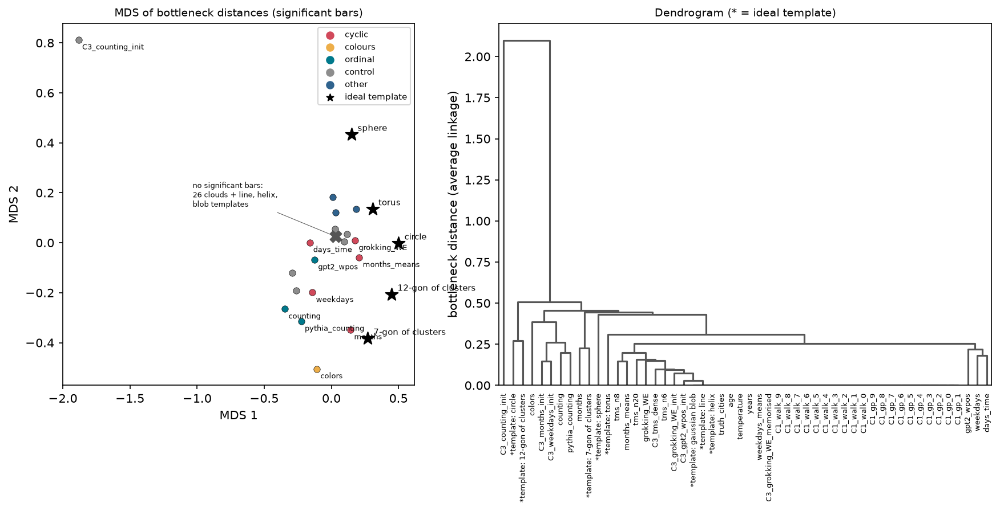

*Which clouds have similar persistence diagrams?*
- **Left:** a 2D multidimensional-scaling map of bottleneck distances between the diagrams of significant bars, for the 44 clouds and 8 ideal templates (stars). **Right:** the average-linkage dendrogram.
- Clouds with no significant bar are all at distance 0 from each other and from the line, helix and blob templates, so they collapse onto one point (X).
- The cyclic sets do not cluster together (exact cohesion p = 0.581). Bottleneck distance in absolute radius units is dominated by bar length, not by how persistent a loop is relative to its size, so we report this analysis as uninformative ([reports/exp4_exp5.md](reports/exp4_exp5.md)).

## Methodology

Full design decisions: [docs/methodology.md](docs/methodology.md). Every technical term: [docs/glossary.md](docs/glossary.md). Every step of the loop and ring test carried out with numbers on a toy cloud: [docs/worked_example.md](docs/worked_example.md). Exact topology of each family: [docs/analytic_topology.md](docs/analytic_topology.md).

- **Data** (no new data were collected):
  - **44 real clouds** from the source project: activations of Llama-3.1-8B (weekdays, months, days with times, colours, years, temperature, age, counting, truth cities), Pythia-410m (counting), and the weights of GPT-2 (W_pos) and of a grokked one-layer modular-addition transformer (W_E).
  - **Controls:** random-init networks and 20 random walks and Gaussian processes. Toy models of superposition are included as exploratory sets.
  - Each cloud is the source's top-3 PCA projection (centred, skewness-signed, RMS = 1), re-implemented here and checked to reproduce the source to 1e-4. Raw activations, needed for the top-10-PC and Monte Carlo checks, are on Hugging Face.
  - Per-dataset table: [reports/summary.md](reports/summary.md#datasets-from-the-source-project).
- **Synthetic validation data:** the source's fixed test set of 39,000 clouds (13 families × 4 sample-size bins × 3 noise bins × 250) and its 1,560-cloud validation stream. Ground-truth shape parameters were regenerated bit-exactly with the source generator.
- **Models:** none are trained or run here.
  - The "baseline" family labels come from the source's published shape fitter ([HF model](https://huggingface.co/BurnyCoder/neurogeom-shape-fitter-main-s0)), whose predictions are stored.
  - Steering (Llama-3.1-8B, grokking model) is coded but postponed.
- **Method A:** closed-form (b0, b1, b2), χ, genus, boundary components and a margin m for every family (for example, a torus with R > r > 0 has (1, 2, 1) and genus 1, and a frustum has (1, 1, 0)).
  - The margin ratio is ρ_A = m / (2ν), with noise scale ν = median point-to-shape distance + 95th percentile of shape-to-point distance.
  - θ_A is the parameter of each point's nearest point on the fitted shape.
- **Method B:**
  - Alpha complexes in ℝ³, using √ of GUDHI's squared filtration values.
  - Significance under two nulls:
    - a Monte Carlo max-π null with 999 draws, design-matched: cluster-centre for prompt templates, full-dimensional Gaussian through the Gram matrix otherwise;
    - the universal null (A = ½ for alpha, 1 for Rips; Bonferroni within a diagram).
  - Invariants are read at one characteristic scale. The genus is only defined for a closed surface (b0 = b2 = 1).
- **Traversal statistics:**
  - Per-concept circular means; alignment R = max over orientation of |mean exp(i(θ̄_c − φ_c))|.
  - Permutation null over concept labels (all 7! orderings for weekdays; 99,999 Monte Carlo draws otherwise; maximum over Fourier frequencies for residues).
  - Winding number of the semantic cycle; exact cyclic-order test.
- **Evaluation:**
  - **Primary:** H1-A and H1-B on weekdays, months and residues, with Holm over 6 tests.
  - **Specificity (H2):** ordinal, random-init and random-process controls.
  - **Days with times (H3)** and **criterion comparison (H4).**
  - **Instrument validity (H5):** synthetic accuracy against baselines, with cluster-bootstrap CIs.
  - Exploratory tests use Benjamini–Hochberg.
  - **Second audit (post hoc, D8):** a colour stimulus baseline, where each top loop lives relative to the concept clusters, the preregistered closure ratio, PCA eigenvalue gaps, size-matched subsample stability, and CIs for the power simulation ([reports/exp7_audit.md](reports/exp7_audit.md)).
  - **Third audit (post hoc, D9):** whether the loop test is specific to holes. It covers the sensitivity and false-loop rate of every synthetic estimator, the cluster-centre null on hole-free arrangements of concept centres, centre loops in other projections, and the dense-check tori ([reports/exp8_audit3.md](reports/exp8_audit3.md)).
- **Preregistration and deviations:** the [preregistration](reports/preregistration.md) has a power addendum (A1) and a steering amendment (A2). Every later change is logged with its date and whether it was decided before or after the results ([deviations D1–D9, P1–P2](reports/deviations.md)).

## Architecture (graph)

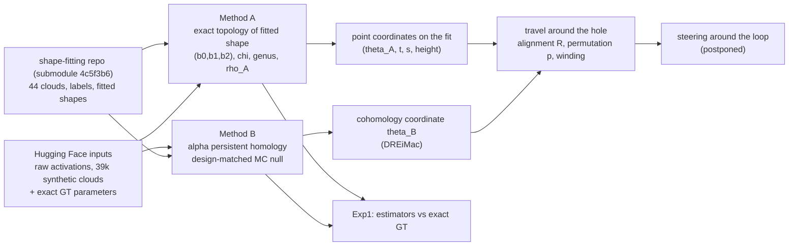

## What happens when you run it

**Data flow.** Inputs come from two places: the git submodule (the source's top-3 PCA points, labels and fitted shapes) and the pinned Hugging Face dataset (raw activations, synthetic clouds, ground-truth parameters, fitter predictions), fetched and checked against SHA-256 hashes.
Method A reads the fitted parameters and computes exact topology. Method B computes persistent homology of the clouds against Monte Carlo nulls (cached in `results/nulls/`). The traversal tests combine both coordinates with the concept labels, and the synthetic phases score the estimators against exact topology.
Each phase writes `results/<phase>/` and a timestamped log in `logs/`. `report` and `site` then regenerate every table, number and figure in this README, the reports, the paper and the explorer from `results/`. The phases, in the order `run.py all` runs them:

```text
run.py <phase>
  fetch        download inputs/ from the Hugging Face dataset at the pinned revision, verify SHA-256
  exp0         Method A: exact topology + margin of the 44 fits and 40,560 synthetic GT shapes; theta_A tests
  coords       where the labelled points sit on their fitted shapes (curve parameter, azimuth, height, clusters)
  power        validation-stream tuning (b0 rule, baseline thresholds) and the preregistered power simulation
  power2       corrected power simulation (post hoc, deviation D6)
  exp1         synthetic validation of the persistent-homology Betti estimators against exact GT topology
  exp1outliers false-positive rate on outlier clouds; decides the preregistered DTM conditional (deviation D7)
  exp2         persistent homology of the 44 clouds with 999-draw design-matched nulls (cached in results/nulls)
  exp3         preregistered cyclic hypotheses H1-H4 (theta_B, top-10-PC check, Holm)
  exp3posthoc  post hoc: theta_B with DREiMac standard_range=False (deviation D5)
  exp4         bottleneck distances between clouds and ideal templates
  exp5         robustness: Rips vs alpha, top-k PCs (with matched null), full-D cosine, offset removal, seeds, noise scale
  audit        post hoc checks of the second audit (D8): colour RGB baseline, loop localisation, closure ratio, PCA gaps, stability
  audit3       post hoc checks of the third audit (D9): is the loop test specific to holes? (synthetic rates, cluster null, tori)
  toy          worked example: every step of the loop and ring test on a 21-point toy week (docs/worked_example.md)
  report       regenerate every table, figure and number in README / reports / paper from results/
  site         GitHub Pages explorer (docs/index.html), interactive worked example (docs/worked_example.html) and examples (docs/examples.html)
  all          everything above, CPU only (about 1.5 h on 16 cores)
  exp6sim, exp6  simulated / LLM steering around the loops (postponed; exp6 needs a GPU and Llama-3.1-8B)
```

## Installation, setup and usage

Requirements: [uv](https://docs.astral.sh/uv/) and git. uv installs Python 3.11, which is pinned because DREiMac requires Python below 3.12. No GPU is needed, and no Hugging Face login is needed to run the pipeline.

```bash
git clone --recursive https://github.com/BurnyCoder/topology-of-neural-geometry-in-llm-mechanistic-interpretability.git
```

```bash
cd topology-of-neural-geometry-in-llm-mechanistic-interpretability && uv sync
```

Optional: copy the configuration template. The defaults work without it, and nothing in it is secret.

```bash
cp .env.example .env
```

Run the whole pipeline: it fetches the inputs, then runs every analysis and regenerates the documentation.

```bash
uv run python run.py all
```

Run the tests:

```bash
uv run pytest
```

Regenerate the documentation numbers and figures from the committed results without recomputing:

```bash
uv run python run.py report site
```

Settings (seeds, null draws, thresholds, dataset groups) live in [configs/base.yaml](configs/base.yaml); values marked "prereg" are fixed by the preregistration. Reproducing the inputs from scratch, which needs a GPU and the source project, is described in [docs/reproduce_inputs.md](docs/reproduce_inputs.md).

**Reproducibility check (2026-11-15).** The full pipeline was re-run from a fresh `git clone --recursive`, with inputs from Hugging Face only, no local files and no `.env`. Before the comparison, the committed `results/` folder was moved aside, so nothing cached was reused. It reproduced 80/80 result files within tolerance (relative 1e-6), as checked by `scripts/compare_results.py`.

## Features

- Exact topology (Betti numbers, χ, genus, boundary, margin) of the source's 13 parametrised shape families, tested against persistent homology of dense samples.
- Intrinsic coordinates of points on fitted shapes. The numpy parametrisations reproduce the source's fitted shapes to 1e-5.
- Alpha and Rips persistence, the universal null, and design-matched Monte Carlo nulls (cluster-centre and full-dimensional Gaussian, sampled through the Gram matrix).
- Circular coordinates from persistent cohomology, and the travel-around-the-hole statistics: exact permutation tests, winding, cyclic order.
- Validation against exact ground truth on 39,000 synthetic clouds, with cluster-bootstrap CIs and an outlier false-positive check.
- Reproducible from GitHub + Hugging Face: pinned revision, SHA-256 manifest, bit-exact regeneration of the synthetic ground truth, clean-room replication script.
- Every documentation number and figure is generated from `results/` by one command; an interactive explorer is on GitHub Pages.

## Technologies

uv, Python 3.11, NumPy, SciPy, scikit-learn, pandas, [GUDHI](https://gudhi.inria.fr) (alpha complexes, bottleneck), [ripser.py](https://github.com/scikit-tda/ripser.py), [persim](https://github.com/scikit-tda/persim), [DREiMac](https://github.com/scikit-tda/DREiMac), matplotlib, plotly.js (explorer), Hugging Face Hub, pytest, LaTeX (paper).

## Repository layout

- `run.py`: the single entry point; each phase is one imported function.
- `src/neurotopo/`:
  - `analytic/`: Method A rules and coordinates.
  - `tda/`: diagrams, nulls, invariants, circular coordinates.
  - `stats/`: alignment and tests.
  - `experiments/`: one module per phase.
  - `steering/`: postponed steering code.
  - `report/`: tables, figures, site, numbers.
- `external/shape-fitting/`: the source project (git submodule, commit 4c5f3b6).
- `reports/`: literature and state-of-the-art reviews, preregistration (with addendum and amendment), deviations, plan, one report per experiment, summary. `reports/templates/` holds the report sources; `reports/generated/` holds generated tables.
- `docs/`: [methodology](docs/methodology.md), [method and terms](docs/glossary.md), [worked example](docs/worked_example.md) (source: `docs/templates/`), [exact topology of the families](docs/analytic_topology.md), [reproducing the inputs](docs/reproduce_inputs.md), figures, explorer.
- `paper/`: LaTeX source and PDF.
- `results/`: machine-readable results of every phase.
- `logs/`: timestamped run logs.

## To do

- **Steering around the detected loops** (preregistered as H6, postponed by the author):
  - simulated steering with cross-validated decoders, then
  - Llama-3.1-8B steering of weekdays, months, days and colours;
  - steering of the grokked modular-addition model, retrained with the source recipe.
- A loop test for weekdays with more prompt templates per day: 7 clusters of 7 points are close to the power limit.
- A distance for comparing clouds that is not dominated by absolute scale (Exp4 was uninformative), for example bottleneck distance in log-π coordinates.
- Torus and thin-loop detection: the synthetic accuracy for tori is near zero at these sample sizes.
- Optional Exp0b: refit the synthetic clouds with the published source checkpoint, to score Method A on fitted rather than ground-truth parameters (needs model inference).
- A clean-room replication run that includes the `exp1outliers`, `audit` and `audit3` phases.
- **A hole-specific loop test** (D9). The Gaussian nulls also reject hole-free sheets and caps. A null drawn from hole-free shapes fitted to each cloud (for example, the best hole-free family of the source fitter, resampled at the cloud's noise) would test for a hole rather than for non-Gaussian structure.
- **Colour controls that need model inference** (postponed): a random-init Llama on the same 900 prompts, and colour prompts by name instead of hex code, to separate the model's hue code from the hue circle of the input.

## License

MIT ([LICENSE](LICENSE)). GUDHI's alpha complex is GPL-3.0 through CGAL; see [NOTICE](NOTICE).
