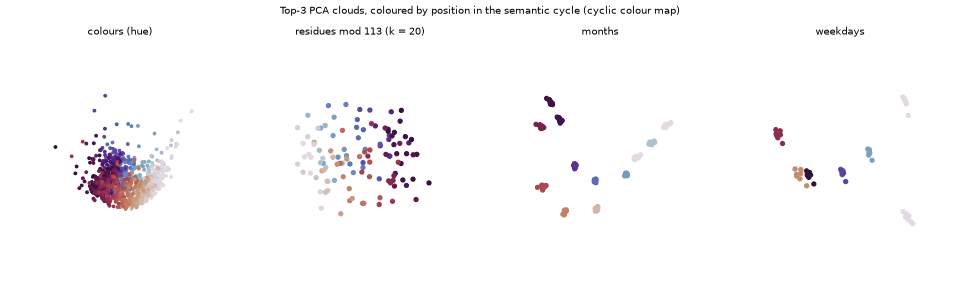
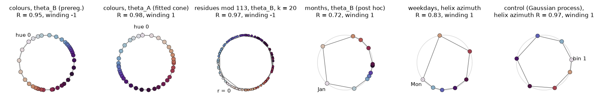
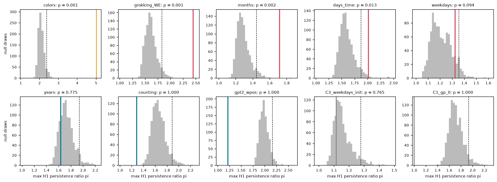
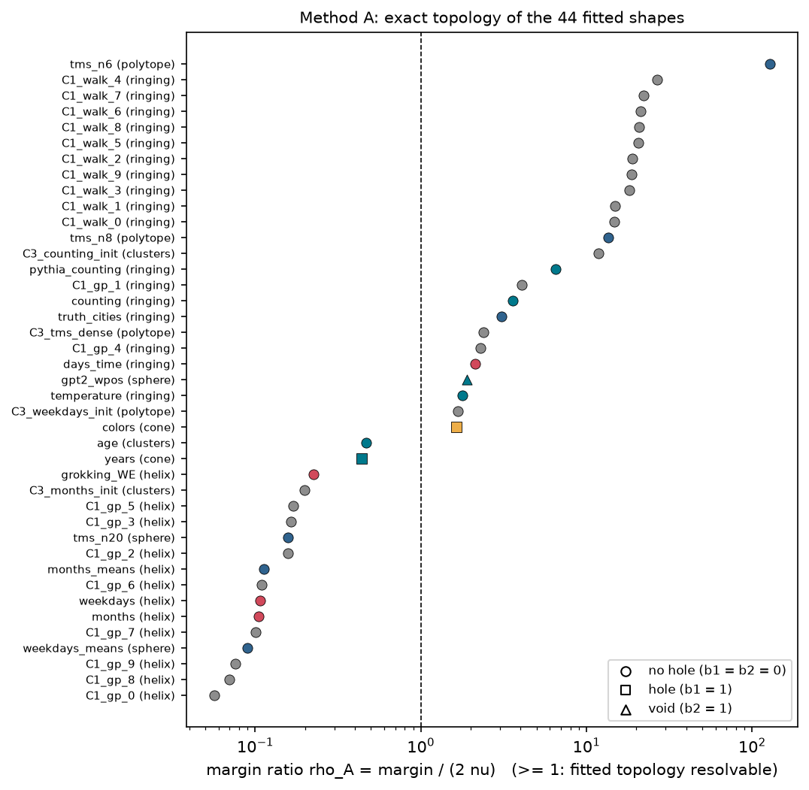
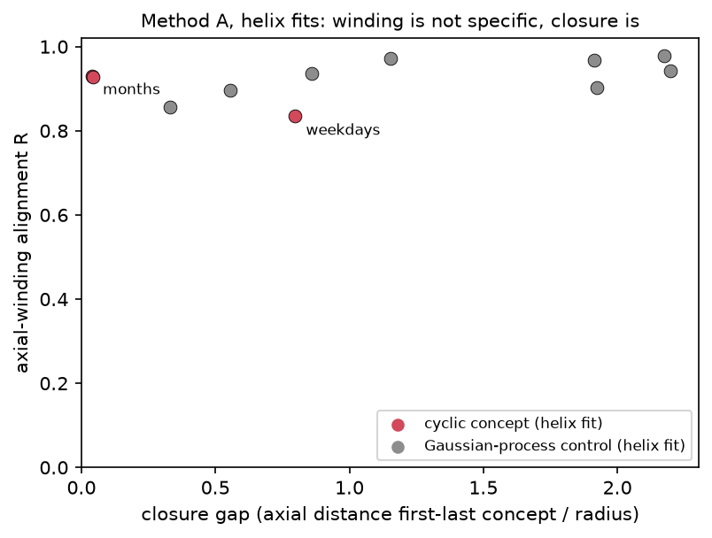
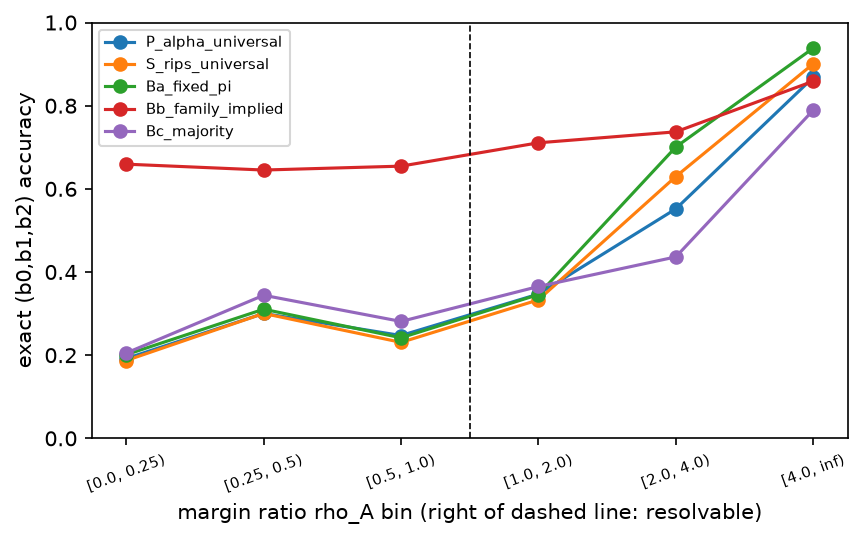
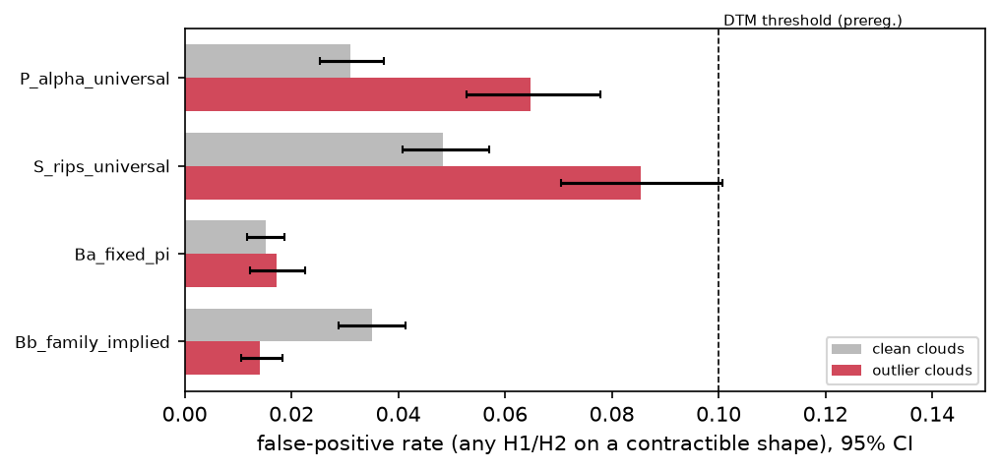
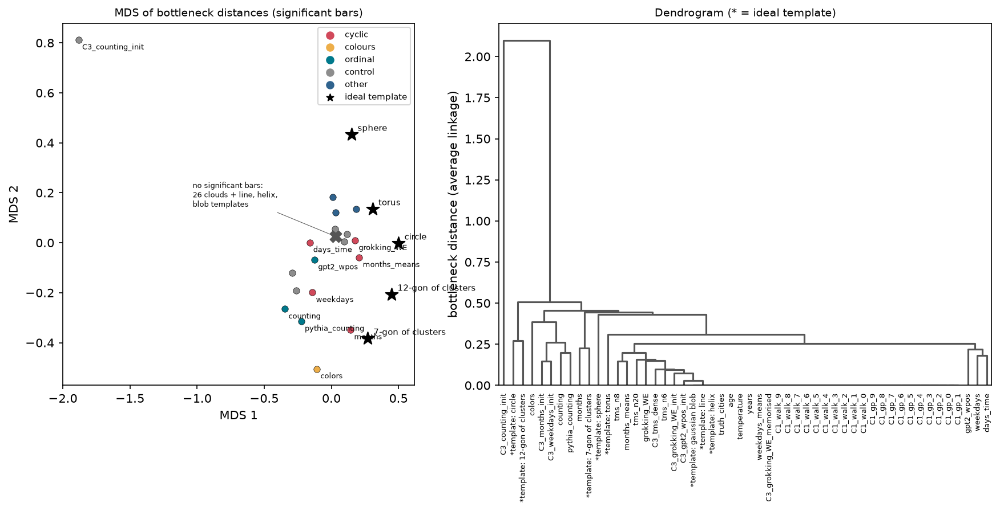
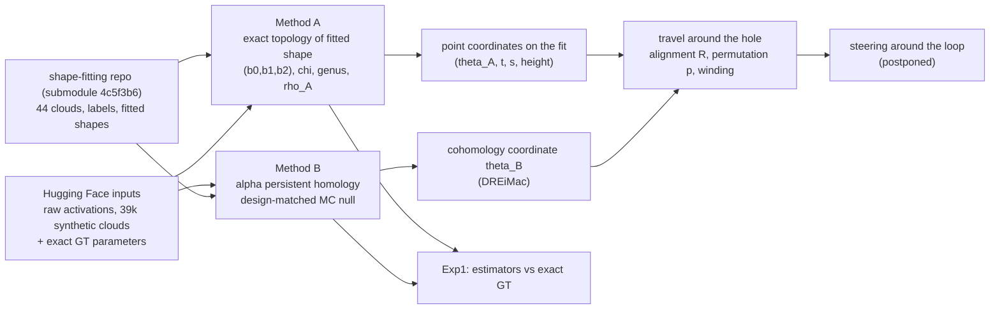

# Topology of neural geometry

Do concepts that are cyclic in meaning (days, months, colours, residues mod n) occupy a region of activation space with a **hole that the concept goes around**? This repository answers that question with exact topology and persistent homology, for 44 activation and weight clouds from language models and toy networks.

**Status (2026-11-15):** all preregistered topology analyses are done. They use only stored activations; no model inference was run. Model steering and simulated steering are preregistered and **postponed by the author**.

**Links:** [paper (PDF)](paper/main.pdf) · [interactive explorer](https://burnycoder.github.io/topology-of-neural-geometry-in-llm-mechanistic-interpretability/) · [inputs and results on Hugging Face](https://huggingface.co/datasets/BurnyCoder/topology-of-neural-geometry) · [preregistration](reports/preregistration.md) · [summary of all experiments](reports/summary.md)

## At a glance

- **What it is.** A topological analysis of the point clouds that the sibling project [shape-fitting](https://github.com/BurnyCoder/shape-fitting-in-neural-geometry-in-llm-mechanistic-interpretability) classified into 13 geometric shape families. Each cloud is the **top-3 PCA coordinates** of activations or weights for one concept, for example the residual stream of Llama-3.1-8B at the token of each weekday.
- **Motivation.**
  - Interpretability research keeps finding shapes in activations: circles for weekdays and months ([Engels et al. 2024](https://arxiv.org/abs/2405.14860)), a helix for GPT-2 positions ([Yedidia 2023](https://www.lesswrong.com/posts/qvWP3aBDBaqXvPNhS/gpt-2-s-positional-embedding-matrix-is-a-helix)), circles of residues in grokked modular addition ([Nanda et al. 2023](https://arxiv.org/abs/2301.05217)), and loops for colours and dates ([Modell et al. 2025](https://arxiv.org/abs/2505.18235)).
  - Manifold steering moves activations *along* such a curved manifold and changes the model's answer in semantic order (Monday → Tuesday → …) ([Wurgaft et al. 2026](https://arxiv.org/abs/2605.05115); [Goodfire](https://www.goodfire.com/research/manifold-steering); the [Neural Geometry series](https://www.goodfire.com/research/neural-geometry)).
  - The topological question behind that: is there a hole you can travel around, and does the semantic cycle go around it exactly once? If so, steering around the loop should be semantically meaningful, and topology should help find where to steer.
- **How it works.** Two independent methods, then one shared test:
  1. **Method A, exact topology of the fitted shape.** The source's shapes are uniquely parametrised, so Betti numbers, Euler characteristic and genus follow exactly from the fitted parameters ([Hatcher](https://pi.math.cornell.edu/~hatcher/AT/AT.pdf)). A margin ratio ρ_A says whether the data's noise can resolve that topology.
  2. **Method B, persistent homology of the cloud itself.** We use alpha complexes ([GUDHI](https://gudhi.inria.fr)), the persistence ratio π = death/birth with a universal null ([Bobrowski & Skraba 2023](https://doi.org/10.1038/s41598-023-37842-2)), and a design-matched Monte Carlo max-statistic null (as in [Gardner et al. 2022](https://doi.org/10.1038/s41586-021-04268-7)).
  3. **Travel around the hole.** Each point gets a circle-valued coordinate: its position on the fitted shape (θ_A), or a persistent-cohomology coordinate ([de Silva et al. 2011](https://doi.org/10.1007/s00454-011-9344-x), via [DREiMac](https://github.com/scikit-tda/DREiMac)) (θ_B). We test whether the concepts are ordered around it (alignment R with exact or Monte Carlo permutation tests) and wind around it exactly once (winding number ±1).
- **Methodology.**
  - **Preregistered:** hypotheses, metrics, nulls and decision rules were pushed before any topology was computed ([preregistration](reports/preregistration.md)). All later changes are logged as dated deviations ([deviations](reports/deviations.md)).
  - **Controls:** six ordinal concepts, random-init networks and 20 random processes.
  - **Multiple testing:** Holm correction over the primary tests, Benjamini–Hochberg for exploratory ones.
  - **Instrument check:** the estimator is validated on 39,000 synthetic clouds with exact ground-truth topology.
- **Positive results.**
  - **Colours:** a robust hole that hue goes around once. It survives in the top-10 PCs against a matched null.
  - **Residues mod 113:** a hole that the residues go around once at Fourier frequency {{exp3.grok.thetaB.k}}, but fragile under subsampling.
  - **Months:** a robust hole, but the months go around it only in a post hoc analysis, and only in the top-3 PCs.
  - **Controls:** no top-3 loop in any ordinal concept ({{exp2.ordinal_loops}}/6) or random process ({{exp2.c1_loops}}/20).
- **Negative results.**
  - **Primary verdicts:** the preregistered hypotheses fail for all three primary cyclic sets: H1-A {{exp3.H1A}}/3, H1-B {{exp3.H1B}}/3.
  - **Weekdays:** no detectable hole. A post hoc power simulation shows the test rarely detects 7-cluster rings.
  - **Days with times:** there is a loop, but the day does not go around it.
  - **Top-10 PCs:** ordinal concepts have loops there too, so a loop alone is not specific.
  - **Synthetic data:** the preregistered persistent-homology estimator is less accurate than reading topology off the fitter's family label.
  - **Fitted helices:** whether the fitter's helices for cyclic concepts are open or closed cannot be resolved at the data's noise scale.
- **Novelty**, as far as our [state-of-the-art review](reports/state-of-the-art-review.md) found:
  - **Exact topology of uniquely parametrised fitted shapes,** compared with persistent homology of the same clouds.
  - **A preregistered, null-controlled test** that a hole exists *and* that the semantic cycle winds around it once, with design-matched negative controls. Prior work counts Betti numbers without a null ([Moisescu-Pareja et al.](https://arxiv.org/abs/2512.25060); [Tang et al.](https://arxiv.org/abs/2605.06352)), judges loops by eye ([Modell et al.](https://arxiv.org/abs/2505.18235)), or tests centroids of imposed cycles ([David & Fomin](https://arxiv.org/abs/2607.24425)).
  - **Validation of a Betti-number estimator** against exact topology on 39,000 synthetic clouds of 13 families.
- **Features and technologies.**
  - **Pipeline:** one command (`run.py all`), CPU only. Inputs are pinned and hash-verified on Hugging Face, and a clean-room replication passed.
  - **Outputs:** every number in the documentation is generated from `results/`. A GitHub Pages explorer shows the results.
  - **Tools:** Python 3.11 with uv, GUDHI, ripser.py, persim, DREiMac, NumPy/SciPy, matplotlib and plotly.js ([details](#features)).


*Architecture.* The inputs (left) feed two independent methods.
- Method A reads the topology off the fitted shape's parameters.
- Method B computes persistent homology of the cloud itself, with no fit involved.

Each method gives a circle-valued coordinate for the hole (θ_A, θ_B), and both go through the same travel-around-the-hole statistics. Steering around the loop (right) is designed and postponed.



*Four clouds in their top-3 PCs, rotating.* Points are coloured by their position in the semantic cycle, using a cyclic colour map.
- The colour cloud wraps around a hole.
- Residues mod 113 form a loop when ordered by k·r mod 113 (k = {{exp3.grok.thetaB.k}}, the frequency found by θ_B).
- Months and weekdays form tight clusters, one per month or day, each made of that concept's prompts. The months' clusters are arranged around a loop; the 7 weekday clusters show no loop that persistent homology can detect.



*Does the concept go around the hole?*
- **How to read:** each dot is one concept (a hue bin, a residue, a month, a weekday), placed at the circular mean of its points' hole angle and coloured by its position in the semantic cycle. Chords join consecutive concepts.
- If the concept goes around the hole once and in order, the colours run around the circle like a rainbow and the chords form one non-crossing polygon (winding ±1; the sign is only the direction).
- **Panels:**
  - Method B (θ_B): colours, residues, and months (post hoc).
  - Method A (θ_A, the fitted cone's azimuth): colours.
  - A warning case: the weekdays' helix azimuth.
  - A control: a Gaussian-process cloud that was also fitted as a helix. It winds too ({{exp0.gp_wind1}} of {{exp0.gp_helix_n}} such controls do), so winding around a helix axis is not evidence of a cyclic concept.

## Results

### Evaluation scores: method vs baselines, controls and ablations

**Real data: test sets vs controls.** Each column counts the sets that pass one step. "Goes around" means alignment p < 0.05 and winding ±1 for the concept variable. Ordinal sets use 7 or 12 equal-width value bins.

<!-- BEGIN:readme_roles -->
<!-- END:readme_roles -->

**Synthetic validation (Exp1): does persistent homology recover the exact topology?** These are 39,000 clouds of 13 families with exact ground-truth Betti numbers. Scores are exact (b0, b1, b2) accuracy, macro-averaged over families, with 95% cluster-bootstrap CIs over generator chunks.

| Role | Estimator | Resolvable clouds ({{exp1.n}}) | Well-resolved, ρ_A ≥ 4 ({{exp1.well.n}}) | False holes on contractible outlier clouds |
|---|---|---|---|---|
| method (preregistered) | P: alpha complex + universal null | {{exp1.P.acc:3}} [{{exp1.P.lo:3}}, {{exp1.P.hi:3}}] | {{exp1.well.P.acc:3}} [{{exp1.well.P.lo:3}}, {{exp1.well.P.hi:3}}] | {{exp1.out.P.outlier:3}} |
| ablation: Rips instead of alpha (D1) | S: Rips H1 + universal null | {{exp1.S.acc:3}} [{{exp1.S.lo:3}}, {{exp1.S.hi:3}}] | {{exp1.well.S.acc:3}} [{{exp1.well.S.lo:3}}, {{exp1.well.S.hi:3}}] | {{exp1.out.S.outlier:3}} |
| ablation: Monte Carlo instead of universal null | MC: 3D matched-Gaussian null (3,120-cloud subset) | {{exp1.MC.acc:3}} [{{exp1.MC.lo:3}}, {{exp1.MC.hi:3}}] | – | – |
| baseline | Ba: fixed π thresholds tuned on validation | {{exp1.Ba.acc:3}} [{{exp1.Ba.lo:3}}, {{exp1.Ba.hi:3}}] | {{exp1.well.Ba.acc:3}} [{{exp1.well.Ba.lo:3}}, {{exp1.well.Ba.hi:3}}] | {{exp1.out.Ba.outlier:3}} |
| baseline | Bb: fitter's family label → modal Betti vector | {{exp1.Bb.acc:3}} [{{exp1.Bb.lo:3}}, {{exp1.Bb.hi:3}}] | {{exp1.well.Bb.acc:3}} [{{exp1.well.Bb.lo:3}}, {{exp1.well.Bb.hi:3}}] | {{exp1.out.Bb.outlier:3}} |
| control (trivial) | Bc: majority Betti vector | {{exp1.Bc.acc:3}} [{{exp1.Bc.lo:3}}, {{exp1.Bc.hi:3}}] | {{exp1.well.Bc.acc:3}} [{{exp1.well.Bc.lo:3}}, {{exp1.well.Bc.hi:3}}] | {{exp1.out.Bc.outlier:3}} |

**Ablations and robustness checks on the real data.**

| What was changed | Result |
|---|---|
| Alpha complex → Rips complex (3D, top H1 π) | colours {{exp5.colors.alpha3_pi1:2}} → {{exp5.colors.rips3_pi1:2}}; months {{exp5.months.alpha3_pi1:2}} → {{exp5.months.rips3_pi1:2}}; weekdays {{exp5.weekdays.alpha3_pi1:2}} → {{exp5.weekdays.rips3_pi1:2}} |
| Top-3 → top-10 PCs, matched null (post hoc) | significant loops among {{exp5.top10.n}} key sets: {{exp5.top3.n_sig}} → {{exp5.top10.n_sig}} ({{exp5.top10.sig_ids}}) |
| 3D Euclidean → full-dimensional cosine distance (Rips π) | colours {{exp5.colors.rips3_pi1:2}} → {{exp5.colors.ripsD_cos_pi1:2}}; residues {{exp5.grok.rips3_pi1:2}} → {{exp5.grok.ripsD_cos_pi1:2}}; months {{exp5.months.rips3_pi1:2}} → {{exp5.months.ripsD_cos_pi1:2}} |
| Prompt-offset means removed ("k days from …") | loop p: months {{exp2.months.p_top_loop}} → {{exp5.offset.months.p_loop}}; weekdays {{exp2.weekdays.p_top_loop}} → {{exp5.offset.weekdays.p_loop}} |
| Monte Carlo seed 0 → 1, 2 | loop p: months {{exp2.months.p_top_loop}} → {{exp5.seed1.months.p_loop}}, {{exp5.seed2.months.p_loop}}; residues {{exp2.grok.p_top_loop}} → {{exp5.seed1.grok.p_loop}}, {{exp5.seed2.grok.p_loop}}; weekdays {{exp2.weekdays.p_top_loop}} → {{exp5.seed1.weekdays.p_loop}}, {{exp5.seed2.weekdays.p_loop}} |
| 200 subsamples of 80% of the points | loop kept in: colours {{exp2.colors.loop_freq:2}}, months {{exp2.months.loop_freq:2}}, residues {{exp2.grok.loop_freq:2}}, days_time {{exp2.daystime.loop_freq:2}} |
| Noise scale ν of Method A: main → median term only → doubled coverage term | resolvable fits: {{exp5.resolvable.rho_main}} → {{exp5.resolvable.rho_median_only}} → {{exp5.resolvable.rho_coverage_x2}} of 44 |
| DREiMac `standard_range` True → False (post hoc, D5) | months: no coordinate → winding {{exp3ph.months.3d.w}} (R = {{exp3ph.months.3d.R:2}}); days_time: no coordinate → winding {{exp3ph.daystime.3d.w}} |
| Synthetic clouds with vs without outliers (D7) | P's false holes: {{exp1.out.P.clean:3}} → {{exp1.out.P.outlier:3}}; DTM filtration {{exp1.out.dtm}} (threshold {{exp1.out.thr:2}}); outlier-proxy factor {{exp1.out.sens.factors}} instead of {{exp1.out.factor:0}}: {{exp1.out.sens.P.min:3}}–{{exp1.out.sens.P.max:3}} |

**Better or worse, in plain words.**
- **Test sets vs controls:**
  - Colours pass every step except the preregistered top-10 check, which they pass only post hoc.
  - Residues and months have loops, and the concept goes around them, but only residues do so in the preregistered setting, and both lose the loop in the top-10 PCs.
  - No ordinal concept and no random process has a top-3 loop. One random-init network has a borderline loop (p = {{exp2.grokinit.p_top_loop}}), but nothing goes around it.
  - Because no cyclic set passed the full preregistered rule, the controls' failures are weak evidence of specificity.
- **Method vs baselines (synthetic):**
  - The preregistered estimator P is **worse** than both the fixed-threshold baseline (Ba) and the family label (Bb), overall and on well-resolved clouds.
  - The family label (Bb) is the most accurate estimator overall. On well-resolved clouds, the tuned persistence baseline Ba is the most accurate: {{exp1.well.Ba.acc:3}} [{{exp1.well.Ba.lo:3}}, {{exp1.well.Ba.hi:3}}] vs {{exp1.well.Bb.acc:3}} [{{exp1.well.Bb.lo:3}}, {{exp1.well.Bb.hi:3}}] for the label.
  - Persistent homology (Ba) is **better** than the family label exactly where the label cannot fix the topology: arcs, open or closed ({{exp1.Ba.arc:2}} vs {{exp1.Bb.arc:2}}), and spheres, cap or full ({{exp1.Ba.sphere:2}} vs {{exp1.Bb.sphere:2}}).
  - It is **worse** on thin loops (ellipses {{exp1.Ba.ellipse:2}} vs {{exp1.Bb.ellipse:2}}) and tori ({{exp1.Ba.torus:2}} vs {{exp1.Bb.torus:2}}).
  - Every estimator scores above the majority-vector control.
- **Ablations:**
  - Switching the complex from alpha to Rips changes little.
  - Moving to 10 dimensions makes loops appear in ordinal sets, so a loop alone stops being specific.
  - The months and residue loops are strongest in the top-3 PCs.
  - Conclusions do not depend on the Monte Carlo seed, the prompt-offset nuisance factor, or the outlier proxy.

### Output examples: test sets, controls and the null


*Method B output on test sets (weekdays, months, residues, colours) and controls (years, GPT-2 positions, a random-init network, a random walk).*
- **Top row:** each cloud in its first two principal components, coloured by concept. The fitted family is in the title.
- **Bottom row:** the persistence ratio π of every H1 bar (loops, circles) and H2 bar (voids, triangles), on a log scale. Red: the 95th percentile of the null distribution of the largest ratio. A bar above it is a significant hole.



*The loop test against its null, dataset by dataset.*
- **How to read:**
  - Grey: the largest H1 ratio in each of 999 surrogate clouds with the same design but no planted loop. Prompt-template sets use a cluster-centre null; the others use a full-dimensional matched Gaussian.
  - Dashed: the null's 95th percentile. Solid: the observed value.
- **Results:**
  - Colours, residues, months and days_time lie beyond the null.
  - Weekdays fall just short (p = {{exp2.weekdays.p_top_loop}}).
  - Ordinal sets and controls lie inside the null or below it.


*Loops beyond the top-3 PCs (post hoc).* The observed largest Rips H1 ratio in the top-10 principal components (dot) is compared with a matched null's 95th percentile (bar). A filled dot means p < 0.05. In 10 dimensions, ordinal sets also get loops, as expected from Fourier-like features of numbers; colours keep by far the strongest one.

### Preregistered verdicts and findings per dataset

The per-dataset findings, with every statistic, are in [reports/findings_per_dataset.md](reports/findings_per_dataset.md); the key numbers are in the Method B table below.

- **Preregistered verdicts:**
  - H1-A (fitted-shape hole + traversal): {{exp3.H1A}}/3.
  - H1-B (persistent homology + traversal + top-10 robustness): {{exp3.H1B}}/3.
  - H3 (days_time): {{exp3.H3.B}}.
  - H4: balanced accuracy {{exp3.H4.conj_B:2}} for every criterion. No criterion identified any cyclic set, so the "found more easily" comparison is uninformative.
  - H2 (specificity) is {{exp3.H2.B.falsified}}. That is weak evidence: sensitivity is zero, and the controls never come near the null threshold.

**In plain words.**
- Topology finds a hole that the concept goes around for **colours** (robustly) and **residues mod 113**. For **months** there is a hole, and the months go around it, but only post hoc and only in the top-3 PCs.
- It does **not** find one for weekdays, and the test rarely detects 7-cluster rings anyway. Days-with-times has a loop that the day does not go around.
- Ordinal concepts and random controls have no loops in the top-3 PCs. In 10 dimensions ordinal concepts do get loops, but their values do not travel around them. Going around the hole, not merely having one, is what distinguishes the cyclic concepts.
- The shape fitter's "helices" for cyclic concepts cannot be told apart from closed loops at this noise level.
- Whether steering around these loops changes the model's answers in semantic order is the next experiment: designed, preregistered, and postponed by the author.

### Method B on key clouds (Exp2, Exp3)

| Dataset | top H1 π | null q95 | p (loop) | BH q | traversal: R, winding (θ_B, preregistered) | traversal post hoc, 3D (relaxed range) | top-10 PCs: Rips π vs null q95, p (post hoc) |
|---|---|---|---|---|---|---|---|
| colours (hue) | {{exp2.colors.top_pi1:2}} | {{exp2.colors.null_q95_pi1:2}} | {{exp2.colors.p_top_loop}} | {{exp2.colors.q_loop}} | {{exp3.colors.thetaB.R:2}}, {{exp3.colors.thetaB.w}} | {{exp3ph.colors.3d.R:2}}, {{exp3ph.colors.3d.w}} | {{exp5.top10.colors.pi:2}} vs {{exp5.top10.colors.q95:2}}, p = {{exp5.top10.colors.p}} |
| grokked residues (k = {{exp3.grok.thetaB.k}}) | {{exp2.grok.top_pi1:2}} | {{exp2.grok.null_q95_pi1:2}} | {{exp2.grok.p_top_loop}} | {{exp2.grok.q_loop}} | {{exp3.grok.thetaB.R:2}}, {{exp3.grok.thetaB.w}} | {{exp3ph.grok.3d.R:2}}, {{exp3ph.grok.3d.w}} | {{exp5.top10.grok.pi:2}} vs {{exp5.top10.grok.q95:2}}, p = {{exp5.top10.grok.p}} |
| months | {{exp2.months.top_pi1:2}} | {{exp2.months.null_q95_pi1:2}} | {{exp2.months.p_top_loop}} | {{exp2.months.q_loop}} | no coordinate | {{exp3ph.months.3d.R:2}}, {{exp3ph.months.3d.w}} | {{exp5.top10.months.pi:2}} vs {{exp5.top10.months.q95:2}}, p = {{exp5.top10.months.p}} |
| days with times (day) | {{exp2.daystime.top_pi1:2}} | {{exp2.daystime.null_q95_pi1:2}} | {{exp2.daystime.p_top_loop}} | {{exp2.daystime.q_loop}} | no coordinate | {{exp3ph.daystime.3d.R:2}}, {{exp3ph.daystime.3d.w}} | {{exp5.top10.daystime.pi:2}} vs {{exp5.top10.daystime.q95:2}}, p = {{exp5.top10.daystime.p}} |
| weekdays | {{exp2.weekdays.top_pi1:2}} | {{exp2.weekdays.null_q95_pi1:2}} | {{exp2.weekdays.p_top_loop}} | {{exp2.weekdays.q_loop}} | no coordinate | {{exp3ph.weekdays.3d.R:2}}, {{exp3ph.weekdays.3d.w}} | {{exp5.top10.weekdays.pi:2}} vs {{exp5.top10.weekdays.q95:2}}, p = {{exp5.top10.weekdays.p}} |
| years | {{exp2.years.top_pi1:2}} | {{exp2.years.null_q95_pi1:2}} | {{exp2.years.p_top_loop}} | {{exp2.years.q_loop}} | no coordinate | {{exp3ph.years.3d.R:2}}, {{exp3ph.years.3d.w}} | {{exp5.top10.years.pi:2}} vs {{exp5.top10.years.q95:2}}, p = {{exp5.top10.years.p}} |
| GPT-2 positions | {{exp2.wpos.top_pi1:2}} | {{exp2.wpos.null_q95_pi1:2}} | {{exp2.wpos.p_top_loop}} | {{exp2.wpos.q_loop}} | no coordinate | {{exp3ph.wpos.3d.R:2}}, {{exp3ph.wpos.3d.w}} | {{exp5.top10.wpos.pi:2}} vs {{exp5.top10.wpos.q95:2}}, p = {{exp5.top10.wpos.p}} |

"No coordinate" means DREiMac's preregistered setting, which requires Rips death ≥ 2 × birth, built no circular coordinate. All 44 clouds: [reports/exp2_invariants.md](reports/exp2_invariants.md). Hypothesis tests: [reports/exp3_cyclic.md](reports/exp3_cyclic.md).


*Why weekdays could hardly pass (corrected power simulation, post hoc).*
- **Setup:** 7 or 12 concept clusters in ℝ⁴⁰⁹⁶, matched to the real sets' second-order statistics. Plotted against the simulated top-3 explained variance:
  - the fraction of clouds that pass the loop test (solid);
  - for rings only, the fraction that pass the full preregistered conjunction (dashed).
  - The dotted line marks the real weekdays and months.
- **Results:**
  - At the weekdays' variance ({{power2.weekdays.real_top3:2}}), a true ring passes the loop test in only {{power2.weekdays.loop:2}} of replicates. Random placements pass at most {{power2.weekdays.random_loop_max:2}}, close to the nominal 5%. The full conjunction passes in at most {{power2.weekdays.ring_all_max:2}}, because the circular-coordinate step rarely builds a coordinate on such small loops.
  - **The loop test alone cannot tell a ring from a nearly closed arc.** With 7 clusters, an open 300° arc (50° steps and a 60° gap) is almost a ring and passes as often as one. With 12 clusters (a gap of 2.2 steps) the ring passes more often, but the arc still passes often. Only the traversal conditions separate them.

### Method A: exact topology of the 44 fitted shapes (Exp0)

- {{exp0.n_hole_fits}} fitted shapes have a hole (b1 = 1; both are cones), and {{exp0.n_void_fits}} has a void (b2 = 1: GPT-2 W_pos, a closed sphere).
- {{exp0.n_resolvable}} of the 44 fitted topologies are resolvable at the data's noise scale (ρ_A ≥ 1).
- The analytic rules agree with persistent homology of dense noise-free shape samples for {{exp0.dense_agree:3}} of {{exp0.dense_n}} shapes.
- Full tables: [reports/exp0_analytic.md](reports/exp0_analytic.md). Point coordinates on the shapes: [reports/coords_check.md](reports/coords_check.md).



*Exact topology of every fitted shape.*
- Marker shape gives the fitted shape's Betti vector: circle = no hole, square = a hole (b1 = 1), triangle = a void (b2 = 1).
- The x-axis is the margin ratio ρ_A: the smallest parameter change that would alter the topology, divided by twice the data's noise scale (log scale).
- Right of the dashed line (ρ_A ≥ 1), the fitted topology is resolvable. Fits whose topology cannot change (blob, disc, paraboloid; ρ_A = ∞) are omitted.
- The cyclic sets' helices lie left of the line: whether those curves are open or closed cannot be decided from the data.



*Helix fits.*
- The x-axis is the closure gap: the axial distance between the first and last concept, in units of the helix radius. A closed loop has gap 0.
- The y-axis is how well the concepts line up with the helix azimuth.
- Cyclic concepts (red) wind about as well as Gaussian-process controls fitted as helices (grey).
- Only the months' closure gap ({{exp0.months.azimuth.gap:2}} radii) is below every control's. The weekdays' gap ({{exp0.weekdays.azimuth.gap:2}}) lies inside the controls' range ({{exp0.gp_gap_min:2}}–{{exp0.gp_gap_max:2}}).

### Instrument validation on synthetic clouds (Exp1)


*Exact Betti-vector accuracy on resolvable synthetic clouds* (the table above, as a chart). Blue: persistent-homology estimators. Grey: baselines and the majority control.



*Accuracy against the margin ratio ρ_A, over all 39,000 clouds.*
- The persistence estimators fail on clouds whose topology is unresolvable (left of the dashed line). The family label degrades less, because it reads the topology off the label rather than off the data.
- This is why accuracies are scored on resolvable clouds, and why the unresolvable helix fits of the real cyclic sets cannot be called open or closed.



*False holes on contractible shapes, with and without outliers (deviation D7).*
- The source generator gives a fraction {{exp1.out.gen.prob:2}} of the clouds uniform outliers, replacing up to a fraction {{exp1.out.gen.fracmax:2}} of their points. A cloud counts as an outlier cloud if a point lies more than {{exp1.out.factor:0}} median distances from the true shape.
- Outliers roughly double the false positives of the universal-null estimators (P, S); the tuned fixed threshold (Ba) is unaffected. For P: {{exp1.out.P.outlier:3}} [{{exp1.out.P.outlier.lo:3}}, {{exp1.out.P.outlier.hi:3}}] with outliers vs {{exp1.out.P.clean:3}} [{{exp1.out.P.clean.lo:3}}, {{exp1.out.P.clean.hi:3}}] without.
- P stays below the preregistered threshold of {{exp1.out.thr:2}} (dashed), so the planned distance-to-measure (DTM) ablation is **{{exp1.out.dtm}}**.

Full report: [reports/exp1_synthetic.md](reports/exp1_synthetic.md).

### Topological similarity between clouds (Exp4, exploratory)



*Which clouds have similar persistence diagrams?*
- **Left:** a 2D multidimensional-scaling map of bottleneck distances between the diagrams of significant bars, for the 44 clouds and 8 ideal templates (stars). **Right:** the average-linkage dendrogram.
- Clouds with no significant bar are all at distance 0 from each other and from the line, helix and blob templates, so they collapse onto one point (X).
- The cyclic sets do not cluster together (exact cohesion p = {{exp4.cohesion_p:3}}). Bottleneck distance in absolute radius units is dominated by bar length, not by how persistent a loop is relative to its size, so we report this analysis as uninformative ([reports/exp4_exp5.md](reports/exp4_exp5.md)).

## Methodology

Full design decisions: [docs/methodology.md](docs/methodology.md). Exact topology of each family: [docs/analytic_topology.md](docs/analytic_topology.md).

- **Data** (no new data were collected):
  - **44 real clouds** from the source project: activations of Llama-3.1-8B (weekdays, months, days with times, colours, years, temperature, age, counting, truth cities), Pythia-410m (counting), and the weights of GPT-2 (W_pos) and of a grokked one-layer modular-addition transformer (W_E).
  - **Controls:** random-init networks and 20 random walks and Gaussian processes. Toy models of superposition are included as exploratory sets.
  - Each cloud is the source's top-3 PCA projection (centred, skewness-signed, RMS = 1), re-implemented here and checked to reproduce the source to 1e-4. Raw activations, needed for the top-10-PC and Monte Carlo checks, are on Hugging Face.
  - Per-dataset table: [reports/summary.md](reports/summary.md#datasets-from-the-source-project).
- **Synthetic validation data:** the source's fixed test set of 39,000 clouds (13 families × 4 sample-size bins × 3 noise bins × 250) and its 1,560-cloud validation stream. Ground-truth shape parameters were regenerated bit-exactly with the source generator.
- **Models:** none are trained or run here.
  - The "baseline" family labels come from the source's published shape fitter ([HF model](https://huggingface.co/BurnyCoder/neurogeom-shape-fitter-main-s0)), whose predictions are stored.
  - Steering (Llama-3.1-8B, grokking model) is coded but postponed.
- **Method A:** closed-form (b0, b1, b2), χ, genus, boundary components and a margin m for every family (for example, a torus with R > r > 0 has (1, 2, 1) and genus 1, and a frustum has (1, 1, 0)).
  - The margin ratio is ρ_A = m / (2ν), with noise scale ν = median point-to-shape distance + 95th percentile of shape-to-point distance.
  - θ_A is the parameter of each point's nearest point on the fitted shape.
- **Method B:**
  - Alpha complexes in ℝ³, using √ of GUDHI's squared filtration values.
  - Significance under two nulls:
    - a Monte Carlo max-π null with 999 draws, design-matched: cluster-centre for prompt templates, full-dimensional Gaussian through the Gram matrix otherwise;
    - the universal null (A = ½ for alpha, 1 for Rips; Bonferroni within a diagram).
  - Invariants are read at one characteristic scale. The genus is only defined for a closed surface (b0 = b2 = 1).
- **Traversal statistics:**
  - Per-concept circular means; alignment R = max over orientation of |mean exp(i(θ̄_c − φ_c))|.
  - Permutation null over concept labels (all 7! orderings for weekdays; 99,999 Monte Carlo draws otherwise; maximum over Fourier frequencies for residues).
  - Winding number of the semantic cycle; exact cyclic-order test.
- **Evaluation:**
  - **Primary:** H1-A and H1-B on weekdays, months and residues, with Holm over 6 tests.
  - **Specificity (H2):** ordinal, random-init and random-process controls.
  - **Days with times (H3)** and **criterion comparison (H4).**
  - **Instrument validity (H5):** synthetic accuracy against baselines, with cluster-bootstrap CIs.
  - Exploratory tests use Benjamini–Hochberg.
- **Preregistration and deviations:** the [preregistration](reports/preregistration.md) has a power addendum (A1) and a steering amendment (A2). Every later change is logged with its date and whether it was decided before or after the results ([deviations D1–D7, P1–P2](reports/deviations.md)).

## Architecture (graph)



## What happens when you run it

**Data flow.** Inputs come from two places: the git submodule (the source's top-3 PCA points, labels and fitted shapes) and the pinned Hugging Face dataset (raw activations, synthetic clouds, ground-truth parameters, fitter predictions), fetched and checked against SHA-256 hashes.
Method A reads the fitted parameters and computes exact topology. Method B computes persistent homology of the clouds against Monte Carlo nulls (cached in `results/nulls/`). The traversal tests combine both coordinates with the concept labels, and the synthetic phases score the estimators against exact topology.
Each phase writes `results/<phase>/` and a timestamped log in `logs/`. `report` and `site` then regenerate every table, number and figure in this README, the reports, the paper and the explorer from `results/`. The phases, in the order `run.py all` runs them:

```text
run.py <phase>
  fetch        download inputs/ from the Hugging Face dataset at the pinned revision, verify SHA-256
  exp0         Method A: exact topology + margin of the 44 fits and 40,560 synthetic GT shapes; theta_A tests
  coords       where the labelled points sit on their fitted shapes (curve parameter, azimuth, height, clusters)
  power        validation-stream tuning (b0 rule, baseline thresholds) and the preregistered power simulation
  power2       corrected power simulation (post hoc, deviation D6)
  exp1         synthetic validation of the persistent-homology Betti estimators against exact GT topology
  exp1outliers false-positive rate on outlier clouds; decides the preregistered DTM conditional (deviation D7)
  exp2         persistent homology of the 44 clouds with 999-draw design-matched nulls (cached in results/nulls)
  exp3         preregistered cyclic hypotheses H1-H4 (theta_B, top-10-PC check, Holm)
  exp3posthoc  post hoc: theta_B with DREiMac standard_range=False (deviation D5)
  exp4         bottleneck distances between clouds and ideal templates
  exp5         robustness: Rips vs alpha, top-k PCs (with matched null), full-D cosine, offset removal, seeds, noise scale
  report       regenerate every table, figure and number in README / reports / paper from results/
  site         GitHub Pages explorer (docs/index.html)
  all          everything above, CPU only (about 1.5 h on 16 cores)
  exp6sim, exp6  simulated / LLM steering around the loops (postponed; exp6 needs a GPU and Llama-3.1-8B)
```

## Installation, setup and usage

Requirements: [uv](https://docs.astral.sh/uv/) and git. uv installs Python 3.11, which is pinned because DREiMac requires Python below 3.12. No GPU is needed, and no Hugging Face login is needed to run the pipeline.

```bash
git clone --recursive https://github.com/BurnyCoder/topology-of-neural-geometry-in-llm-mechanistic-interpretability.git
```

```bash
cd topology-of-neural-geometry-in-llm-mechanistic-interpretability && uv sync
```

Optional: copy the configuration template. The defaults work without it, and nothing in it is secret.

```bash
cp .env.example .env
```

Run the whole pipeline: it fetches the inputs, then runs every analysis and regenerates the documentation.

```bash
uv run python run.py all
```

Run the tests:

```bash
uv run pytest
```

Regenerate the documentation numbers and figures from the committed results without recomputing:

```bash
uv run python run.py report site
```

Settings (seeds, null draws, thresholds, dataset groups) live in [configs/base.yaml](configs/base.yaml); values marked "prereg" are fixed by the preregistration. Reproducing the inputs from scratch, which needs a GPU and the source project, is described in [docs/reproduce_inputs.md](docs/reproduce_inputs.md).

**Reproducibility check ({{replication.date}}).** The full pipeline was re-run from a fresh `git clone --recursive`, with inputs from Hugging Face only, no local files and no `.env`. Before the comparison, the committed `results/` folder was moved aside, so nothing cached was reused. It reproduced {{replication.identical}}/{{replication.files}} result files within tolerance (relative 1e-6), as checked by `scripts/compare_results.py`.

## Features

- Exact topology (Betti numbers, χ, genus, boundary, margin) of the source's 13 parametrised shape families, tested against persistent homology of dense samples.
- Intrinsic coordinates of points on fitted shapes. The numpy parametrisations reproduce the source's fitted shapes to 1e-5.
- Alpha and Rips persistence, the universal null, and design-matched Monte Carlo nulls (cluster-centre and full-dimensional Gaussian, sampled through the Gram matrix).
- Circular coordinates from persistent cohomology, and the travel-around-the-hole statistics: exact permutation tests, winding, cyclic order.
- Validation against exact ground truth on 39,000 synthetic clouds, with cluster-bootstrap CIs and an outlier false-positive check.
- Reproducible from GitHub + Hugging Face: pinned revision, SHA-256 manifest, bit-exact regeneration of the synthetic ground truth, clean-room replication script.
- Every documentation number and figure is generated from `results/` by one command; an interactive explorer is on GitHub Pages.

## Technologies

uv, Python 3.11, NumPy, SciPy, scikit-learn, pandas, [GUDHI](https://gudhi.inria.fr) (alpha complexes, bottleneck), [ripser.py](https://github.com/scikit-tda/ripser.py), [persim](https://github.com/scikit-tda/persim), [DREiMac](https://github.com/scikit-tda/DREiMac), matplotlib, plotly.js (explorer), Hugging Face Hub, pytest, LaTeX (paper).

## Repository layout

- `run.py`: the single entry point; each phase is one imported function.
- `src/neurotopo/`:
  - `analytic/`: Method A rules and coordinates.
  - `tda/`: diagrams, nulls, invariants, circular coordinates.
  - `stats/`: alignment and tests.
  - `experiments/`: one module per phase.
  - `steering/`: postponed steering code.
  - `report/`: tables, figures, site, numbers.
- `external/shape-fitting/`: the source project (git submodule, commit 4c5f3b6).
- `reports/`: literature and state-of-the-art reviews, preregistration (with addendum and amendment), deviations, plan, one report per experiment, summary. `reports/templates/` holds the report sources; `reports/generated/` holds generated tables.
- `docs/`: [methodology](docs/methodology.md), [exact topology of the families](docs/analytic_topology.md), [reproducing the inputs](docs/reproduce_inputs.md), figures, explorer.
- `paper/`: LaTeX source and PDF.
- `results/`: machine-readable results of every phase.
- `logs/`: timestamped run logs.

## To do

- **Steering around the detected loops** (preregistered as H6, postponed by the author):
  - simulated steering with cross-validated decoders, then
  - Llama-3.1-8B steering of weekdays, months, days and colours;
  - steering of the grokked modular-addition model, retrained with the source recipe.
- A loop test for weekdays with more prompt templates per day: 7 clusters of 7 points are close to the power limit.
- A distance for comparing clouds that is not dominated by absolute scale (Exp4 was uninformative), for example bottleneck distance in log-π coordinates.
- Torus and thin-loop detection: the synthetic accuracy for tori is near zero at these sample sizes.
- Optional Exp0b: refit the synthetic clouds with the published source checkpoint, to score Method A on fitted rather than ground-truth parameters (needs model inference).
- A clean-room replication run that includes the `exp1outliers` phase.

## License

MIT ([LICENSE](LICENSE)). GUDHI's alpha complex is GPL-3.0 through CGAL; see [NOTICE](NOTICE).
