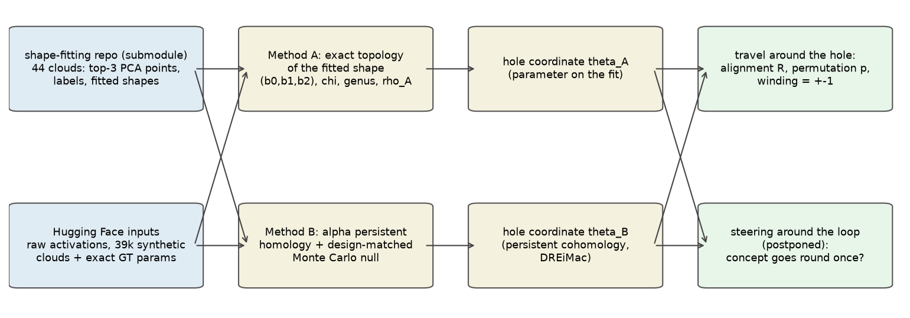
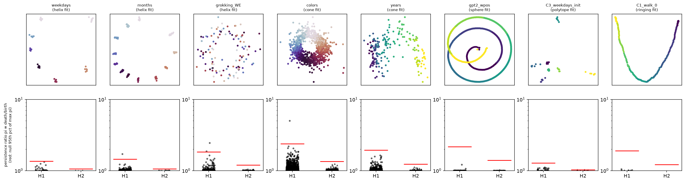
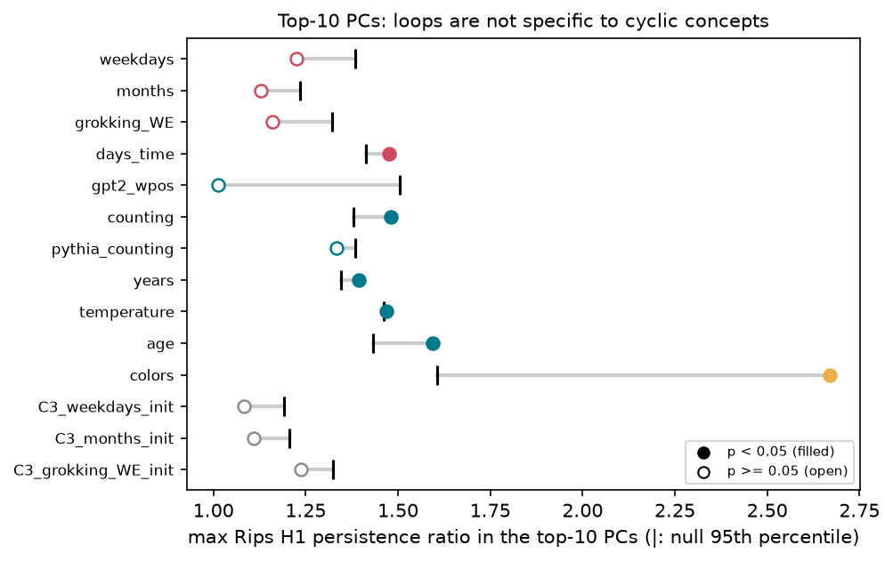
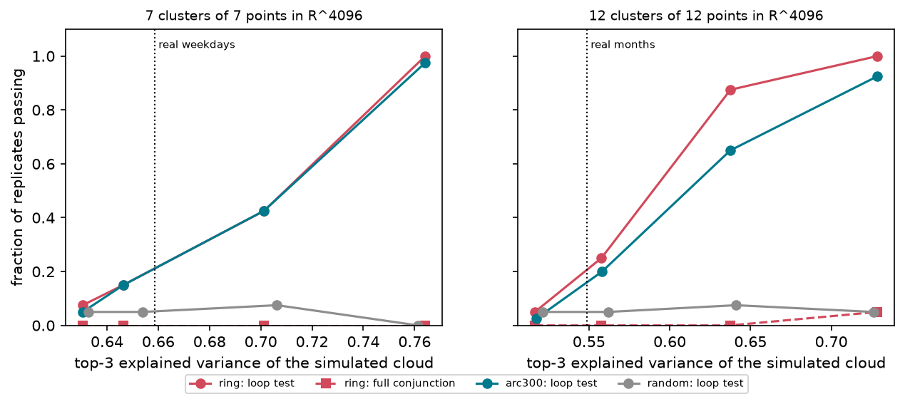
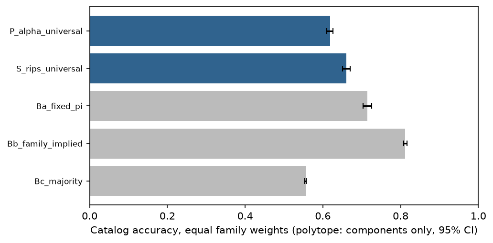
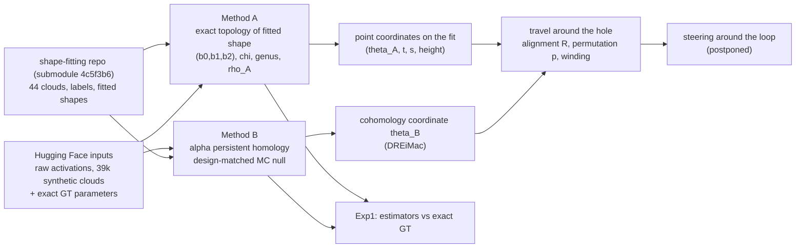

# Topology of neural geometry

**Status (2026-11-15):** all preregistered topology analyses are done. They use only stored activations; no model inference was run. Model steering and simulated steering are preregistered and **postponed by the author**.

**Links:** [paper (PDF)](paper/main.pdf) · [interactive explorer](https://burnycoder.github.io/topology-of-neural-geometry-in-llm-mechanistic-interpretability/) · [inputs and results on Hugging Face](https://huggingface.co/datasets/BurnyCoder/topology-of-neural-geometry) · [preregistration](reports/preregistration.md) · [summary of all experiments](reports/summary.md)

Interpretability research keeps finding **shapes** in neural activations:
- circles for weekdays and months ([Engels et al. 2024](https://arxiv.org/abs/2405.14860));
- a helix for GPT-2 positions ([Yedidia 2023](https://www.lesswrong.com/posts/qvWP3aBDBaqXvPNhS/gpt-2-s-positional-embedding-matrix-is-a-helix));
- circles of residues in grokked modular addition ([Nanda et al. 2023](https://arxiv.org/abs/2301.05217)).

The sibling project [shape-fitting](https://github.com/BurnyCoder/shape-fitting-in-neural-geometry-in-llm-mechanistic-interpretability) fits one of 13 uniquely parametrised shapes to the **top-3 PCA coordinates** of 44 such activation and weight clouds.

**This project asks the topological question behind the hypothesis.** Does a concept have a **hole you can travel around**, and does the concept's semantic cycle (Monday → … → Sunday → Monday) go around it exactly once? Steering activations around such a loop should then be semantically meaningful. That idea comes from **manifold steering** ([Wurgaft et al. 2026](https://arxiv.org/abs/2605.05115); [Goodfire](https://www.goodfire.com/research/manifold-steering); the [Neural Geometry series](https://www.goodfire.com/research/neural-geometry)).

We answer it in two independent ways:
1. **Method A, exact topology of the fitted shape.** The shapes are uniquely parametrised, so Betti numbers, Euler characteristic and genus are exact. A *margin ratio* ρ_A says whether the data's noise can resolve that topology. Every point is projected onto its fitted shape, and we test whether the concepts are ordered along it.
2. **Method B, persistent homology of the cloud.** We use alpha complexes with a design-matched Monte Carlo null. The circle-valued coordinate of the hole comes from persistent cohomology via [DREiMac](https://github.com/scikit-tda/DREiMac).



*Pipeline.* The inputs (left) feed two independent methods.
- Method A reads the topology off the fitted shape's parameters.
- Method B computes persistent homology of the cloud itself, with no fit involved.

Each method gives a circle-valued coordinate for the hole (θ_A on the fitted shape, θ_B from persistent cohomology), and both coordinates go through the same travel-around-the-hole statistics. Steering around the loop (right) is designed and postponed.

## Highlights (all numbers generated from `results/`)

Results per dataset. "Hole" means a significant H1 loop under the design-matched Monte Carlo null (999 draws); "goes around" means the concept's semantic cycle winds exactly once in the loop's circle-valued coordinate. The alignment R and its permutation p measure *ordering*; only winding ±1 carries the cyclic claim.

- **Colours (exploratory set):**
  - Hole: π = {{exp2.colors.top_pi1:2}} vs null 95th percentile {{exp2.colors.null_q95_pi1:2}}, p = {{exp2.colors.p_top_loop}}, Benjamini–Hochberg q = {{exp2.colors.q_loop}}, stable in {{exp2.colors.loop_freq:2}} of subsamples.
  - Hue goes around it once, in the cohomology coordinate (R = {{exp3.colors.thetaB.R:2}}, winding {{exp3.colors.thetaB.w}}) and on the fitted cone (R = {{exp0.colors.theta.R:2}}, winding {{exp0.colors.theta.w}}).
  - In the top-10 PCs, against a matched null (post hoc), the loop is still significant: Rips π = {{exp5.top10.colors.pi:2}} vs {{exp5.top10.colors.q95:2}}, p = {{exp5.top10.colors.p}}. Hue still winds once there (R = {{exp3ph.colors.top10.R:2}}, winding {{exp3ph.colors.top10.w}}).
  - In 10D a loop by itself is not specific: ordinal concepts have significant top-10 loops too (see below). What singles out colours is that hue goes around its loop.
- **Grokked residues mod 113:**
  - Hole: π = {{exp2.grok.top_pi1:2}} vs {{exp2.grok.null_q95_pi1:2}}, p = {{exp2.grok.p_top_loop}}, but stable in only {{exp2.grok.loop_freq:2}} of subsamples.
  - The residues go around it once at Fourier frequency {{exp3.grok.thetaB.k}} (Holm p = {{exp3.grok.B.holm}}, winding {{exp3.grok.thetaB.w}}).
  - The preregistered top-10-PC check (d) fails. Top-10 null p = {{exp5.top10.grok.p}}.
- **Months:**
  - Hole: π = {{exp2.months.top_pi1:2}} vs {{exp2.months.null_q95_pi1:2}}, p = {{exp2.months.p_top_loop}}. It is robust to removing the prompt-offset means (p = {{exp5.offset.months.p_loop}}) and to the Monte Carlo seed.
  - The preregistered circular-coordinate setting built no coordinate. Only post hoc (relaxed setting) do the months go around the loop once in 3D (R = {{exp3ph.months.3d.R:2}}, winding {{exp3ph.months.3d.w}}); not in the top-10 PCs (winding {{exp3ph.months.top10.w}}; top-10 null p = {{exp5.top10.months.p}}).
  - On the fitted helix the two ends nearly meet (closure gap {{exp0.months.azimuth.gap:2}} radii). Post hoc, the axial position follows the 2nd Fourier harmonic (R² = {{coords.months.harmonic.h2:2}} vs {{coords.months.harmonic.h1:2}} for the 1st), as a closed saddle-shaped loop would.
- **Days with times** (day phase, exploratory):
  - There is a loop (p = {{exp2.daystime.p_top_loop}}), but it is unstable (stable in {{exp2.daystime.loop_freq:2}} of subsamples).
  - **The day does not go around it**, even post hoc (R = {{exp3ph.daystime.3d.R:2}}, winding {{exp3ph.daystime.3d.w}}).
  - On the fitted curve, the days lie in linear order (ρ = {{coords.daystime.curve_parameter_s.day_of_week.rho:2}}).
- **Weekdays:**
  - **No detectable hole** (π = {{exp2.weekdays.top_pi1:2}} vs {{exp2.weekdays.null_q95_pi1:2}}, p = {{exp2.weekdays.p_top_loop}}), across seeds and after offset removal.
  - The test has little power here. In the corrected power simulation (post hoc), a true ring of 7 clusters with weekday-like statistics (top-3 variance {{power2.weekdays.top3:2}}; real {{power2.weekdays.real_top3:2}}) passes the loop test in {{power2.weekdays.loop:2}} of replicates. It passes the full preregistered conjunction in at most {{power2.weekdays.ring_all_max:2}}, because the circular-coordinate step fails on such loops.
  - So the preregistered H1-B test was nearly incapable of passing for 7- or 12-cluster designs. For 12-cluster rings like months, the conjunction passes in at most {{power2.months.ring_all_max:2}} of replicates.
  - The days are ordered around the fitted helix's axis (exact p = {{exp0.weekdays.azimuth.p}}, winding {{exp0.weekdays.azimuth.w}}). **This is not specific:** {{exp0.gp_wind1}} of {{exp0.gp_helix_n}} smooth random-process controls fitted as helices wind too, and their closure gaps ({{exp0.gp_gap_min:2}}–{{exp0.gp_gap_max:2}}) include the weekdays' {{exp0.weekdays.azimuth.gap:2}}.
- **Ordinal concepts and controls:**
  - In the top-3 PCs, none of the 6 ordinal sets has a loop ({{exp2.ordinal_loops}}/6), and none of the 20 random walks or Gaussian processes ({{exp2.c1_loops}}/20).
  - In the top-10 PCs (post hoc, matched null), loops are significant for {{exp5.top10.sig_ids}}. Ordinal values do not wind around them; only {{exp3ph.noncyclic_wind1_ids}} has a single winding record among all non-cyclic sets.
  - The random-init grokking embedding has a borderline loop (p = {{exp2.grokinit.p_top_loop}}, q = {{exp2.grokinit.q_loop}}).
  - After Benjamini–Hochberg over all 44 loop tests, {{exp2.n_loop_q05}} loops remain at q < 0.05: {{exp2.loops_q05}}.
  - Ordinal concepts lie in order along open curves: counts ρ = {{coords.counting.curve_parameter_s.value.rho:3}}, temperature {{coords.temperature.curve_parameter_s.value.rho:3}}. GPT-2 positions run from pole to pole of their fitted sphere ({{coords.wpos.polar_height_z.value.rho:3}}) as a spiral curve.
- **Fitted helices.** The helix fits of weekdays, months and residues have margin ratios of {{exp0.weekdays.rho:2}}, {{exp0.months.rho:2}} and {{exp0.grok.rho:2}}. Whether they are open or closed is **unresolvable** at the data's noise scale. For prompt-template designs, this low ratio is partly a property of the design (gaps between clusters).
- **Preregistered verdicts:**
  - H1-A (fitted-shape hole + traversal): {{exp3.H1A}}/3.
  - H1-B (persistent homology + traversal + top-10 robustness): {{exp3.H1B}}/3.
  - H3 (days_time): {{exp3.H3.B}}.
  - H4: balanced accuracy {{exp3.H4.conj_B:2}} for every criterion. No criterion identified any cyclic set, so the "found more easily" comparison is uninformative.
  - H2 (specificity) is {{exp3.H2.B.falsified}}. That is weak evidence: sensitivity is zero, and the controls never come near the null threshold.
- **Instrument check on 39,000 synthetic clouds with exact ground-truth topology** ({{exp1.n}} resolvable):
  - The preregistered estimator (alpha complex + universal null) recovers the exact Betti vector for {{exp1.P.acc:3}} [{{exp1.P.lo:3}}, {{exp1.P.hi:3}}] of clouds (macro). A fixed-threshold baseline scores {{exp1.Ba.acc:3}}, and reading topology off the fitter's family label scores {{exp1.Bb.acc:3}}.
  - On well-resolved clouds (ρ_A ≥ 4; {{exp1.well.n}} clouds, {{exp1.well.trivial_frac:2}} of them trivially contractible), the preregistered estimator scores {{exp1.well.P.acc:3}} vs {{exp1.well.Bb.acc:3}} for the family label; paired difference {{exp1.well.diff.Bb:3}} [{{exp1.well.diff.Bb.lo:3}}, {{exp1.well.diff.Bb.hi:3}}].
  - The fixed-threshold persistence estimator beats the family label where the label cannot fix the topology: open vs closed arcs, {{exp1.Ba.arc:2}} vs {{exp1.Bb.arc:2}}; caps vs full spheres, {{exp1.Ba.sphere:2}} vs {{exp1.Bb.sphere:2}}.

**In plain words.**
- Topology finds a hole that the concept goes around for **colours** (robustly) and **residues mod 113**. For **months** there is a hole, and the months go around it, but only in a post hoc analysis and only in the top-3 PCs.
- It does **not** find one for weekdays. The corrected power simulation shows the test rarely detects 7-cluster rings. It finds a loop in days-with-times, but the day does not go around it.
- It finds no loops in ordinal concepts or random controls in the top-3 PCs. In 10 dimensions ordinal concepts do get loops, but their values do not travel around them; going around the hole, not having one, is what distinguishes the cyclic concepts. Since the strict tests never fired for any cyclic set, the specificity evidence is weak.
- The shape fitter's "helices" for cyclic concepts cannot be told apart from closed loops at this noise level. Months come closest to closing.
- Whether steering around these loops changes the model's answers in semantic order is the next experiment. It is designed, and postponed by the author.



*Real clouds and their holes.*
- **Top row:** each cloud in its first two principal components, coloured by concept: a cyclic colour map for cyclic concepts, viridis for ordinal ones. The fitted family is in the title.
- **Bottom row:** the persistence ratio π = death/birth of every H1 bar (loops, circles) and H2 bar (voids, triangles), on a log scale. The red line is the 95th percentile of the null distribution of the largest ratio. A bar above it is a significant hole.
- Colours, residues and months have a loop above the line. Weekdays, years, GPT-2 positions and the controls do not.


*Does the concept go around the hole?*
- **How to read:** each dot is one concept (a hue bin, a residue, a month, a weekday). It sits at the circular mean of its points' hole angle and is coloured by its position in the semantic cycle. A chord joins it to the next concept.
- If the concept goes around the hole once and in order, the colours run around the circle like a rainbow and the chords form a single non-crossing polygon (winding ±1). The sign only gives the direction.
- **Results:**
  - Colours do this in both coordinates: cohomology θ_B and the fitted cone's azimuth θ_A.
  - Residues mod 113 do it at Fourier frequency {{exp3.grok.thetaB.k}}.
  - Months do it only in the post hoc relaxed setting.
- **The last two panels are a warning.** The weekday points also go once around the axis of their fitted helix, but so does a smooth Gaussian-process control that was fitted as a helix. Winding around a helix axis is therefore not evidence of a cyclic concept ({{exp0.gp_wind1}} of {{exp0.gp_helix_n}} such controls wind).

## Results

### Method A: exact topology of the 44 fitted shapes (Exp0)

- {{exp0.n_hole_fits}} fitted shapes have a hole (b1 = 1; both are cones) and {{exp0.n_void_fits}} has a void (b2 = 1: GPT-2 W_pos, a closed sphere).
- {{exp0.n_resolvable}} of the 44 fitted topologies are resolvable at the data's noise scale (ρ_A ≥ 1).
- The analytic rules agree with persistent homology of dense noise-free shape samples for {{exp0.dense_agree:3}} of {{exp0.dense_n}} shapes.
- Full tables: [reports/exp0_analytic.md](reports/exp0_analytic.md); point coordinates on the shapes: [reports/coords_check.md](reports/coords_check.md).


*Exact topology of every fitted shape (Method A).*
- Marker shape gives the fitted shape's Betti vector: circle = no hole, square = a hole (b1 = 1), triangle = a void (b2 = 1).
- The x-axis is the margin ratio ρ_A, the smallest parameter change that would alter the topology divided by twice the data's noise scale (log scale).
- Right of the dashed line (ρ_A ≥ 1), the noise is small enough for the fitted topology to be resolvable. Fits whose topology cannot change (blob, disc, paraboloid; ρ_A = ∞) are omitted.
- The cyclic sets' helices lie left of the line: whether those curves are open or closed cannot be decided from the data.


*Helix fits.*
- The x-axis is the closure gap: the axial distance between the first and last concept, in units of the helix radius. A closed loop would have gap 0.
- The y-axis is how well the concepts line up with the helix azimuth (R = 1: perfectly ordered).
- Cyclic concepts (red) wind about as well as Gaussian-process controls fitted as helices (grey), so winding does not separate them.
- The closure gap separates only months: their gap ({{exp0.months.azimuth.gap:2}} radii) is below every control's. The weekdays' gap ({{exp0.weekdays.azimuth.gap:2}}) lies inside the controls' range ({{exp0.gp_gap_min:2}}–{{exp0.gp_gap_max:2}}).

### Method B: persistent homology of the clouds (Exp2) and the cyclic tests (Exp3)

| Dataset | top H1 π | null q95 | p (loop) | BH q | traversal: R, winding (θ_B, preregistered) | traversal post hoc, 3D (relaxed range) | top-10 PCs: Rips π vs null q95, p (post hoc) |
|---|---|---|---|---|---|---|---|
| colours (hue) | {{exp2.colors.top_pi1:2}} | {{exp2.colors.null_q95_pi1:2}} | {{exp2.colors.p_top_loop}} | {{exp2.colors.q_loop}} | {{exp3.colors.thetaB.R:2}}, {{exp3.colors.thetaB.w}} | {{exp3ph.colors.3d.R:2}}, {{exp3ph.colors.3d.w}} | {{exp5.top10.colors.pi:2}} vs {{exp5.top10.colors.q95:2}}, p = {{exp5.top10.colors.p}} |
| grokked residues (k = {{exp3.grok.thetaB.k}}) | {{exp2.grok.top_pi1:2}} | {{exp2.grok.null_q95_pi1:2}} | {{exp2.grok.p_top_loop}} | {{exp2.grok.q_loop}} | {{exp3.grok.thetaB.R:2}}, {{exp3.grok.thetaB.w}} | {{exp3ph.grok.3d.R:2}}, {{exp3ph.grok.3d.w}} | {{exp5.top10.grok.pi:2}} vs {{exp5.top10.grok.q95:2}}, p = {{exp5.top10.grok.p}} |
| months | {{exp2.months.top_pi1:2}} | {{exp2.months.null_q95_pi1:2}} | {{exp2.months.p_top_loop}} | {{exp2.months.q_loop}} | no coordinate | {{exp3ph.months.3d.R:2}}, {{exp3ph.months.3d.w}} | {{exp5.top10.months.pi:2}} vs {{exp5.top10.months.q95:2}}, p = {{exp5.top10.months.p}} |
| days with times (day) | {{exp2.daystime.top_pi1:2}} | {{exp2.daystime.null_q95_pi1:2}} | {{exp2.daystime.p_top_loop}} | {{exp2.daystime.q_loop}} | no coordinate | {{exp3ph.daystime.3d.R:2}}, {{exp3ph.daystime.3d.w}} | {{exp5.top10.daystime.pi:2}} vs {{exp5.top10.daystime.q95:2}}, p = {{exp5.top10.daystime.p}} |
| weekdays | {{exp2.weekdays.top_pi1:2}} | {{exp2.weekdays.null_q95_pi1:2}} | {{exp2.weekdays.p_top_loop}} | {{exp2.weekdays.q_loop}} | no coordinate | {{exp3ph.weekdays.3d.R:2}}, {{exp3ph.weekdays.3d.w}} | {{exp5.top10.weekdays.pi:2}} vs {{exp5.top10.weekdays.q95:2}}, p = {{exp5.top10.weekdays.p}} |
| years | {{exp2.years.top_pi1:2}} | {{exp2.years.null_q95_pi1:2}} | {{exp2.years.p_top_loop}} | {{exp2.years.q_loop}} | no coordinate | {{exp3ph.years.3d.R:2}}, {{exp3ph.years.3d.w}} | {{exp5.top10.years.pi:2}} vs {{exp5.top10.years.q95:2}}, p = {{exp5.top10.years.p}} |
| GPT-2 positions | {{exp2.wpos.top_pi1:2}} | {{exp2.wpos.null_q95_pi1:2}} | {{exp2.wpos.p_top_loop}} | {{exp2.wpos.q_loop}} | no coordinate | {{exp3ph.wpos.3d.R:2}}, {{exp3ph.wpos.3d.w}} | {{exp5.top10.wpos.pi:2}} vs {{exp5.top10.wpos.q95:2}}, p = {{exp5.top10.wpos.p}} |

**How to read the table:**
- The null is a cluster-centre null for prompt-template designs and a full-dimensional matched Gaussian otherwise, with 999 draws.
- "No coordinate" means DREiMac's preregistered setting, which requires Rips death ≥ 2 × birth, built no circular coordinate.

All 44 clouds: [reports/exp2_invariants.md](reports/exp2_invariants.md). Hypothesis tests: [reports/exp3_cyclic.md](reports/exp3_cyclic.md).


*The loop test, dataset by dataset.*
- **How to read:**
  - Grey histogram: the largest H1 persistence ratio in each of 999 surrogate clouds with the same design but no planted loop. Prompt-template sets use the cluster-centre null; the others use a full-dimensional matched Gaussian.
  - Dashed line: the 95th percentile of the null. Solid line: the observed largest ratio.
- **Results:**
  - Colours, residues, months and days_time lie beyond the null.
  - Weekdays fall just short (p = {{exp2.weekdays.p_top_loop}}).
  - Years, counting, GPT-2 positions, the random-init weekday model and the Gaussian-process control lie inside the null or below it.



*Loops beyond the top-3 PCs (post hoc).*
- The observed largest Rips H1 ratio in the top-10 principal components (dot) is compared with the 95th percentile of a matched 199-draw null (bar). A filled dot is significant (p < 0.05).
- In 10 dimensions, ordinal sets get loops too ({{exp5.top10.sig_ids}}), as expected from Fourier-like features of numbers. **A loop alone is therefore not specific.**
- Colours are the only set that keeps both a strong loop and a single winding there.



*Why weekdays could hardly pass (corrected power simulation, post hoc).*
- **Setup:** 7 or 12 concept clusters in ℝ⁴⁰⁹⁶, matched to the real sets' second-order statistics. Plotted against the simulated top-3 explained variance:
  - the fraction of clouds that pass the loop test (solid);
  - for rings only, the fraction that pass the full preregistered conjunction (dashed).
  - The dotted line marks the real weekdays and months.
- **Results:**
  - At the weekdays' variance, a true ring passes the loop test in only {{power2.weekdays.loop:2}} of replicates. Random placements pass at most {{power2.weekdays.random_loop_max:2}}, close to the nominal 5%. The full conjunction almost never passes, because the circular-coordinate step rarely builds a coordinate on such small loops.
  - **The loop test alone cannot tell a ring from a nearly closed arc.** With 7 clusters, an open 300° arc (50° steps and a 60° gap) is almost a ring and passes as often as one. With 12 clusters (a gap of 2.2 steps) the ring passes more often, but the arc still passes often. Only the traversal conditions separate them.

### Instrument validation on synthetic clouds with exact topology (Exp1)

| Estimator | exact (b0,b1,b2) accuracy, macro over 13 families [95% CI] |
|---|---|
| P: alpha + universal null (preregistered primary) | {{exp1.P.acc:3}} [{{exp1.P.lo:3}}, {{exp1.P.hi:3}}] |
| S: Rips H1 + universal null (deviation D1) | {{exp1.S.acc:3}} [{{exp1.S.lo:3}}, {{exp1.S.hi:3}}] |
| Ba: fixed π thresholds (tuned on validation) | {{exp1.Ba.acc:3}} [{{exp1.Ba.lo:3}}, {{exp1.Ba.hi:3}}] |
| Bb: family-implied (fitter's label → modal Betti vector) | {{exp1.Bb.acc:3}} [{{exp1.Bb.lo:3}}, {{exp1.Bb.hi:3}}] |
| Bc: majority vector | {{exp1.Bc.acc:3}} [{{exp1.Bc.lo:3}}, {{exp1.Bc.hi:3}}] |

**Better or worse, in plain words:**
- The preregistered persistent-homology estimator (P) and the fixed-threshold one (Ba) are **worse** than the family label (Bb) overall. Ba misses thin loops (ellipse: {{exp1.Ba.ellipse:2}} vs {{exp1.Bb.ellipse:2}}) and tori ({{exp1.Ba.torus:2}} vs {{exp1.Bb.torus:2}}).
- Ba is **better** where the label is topologically ambiguous: arcs, open or closed ({{exp1.Ba.arc:2}} vs {{exp1.Bb.arc:2}}), and spheres, cap or full ({{exp1.Ba.sphere:2}} vs {{exp1.Bb.sphere:2}}).
- On well-resolved clouds (ρ_A ≥ 4), the preregistered P scores {{exp1.well.P.acc:3}} [{{exp1.well.P.lo:3}}, {{exp1.well.P.hi:3}}] vs {{exp1.well.Bb.acc:3}} [{{exp1.well.Bb.lo:3}}, {{exp1.well.Bb.hi:3}}] for the family label (macro, cluster-bootstrap CIs).
- P rarely invents holes: {{exp1.P.fpr_min:3}}–{{exp1.P.fpr_max:3}} false positives on contractible shapes (per N bin), {{exp1.out.P.outlier:3}} on clouds with outliers.



*Exact Betti-vector accuracy on resolvable synthetic clouds.* Macro average over the 13 shape families, with 95% cluster-bootstrap CIs over generator chunks. Blue: persistent-homology estimators. Grey: baselines.


*Accuracy against the margin ratio ρ_A, over all 39,000 clouds.*
- The persistence estimators fail on clouds whose topology is unresolvable (left of the dashed line). The family label degrades less, because it reads the topology off the label rather than off the data.
- This is why accuracies are scored on resolvable clouds, and why the unresolvable helix fits of the real cyclic sets cannot be called open or closed.


*False holes on contractible shapes, with and without outliers (deviation D7).*
- The source generator gives a fraction {{exp1.out.gen.prob:2}} of the clouds uniform outliers, replacing up to a fraction {{exp1.out.gen.fracmax:2}} of their points. A cloud counts as an outlier cloud if a point lies more than {{exp1.out.factor:0}} median distances from the true shape.
- Outliers roughly double the false positives of the universal-null estimators (P, S); the tuned fixed threshold (Ba) is unaffected. For the preregistered P: {{exp1.out.P.outlier:3}} [{{exp1.out.P.outlier.lo:3}}, {{exp1.out.P.outlier.hi:3}}] with outliers vs {{exp1.out.P.clean:3}} [{{exp1.out.P.clean.lo:3}}, {{exp1.out.P.clean.hi:3}}] without.
- P stays below the preregistered threshold of {{exp1.out.thr:2}} (dashed), so the planned distance-to-measure (DTM) ablation is **{{exp1.out.dtm}}**.

### Topological similarity between clouds (Exp4, exploratory)


*Which clouds have similar persistence diagrams?*
- **Left:** a 2D multidimensional-scaling map of bottleneck distances between the diagrams of significant bars, for the 44 clouds and 8 ideal templates (stars). **Right:** the average-linkage dendrogram.
- Clouds with no significant bar are all at distance 0 from each other and from the line, helix and blob templates, so they collapse onto one point (X).
- The cyclic sets do not cluster together (exact cohesion p = {{exp4.cohesion_p:3}}). Bottleneck distance in absolute radius units is dominated by bar length, not by how persistent a loop is relative to its size. We report this analysis as uninformative ([reports/exp4_exp5.md](reports/exp4_exp5.md)).

## Architecture



## What happens when you run it

```text
run.py <phase>
  fetch        download inputs/ from the Hugging Face dataset at the pinned revision, verify SHA-256
  exp0         Method A: exact topology + margin of the 44 fits and 40,560 synthetic GT shapes; theta_A tests
  coords       where the labelled points sit on their fitted shapes (curve parameter, azimuth, height, clusters)
  power        validation-stream tuning (b0 rule, baseline thresholds) and the power simulation
  exp1         synthetic validation of the persistent-homology Betti estimators against exact GT topology
  exp1outliers false-positive rate on outlier clouds; decides the preregistered DTM conditional (deviation D7)
  exp2         persistent homology of the 44 clouds with 999-draw design-matched nulls (cached in results/nulls)
  exp3         preregistered cyclic hypotheses H1-H4 (theta_B, top-10-PC check, Holm)
  exp3posthoc  post hoc: theta_B with DREiMac standard_range=False (deviation D5)
  exp4         bottleneck distances between clouds and ideal templates
  exp5         robustness: Rips vs alpha, top-k PCs (with matched null), full-D cosine, offset removal, seeds, noise scale
  report       regenerate every table, figure and number in README / reports / paper from results/
  site         GitHub Pages explorer (docs/index.html)
  all          everything above, CPU only (about 1.5 h on 16 cores)
  exp6sim, exp6  simulated / LLM steering around the loops (postponed; exp6 needs a GPU and Llama-3.1-8B)
```

## Installation and usage

Requirements: [uv](https://docs.astral.sh/uv/). Python 3.11 is installed by uv; it is pinned because DREiMac requires Python below 3.12. No GPU is needed.

```bash
git clone --recursive https://github.com/BurnyCoder/topology-of-neural-geometry-in-llm-mechanistic-interpretability.git
```

```bash
cd topology-of-neural-geometry-in-llm-mechanistic-interpretability && uv sync
```

```bash
uv run python run.py all
```

Run the tests:

```bash
uv run pytest
```

Regenerate the documentation numbers and figures from the committed results without recomputing:

```bash
uv run python run.py report site
```

Reproducing the inputs from scratch, which needs a GPU and the source project, is described in [docs/reproduce_inputs.md](docs/reproduce_inputs.md).

**Reproducibility check ({{replication.date}}).** The full pipeline was re-run from a fresh `git clone --recursive`, with inputs from Hugging Face only, no local files and no `.env`. It reproduced {{replication.identical}}/{{replication.files}} result files within tolerance (relative 1e-6), as checked by `scripts/compare_results.py`. Before the comparison, the committed `results/` folder was moved aside, so nothing cached was reused.

## Features

- Exact topology (Betti numbers, χ, genus, boundary, margin) of the source's 13 parametrised shape families, with tests against persistent homology of dense samples.
- Intrinsic coordinates of points on fitted shapes. The numpy parametrisations reproduce the source's fitted shapes to 1e-5.
- Alpha and Rips persistence, the universal null, and design-matched Monte Carlo nulls (cluster-centre and full-dimensional Gaussian, sampled through the Gram matrix).
- Circular coordinates from persistent cohomology, and the travel-around-the-hole statistics: exact permutation tests, winding, cyclic order.
- Validation against exact ground truth on 39,000 synthetic clouds, with cluster-bootstrap CIs.
- Reproducible from GitHub + Hugging Face: pinned revision, SHA-256 manifest, bit-exact regeneration of the synthetic ground truth.
- Every documentation number is generated from `results/`.

## Repository layout

- `src/neurotopo/`:
  - `analytic/`: Method A rules and coordinates.
  - `tda/`: diagrams, nulls, invariants, circular coordinates.
  - `stats/`: alignment and tests.
  - `experiments/`: one module per phase.
  - `steering/`: postponed steering code.
  - `report/`: tables, figures, site, numbers.
- `external/shape-fitting/`: the source project (git submodule, commit 4c5f3b6).
- `reports/`: literature and state-of-the-art reviews, preregistration (with addendum and amendment), deviations, plan, one report per experiment, summary. `reports/templates/` holds the report sources; `reports/generated/` holds generated tables.
- `docs/`: [methodology](docs/methodology.md), [exact topology of the families](docs/analytic_topology.md), [reproducing the inputs](docs/reproduce_inputs.md), figures, explorer.
- `paper/`: LaTeX source and PDF.
- `results/`: machine-readable results of every phase.
- `logs/`: timestamped run logs.

## Technologies

uv, Python 3.11, NumPy, SciPy, scikit-learn, pandas, [GUDHI](https://gudhi.inria.fr) (alpha complexes, bottleneck), [ripser.py](https://github.com/scikit-tda/ripser.py), [persim](https://github.com/scikit-tda/persim), [DREiMac](https://github.com/scikit-tda/DREiMac), matplotlib, plotly.js (explorer), Hugging Face Hub, pytest.

## To do

- **Steering around the detected loops** (preregistered, postponed by the author):
  - simulated steering with cross-validated decoders, then
  - Llama-3.1-8B steering of weekdays, months, days and colours;
  - steering of the grokked modular-addition model, retrained with the source recipe.
- A loop test for weekdays with more prompt templates per day: 7 clusters of 7 points are close to the power limit.
- A distance for comparing clouds that is not dominated by absolute scale (Exp4 was uninformative). For example, bottleneck distance in log-π coordinates.
- Torus and thin-loop detection: the synthetic accuracy for tori is near zero at our sample sizes.

## License

MIT ([LICENSE](LICENSE)). GUDHI's alpha complex is GPL-3.0 through CGAL; see [NOTICE](NOTICE).
