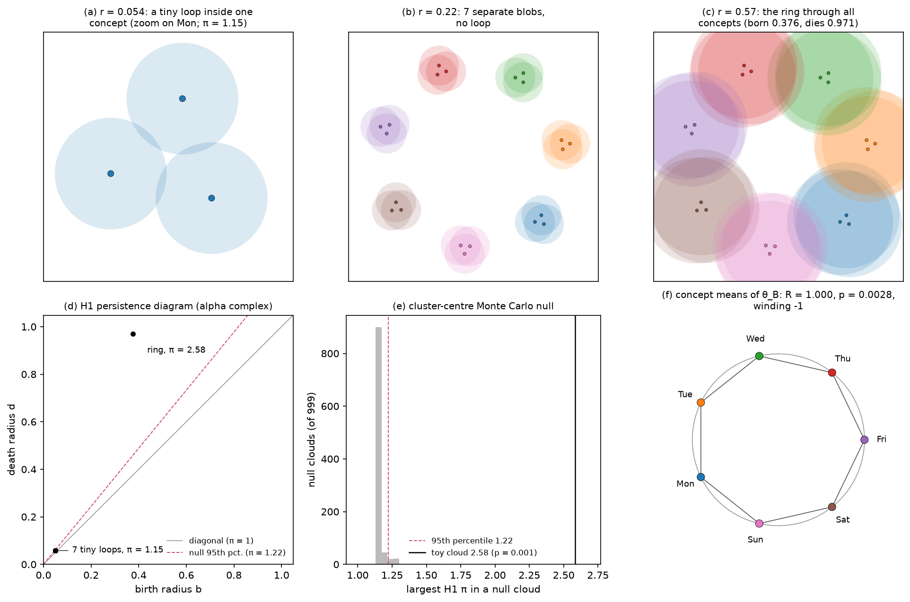

# Worked example: how the loop and ring test works

This page walks through every step behind the plain-language example figure in the [README](../README.md#what-we-found-in-plain-words) (`fig_examples`), on a toy cloud small enough to check by hand. An [interactive version](https://burnycoder.github.io/topology-of-neural-geometry-in-llm-mechanistic-interpretability/worked_example.html) lets you grow the balls yourself.

- **Same code as the real data.** The toy is analysed by [`experiments/toy_example.py`](../src/neurotopo/experiments/toy_example.py) with exactly the functions that analyse the 44 real clouds. No model or stored activation is involved.
- **Checked against closed forms.** [`tests/test_toy_example.py`](../tests/test_toy_example.py) checks the persistence bars, the null's floor, the alignment p-value and the winding number against formulas derived by hand.
- **No hand-typed numbers.** Every number here comes from `results/toy/summary.json`; `uv run python run.py toy report site` regenerates this page, its figure and the interactive version.

*The toy cloud.* (a)–(c) Balls of radius r around the 21 points at three radii: a tiny loop inside one concept, 7 separate blobs, and the ring through all concepts. (d) The loop persistence diagram, with the null's 95th-percentile line d = q95 · b. (e) The null distribution of the largest persistence ratio. (f) The concepts' mean hole angles, joined in weekday order.

## The toy cloud

- **Concepts.** 7 concepts (a week, Mon = 0 … Sun = 6), each with 3 prompts: N = 21 points.
- **Centres.** Concept c has centre v_c = (cos 2πc/7, sin 2πc/7), a vertex of the regular heptagon of radius 1.
- **Prompts.** Concept c's 3 prompts are the corners of an equilateral triangle of side s = 0.1 centred on v_c, with one corner pointing outward:
  - the outer corner is at distance 1 + s/√3 = 1.0577 from the origin;
  - the two inner corners are at radial distance 1 − s/(2√3) = 0.9711, shifted ±s/2 sideways, so at distance 0.9724 from the origin.
- **Activations.** The "activations" are x_i = m + 3 · (p_i1 a + p_i2 b) in R^8, where p_i is the toy point, m a random mean and a, b random orthonormal directions.

The cloud is built so that the right answer is obvious: there is one ring of concepts, the week goes around it once, and each triangle is a small "noise" loop inside one concept.

## 1. Flatten to the top-3 PCA coordinates

Code: [`fit_frame`](../src/neurotopo/geometry/pca.py), identical to the source project's normalisation.

- **Mean:** m̂ = (1/N) Σ x_i.
- **Covariance:** Σ = (1/N) Σ (x_i − m̂)(x_i − m̂)ᵀ, a D×D matrix.
- **Principal components:** the eigenvectors u₁, u₂, u₃ of Σ with the largest eigenvalues λ₁ ≥ λ₂ ≥ λ₃, i.e. the directions of largest variance.
- **Scores:** z_i = ((x_i − m̂)·u₁, (x_i − m̂)·u₂, (x_i − m̂)·u₃). Each axis is flipped so that Σ_i z_ik³ ≥ 0 (skewness sign).
- **RMS radius:** ρ = √((1/N) Σ ‖z_i‖²). The analysed cloud is y_i = z_i / ρ.

In the toy:
- λ = (4.515, 4.515, 3.1e-16). The 7-fold symmetry makes the variance equal in every direction of the plane, so PC1 and PC2 are an arbitrary rotation within it. Rotations do not change topology.
- PC3 is zero up to rounding (largest |y_i3| = 3.0e-16).
- ρ = 3.0050, which is 3 × 1.0017. All radii below are in these normalised units: the toy's units divided by 1.0017.

Real clouds have a non-zero third PC, and the code does everything below with balls in 3D. Here the balls are discs in the plane.

## 2. Alpha complex and persistence diagram

Code: [`alpha_diagrams`](../src/neurotopo/tda/diagrams.py), using [GUDHI](https://gudhi.inria.fr/python/latest/alpha_complex_user.html).

**Terms**
- **Union of balls.** Put a ball of radius r around every point and let r grow from 0. We track the holes of the union.
- **Simplicial complex.** Vertices, edges and triangles (plus tetrahedra in 3D) glued along shared faces.
- **Alpha complex.** A simplicial complex that has the same holes as the union of balls at every r (the nerve theorem). It uses only **Delaunay** simplices: triangles whose circumcircle contains no data point. In 2D:
  - an edge enters at r = half its length if it is a **Gabriel edge** (no other point lies inside the circle that has the edge as diameter); otherwise it enters together with its triangle;
  - a triangle enters at r = its circumradius.
- **Filtration.** The growing sequence of complexes as r increases.
- **Homology.** H0 counts connected pieces, H1 independent loops, and H2 enclosed voids (3D only). Their counts are the Betti numbers. Coefficients are Z/2 (arithmetic mod 2).
- **Persistence.** Each loop has a **birth** radius b, where it closes, and a **death** radius d, where it is filled in. The **persistence diagram** is the list of (b, d) pairs. GUDHI reports squared radii, so the code takes square roots, and it drops zero-length bars (b = d), which ties create.

**Filtration of the toy**, read off GUDHI's simplex tree:

| r | edges entering | triangles entering | effect |
|---|---|---|---|
| 0 | – | – | 21 points, 21 pieces |
| 0.0499 | 21 (the triangles' sides) | 0 | 7 pieces; **7 tiny loops are born** |
| 0.0576 | 0 | 7 (circumradius s/√3) | the tiny loops die |
| 0.3757 | 7 (gaps between neighbouring concepts) | 0 | 1 piece; **the ring is born** |
| 0.7418 | 14 | 14 | outer regions between neighbours fill; loops born and killed at the same r (zero length, dropped) |
| 0.9708 | 11 | 12 | the 14 inner corners lie on one empty circle; its triangles enter and **the ring dies** |

So the loop (H1) diagram has 8 bars: 7 × (0.0499, 0.0576) and 1 × (0.3757, 0.9708). There are no voids (0 H2 bars).

## 3. Persistence ratio π = d / b

Code: `diagrams.ratios` and `max_ratio`, after [Bobrowski & Skraba 2023](https://doi.org/10.1038/s41598-023-37842-2).

- Tiny loops: π = 0.0576 / 0.0499 = 1.155.
- Ring: π = 0.9708 / 0.3757 = **2.584**. This is the cloud's `top_pi1`, the numerator of the example figure's bar height (step 4).

π is a ratio, so shrinking the cloud by 1.0017 (or by 1000) leaves it unchanged. Loops made by noise have π close to 1:
- Any 3-point loop has π = 1/sin(largest angle) ≤ 2/√3 = 1.155. Obtuse triangles make no loop at all.
- A regular k-gon of points gives π = 1/sin(π/k):

| k | 3 | 4 | 6 | 7 | 12 |
|---|---|---|---|---|---|
| π | 1.15 | 1.41 | 2.00 | 2.30 | 3.86 |

The 7 toy centres alone are a regular heptagon: their π is 2.305, as the formula says.

## 4. Design-matched Monte Carlo null, p-value and bar height

Code: [`ClusterCentreNull`, `null_max_ratios`, `mc_pvalues`](../src/neurotopo/tda/nulls.py), in the style of the max-over-shuffles threshold of [Gardner et al. 2022](https://doi.org/10.1038/s41586-021-04268-7).

The toy has many prompts per concept, like the weekday, month, colour and days-with-times clouds, so it gets the **cluster-centre null**:
- μ_c = the mean of concept c's prompts. In the toy, μ_c = v_c.
- μ̄ = the mean of the μ_c, here 0.
- e_i = x_i − μ_c(i), the **residual**: each prompt's offset from its concept mean.
- **One null draw:** take Z, a 7×7 matrix of independent standard normal numbers. Then
  - μ*_c = μ̄ + (1/√6) Σ_j Z_cj (μ_j − μ̄), and
  - x*_i = μ*_c(i) + e_i.

Each fake centre μ*_c is an independent draw from a Gaussian with the real centres' sample covariance S. For the toy, S = 0.583 · I in the toy's units (a standard deviation of 0.76 per axis). The spread within each concept is kept exactly; only the arrangement of the concepts is randomised. Every null cloud goes through steps 1–3, and its largest loop π is recorded.

**The numbers**
- M = 999 draws (seed crc32(id) + seed = 996294379).
- **Null floor.** Every null cloud still contains the 7 triangles, so its largest π is never below 1.155. In 88% of draws nothing beats the triangles. The null therefore knows about the noise loops, and they cannot produce a false positive.
- **p-value:** p = (1 + #{null maxima ≥ π_obs}) / (M + 1). Here 0 of 999 null maxima reach 2.584 (the largest is 1.604), so p = 0.001, the smallest value M = 999 allows.
- **q95**, the 95th percentile of the null maxima, uses numpy's linear interpolation. Sort the maxima v₍₀₎ ≤ … ≤ v₍M−1₎; the position is h = 0.95 · (M − 1), and q95 = v₍⌊h⌋₎ + (h − ⌊h⌋)(v₍⌊h⌋+1₎ − v₍⌊h⌋₎). Here q95 = 1.221.
- **Bar height** in the example figure = π_obs / q95 = 2.584 / 1.221 = **2.12**. A bar above 1 means fewer than about 5% of null maxima reach π_obs, i.e. p ≲ 0.05.

Clouds with one point per value (residues, years) use a Gaussian with the data's full covariance instead (`GaussianNull`).

## 5. Is the loop inside one cluster?

Code: [`bar_scale`](../src/neurotopo/experiments/exp7_audit.py) (audit, deviation D8).

- **Connect radius** r_conn = ½ × the smallest distance between two points of *different* concepts. In the toy that is half the gap between facing inner corners of neighbouring concepts: r_conn = 0.3757.
- **Rule:** if the top loop dies at or below r_conn, it lies inside one cluster. Below r_conn, balls of different concepts never touch, so a loop that lives and dies there is made of one concept's points.
- **Toy:** d = 0.9708 > r_conn = 0.3757, so the ring runs through the clusters (inside one cluster: no).
- **For contrast:** the tiny loops die at 0.0576 ≤ r_conn, so each lies inside one cluster. In the real data, the days-with-times cloud's top loop is of this kind.
- A loop through two or more concepts needs a between-concept edge, so it cannot be born before r_conn. In the toy, the ring is born exactly there (0.3757).

## 6. Hole angle θ_B

Code: [`circular_coordinates`](../src/neurotopo/tda/circular.py), using [DREiMac](https://github.com/scikit-tda/DREiMac), after [de Silva, Morozov & Vejdemo-Johansson 2011](https://doi.org/10.1007/s00454-011-9344-x). Goal: give every point an angle θ_i that increases by one full turn around the loop.

- **Rips complex.** A simplex is included when all its points are pairwise within distance ε, a diameter (ε/2 is a radius). It is built on up to 200 landmarks; here all 21 points are landmarks.
- **Cocycle.** Persistent cohomology with Z/47 coefficients gives, for the most persistent class, a **cocycle**: a number on every edge that sums to ±1 around the loop and to 0 around every filled triangle. Think of a cut across the ring, where every edge that crosses the cut gets 1. DREiMac lifts it to integers.
- **Range check** (`standard_range=True`, preregistered): the class's Rips death must be at least twice its birth.
  - In the toy, birth = 0.751 and death = 1.868 (diameters), a ratio of 2.49 ≥ 2, so the check passes.
  - The ring cannot be filled until edges span 3 concepts; edges spanning 2 are not enough, as for 7 evenly spaced points on a circle ([Adamaszek & Adams 2017](https://arxiv.org/abs/1503.03669)).
  - `standard_range=False` is the relaxed post hoc setting (deviation D5).
- **Harmonic smoothing.** Choose one real number f_v per landmark to minimise Σ_edges (α_e − (f_head − f_tail))², where α_e is the cocycle on edge e (DREiMac uses scipy's `lsqr`). Then θ = 2π·f mod 2π, with a partition of unity filling in between landmarks.

**By hand, one vertex per concept.** Take a 7-cycle with edges c → c+1 and the cocycle α = 1 on Sun → Mon, 0 elsewhere. With steps g_c = f_{c+1} − f_c:
- the Sun → Mon edge gets f_Mon − f_Sun = −Σg, so we minimise Σ_c g_c² + (1 + Σ_c g_c)²;
- setting the derivative to zero gives g_c = −(1 + Σg) for every c, so 7g = −1 and g = −1/7.

The single cut is smeared into 7 equal steps of 1/7 turn = 51.4°. On the full toy, DREiMac gives exactly this pattern. The concept mean angles are Mon 205.7°, Tue 154.3°, Wed 102.9°, Thu 51.4°, Fri 0.0°, Sat 308.6°, Sun 257.1°, a step of -51.4° per day. The zero point and direction are arbitrary.

## 7. Does the concept go around once?

Code: [`stats/circular.py`](../src/neurotopo/stats/circular.py) and `alignment.passes`.

- **Circular mean** per concept: θ̄_c = arg Σ_{i∈c} e^{iθ_i}. An arithmetic mean would be wrong: 359° and 1° average to 180°, but their circular mean is 0°.
- **Semantic phase** φ_c = 2πc/7: each concept's place in its cycle (Mon = 0°, Tue = 51.4°, …). For residues mod 113 it is 2π·k·r/113, maximised over the frequency k.
- **Alignment.** R = max over s ∈ {+1, −1} of |(1/7) Σ_c e^{i(θ̄_c − s·φ_c)}|. R = 1 means the angles equal the phases up to a rotation (any zero point) and a reflection (s); R near 0 means no relation.
  - Toy: θ̄_c = θ̄_0 − φ_c.
  - With s = +1 the terms are the 7th roots of unity, which sum to 0.
  - With s = −1 every term is e^{iθ̄_0}.
  - So R = 1.000 with s = -1.
- **Permutation p-value** (exact, since n ≤ 7). Compute R for all 5040 ways to reassign the 7 phases to the 7 concepts; p is the share with R ≥ R_obs. Only the 14 rotations and reflections of the week reach R = 1, so p = 14/5040 = **0.0028**, the smallest p possible with 7 concepts. With 12 months the code draws 99,999 random permutations instead.
- **Winding number.** w = (1/2π) Σ_c wrap(θ̄_{c+1} − θ̄_c), including the Sun → Mon step. wrap() takes the shortest signed angle, in (−180°, 180°]. Toy: 7 steps of -51.4° make a full turn, so w = **-1**.
- **Counter-example.** If each day sat two places further around than the previous one, every step would be -102.9°, w = -2 (around twice), and R = 0.00.
- **Pass rule:** p < 0.05 and |w| = 1. The toy passes: yes.

## 8. Verdict (the example figure's titles)

- Loop: p = 0.001 < 0.05 against the design-matched null.
- Not inside one cluster: 0.9708 > 0.3757.
- Goes around once in the preregistered analysis: p = 0.0028, w = -1.

The figure would title this cloud "ring: yes, goes around once: yes", in green. If only the relaxed `standard_range=False` traversal passed, the ring would be called "suggestive", as for months.

## What the toy does not show

- **It is a best case.** It is perfectly symmetric and its clusters are tight. The real weekday centres reach a persistence ratio of only 1.05 in the top-3 PCs.
- **A significant loop is not a hole.** Both nulls are Gaussian, so they also reject many hole-free shapes, such as curved sheets and caps (deviation D9, [reports/exp8_audit3.md](../reports/exp8_audit3.md)). Ring claims therefore rest on the traversal test of step 7, not on the loop test alone.

## Symbols

| symbol | meaning | toy value |
|---|---|---|
| N, n, D | points, concepts, activation dimension | 21, 7, 8 |
| x_i, y_i | activation, normalised top-3 PCA coordinates | – |
| r | ball radius in the filtration | 0 → ∞ |
| b, d, π | birth and death radius of a loop, π = d/b | 0.3757, 0.9708, 2.584 |
| μ_c, μ̄, e_i | concept mean, mean of the concept means, residual | v_c, 0, the triangle offsets |
| Z, M | standard-normal matrix of one null draw, number of draws | 7×7, 999 |
| p, q95 | Monte Carlo p-value, null 95th percentile | 0.001, 1.221 |
| r_conn | connect radius | 0.3757 |
| θ_i, θ̄_c, φ_c | point angle, concept mean angle, semantic phase | steps of -51.4° and 51.4° |
| R, s, w | alignment, orientation, winding number | 1.000, -1, -1 |
