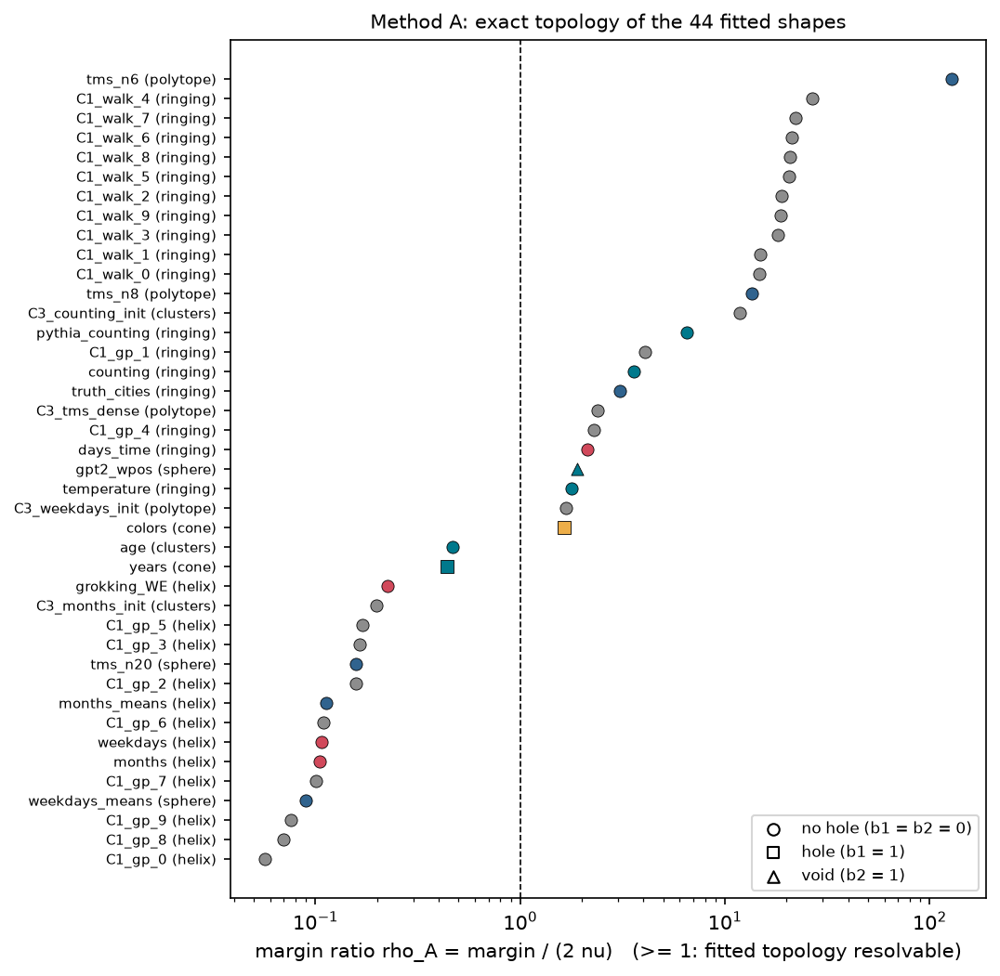

# Exp0: exact topology of the fitted shapes (Method A)

Date: 2026-11-15; wording corrected 2026-11-22 (independent audit, D14). Code: `src/neurotopo/analytic/`, `src/neurotopo/experiments/exp0_analytic.py`. Results: `results/exp0/`. Rules and derivations: [docs/analytic_topology.md](../docs/analytic_topology.md). Preregistration: sections 3, 5 and 6 (H1-A, H2-A).

## Question

The source fits each cloud with a uniquely parametrised shape. What is the exact topology of that shape, and do the data resolve it?

## Method

- `shape_topology(family, params)` gives (b0, b1, b2), χ, genus, boundary components and the margin m, the size of the smallest gap or diameter whose closing or collapse alters the topology (a feature size in data units, not a parameter change). The inputs are the fitted canonical parameters (`real_results.json`) or the regenerated ground-truth parameters (synthetic clouds).
- The **margin ratio** is ρ_A = m / (2ν), with ν = median point-to-shape distance + 95th-percentile shape-to-point distance. Both distances use the exact parametrisation (deviation D2). ρ_A ≥ 1 means the topology is resolvable, a heuristic criterion (balls of radius ν from both sides of a gap m meet once 2ν ≥ m), not a recovery theorem ([Niyogi, Smale & Weinberger 2008](https://doi.org/10.1007/s00454-008-9053-2) give one in terms of the reach).
- **Hole coordinate θ_A** is the parameter of each point's nearest point on the fit, read from 4,096-point curve grids or 256×256 surface grids. For fits with a hole (cone frustum) θ_A is the azimuth. For helix fits the azimuth is reported as **axial winding**, descriptive only, with the **closure gap**: the axial distance between the first and last concept means, divided by the radius.
- **Alignment:** concept circular means, R, a permutation p (exact for 7 concepts), and the winding number.
- **Numerical check:** alpha persistent homology of dense noise-free random samples of each fitted or ground-truth shape. Bars with π > 4 that are born below m/4 are counted. Curves use 2,000 jittered samples, because the Delaunay triangulation of points on a helix grows superlinearly ([Erickson 2003](https://doi.org/10.1007/s00454-003-2927-4): Ω(n^{3/2}) for a helix with about √n points per turn, Thm 2.3; every point is joined to every point less than a full turn away, Lemma 2.1, so a helix with T turns has about n²/T edges).

## Results

- 2 of 44 fitted shapes have a hole (b1 = 1). Both are cones, fitted to years and colours. 1 has a void (GPT-2 W_pos, a closed sphere).
- 27 of 44 fitted topologies are resolvable (ρ_A ≥ 1).
- Families fitted: ringing 17, helix 12, polytope 4, blob 3, clusters 3, sphere 3, cone 2.
- **Primary cyclic sets.** All three are helices (b1 = 0) with ρ_A = 0.11 (weekdays), 0.11 (months) and 0.23 (residues). Each is a coil of 5.7–9.7 turns, and for 12 of the 12 helix fits the margin is the spacing between adjacent turns (the pitch), not the gap between the ends. At the noise scale the turns merge into a tube with one loop around the axis, so the fit's open-curve topology is not resolvable. (The ends alone are 1.06, 1.20 and 2.56 times 2ν apart.) **H1-A: 0/3** (preregistered rule: a b1 = 0 fit fails).
- **Axial winding** (descriptive):
  - weekdays: R = 0.834, exact p = 0.003, winding 1, closure gap 0.80;
  - months: R = 0.931, winding 1, closure gap 0.04;
  - residues: R = 0.976, winding -1.
- **Not specific:** 8 of 8 Gaussian-process controls fitted as helices also wind (R = 0.86–0.98), with closure gaps of 0.33–2.20 ([fig_exp0_helix](../docs/figures/fig_exp0_helix.png)).
- **Colours (exploratory):** the cone frustum's azimuth aligns with hue (R = 0.984, winding 1). **Years:** the frustum's azimuth does not wind (winding 0).
- **Numerical check:** agreement 0.970 over 234 shapes; 0.987 where the margin exceeds 4 sample spacings. The failures are apex cones whose 0.001-unit opening is below sampling resolution, and tori whose void needs more samples: their voids are born below the counting cut, but their persistence ratio (3.4–3.7) stays below the threshold of 4 (checked in the third audit, D9).
- **Synthetic ground truth:** 0.772 of the 39,000 test clouds have resolvable topology.

<!-- BEGIN:exp0_topology -->
| id | family | b0 | b1 | b2 | chi | genus | homotopy | rho_A | resolvable |
|---|---|---|---|---|---|---|---|---|---|
| C1_gp_0 | helix | 1 | 0 | 0 | 1 | - | point | 0.06 | no |
| C1_gp_1 | ringing | 1 | 0 | 0 | 1 | - | point | 4.06 | yes |
| C1_gp_2 | helix | 1 | 0 | 0 | 1 | - | point | 0.16 | no |
| C1_gp_3 | helix | 1 | 0 | 0 | 1 | - | point | 0.16 | no |
| C1_gp_4 | ringing | 1 | 0 | 0 | 1 | - | point | 2.30 | yes |
| C1_gp_5 | helix | 1 | 0 | 0 | 1 | - | point | 0.17 | no |
| C1_gp_6 | helix | 1 | 0 | 0 | 1 | - | point | 0.11 | no |
| C1_gp_7 | helix | 1 | 0 | 0 | 1 | - | point | 0.10 | no |
| C1_gp_8 | helix | 1 | 0 | 0 | 1 | - | point | 0.07 | no |
| C1_gp_9 | helix | 1 | 0 | 0 | 1 | - | point | 0.08 | no |
| C1_walk_0 | ringing | 1 | 0 | 0 | 1 | - | point | 14.75 | yes |
| C1_walk_1 | ringing | 1 | 0 | 0 | 1 | - | point | 14.88 | yes |
| C1_walk_2 | ringing | 1 | 0 | 0 | 1 | - | point | 18.93 | yes |
| C1_walk_3 | ringing | 1 | 0 | 0 | 1 | - | point | 18.10 | yes |
| C1_walk_4 | ringing | 1 | 0 | 0 | 1 | - | point | 26.58 | yes |
| C1_walk_5 | ringing | 1 | 0 | 0 | 1 | - | point | 20.54 | yes |
| C1_walk_6 | ringing | 1 | 0 | 0 | 1 | - | point | 21.13 | yes |
| C1_walk_7 | ringing | 1 | 0 | 0 | 1 | - | point | 22.13 | yes |
| C1_walk_8 | ringing | 1 | 0 | 0 | 1 | - | point | 20.65 | yes |
| C1_walk_9 | ringing | 1 | 0 | 0 | 1 | - | point | 18.64 | yes |
| C3_gpt2_wpos_init | blob | 1 | 0 | 0 | 1 | - | point | inf | yes |
| C3_grokking_WE_init | blob | 1 | 0 | 0 | 1 | - | point | inf | yes |
| C3_grokking_WE_memorised | blob | 1 | 0 | 0 | 1 | - | point | inf | yes |
| C3_llama_counting_init | clusters | 3 | 0 | 0 | 3 | - | 3 points | 11.78 | yes |
| C3_llama_months_init | clusters | 6 | 0 | 0 | 6 | - | 6 points | 0.20 | no |
| C3_llama_weekdays_init | polytope | 4 | 0 | 0 | 4 | - | 4 points | 1.67 | yes |
| C3_tms_dense | polytope | 4 | 0 | 0 | 4 | - | 4 points | 2.38 | yes |
| R1_gpt2_wpos | sphere | 1 | 0 | 1 | 2 | 0.00 | sphere | 1.89 | yes |
| R2_grokking_WE | helix | 1 | 0 | 0 | 1 | - | point | 0.23 | no |
| R3_tms_n20 | sphere | 1 | 0 | 0 | 1 | 0.00 | point | 0.16 | no |
| R3_tms_n6 | polytope | 6 | 0 | 0 | 6 | - | 6 points | 128.39 | yes |
| R3_tms_n8 | polytope | 8 | 0 | 0 | 8 | - | 8 points | 13.47 | yes |
| R4_llama_counting | ringing | 1 | 0 | 0 | 1 | - | point | 3.60 | yes |
| R4b_pythia_counting | ringing | 1 | 0 | 0 | 1 | - | point | 6.49 | yes |
| R5a_llama_weekdays | helix | 1 | 0 | 0 | 1 | - | point | 0.11 | no |
| R5a_llama_weekdays_means | sphere | 1 | 0 | 0 | 1 | 0.00 | point | 0.09 | no |
| R5b_llama_months | helix | 1 | 0 | 0 | 1 | - | point | 0.11 | no |
| R5b_llama_months_means | helix | 1 | 0 | 0 | 1 | - | point | 0.11 | no |
| R5c_llama_days_time | ringing | 1 | 0 | 0 | 1 | - | point | 2.13 | yes |
| R6_llama_years | cone | 1 | 1 | 0 | 0 | 0.00 | circle | 0.44 | no |
| R7_llama_colors | cone | 1 | 1 | 0 | 0 | 0.00 | circle | 1.64 | yes |
| R8a_llama_temperature | ringing | 1 | 0 | 0 | 1 | - | point | 1.79 | yes |
| R8b_llama_age | clusters | 6 | 0 | 0 | 6 | - | 6 points | 0.47 | no |
| R9_llama_truth_cities | ringing | 1 | 0 | 0 | 1 | - | point | 3.07 | yes |
<!-- END:exp0_topology -->

<!-- BEGIN:exp0_alignment -->
| id | coordinate | kind | variable | R | p | winding | closure gap |
|---|---|---|---|---|---|---|---|
| C1_gp_0 | azimuth | axial winding (descriptive) | value in 7 bins | 0.855 | 0.003 | 1 | 0.330 |
| C1_gp_0 | azimuth | axial winding (descriptive) | value in 12 bins | 0.852 | 1.0e-05 | 1 | 0.432 |
| C1_gp_2 | azimuth | axial winding (descriptive) | value in 7 bins | 0.978 | 0.003 | -1 | 2.175 |
| C1_gp_2 | azimuth | axial winding (descriptive) | value in 12 bins | 0.977 | 1.0e-05 | -1 | 2.190 |
| C1_gp_3 | azimuth | axial winding (descriptive) | value in 7 bins | 0.967 | 0.003 | 1 | 1.915 |
| C1_gp_3 | azimuth | axial winding (descriptive) | value in 12 bins | 0.966 | 1.0e-05 | 1 | 1.927 |
| C1_gp_5 | azimuth | axial winding (descriptive) | value in 7 bins | 0.902 | 0.006 | 1 | 1.924 |
| C1_gp_5 | azimuth | axial winding (descriptive) | value in 12 bins | 0.899 | 1.0e-05 | 1 | 1.861 |
| C1_gp_6 | azimuth | axial winding (descriptive) | value in 7 bins | 0.943 | 0.003 | 1 | 2.197 |
| C1_gp_6 | azimuth | axial winding (descriptive) | value in 12 bins | 0.942 | 1.0e-05 | 1 | 2.185 |
| C1_gp_7 | azimuth | axial winding (descriptive) | value in 7 bins | 0.973 | 0.003 | -1 | 1.152 |
| C1_gp_7 | azimuth | axial winding (descriptive) | value in 12 bins | 0.971 | 1.0e-05 | -1 | 1.265 |
| C1_gp_8 | azimuth | axial winding (descriptive) | value in 7 bins | 0.896 | 0.003 | 1 | 0.556 |
| C1_gp_8 | azimuth | axial winding (descriptive) | value in 12 bins | 0.893 | 1.0e-05 | 1 | 0.682 |
| C1_gp_9 | azimuth | axial winding (descriptive) | value in 7 bins | 0.937 | 0.003 | 1 | 0.858 |
| C1_gp_9 | azimuth | axial winding (descriptive) | value in 12 bins | 0.935 | 1.0e-05 | 1 | 0.989 |
| R2_grokking_WE | azimuth | axial winding (descriptive) | residue (max over k) | 0.976 | 1.0e-05 | -1 | - |
| R5a_llama_weekdays | azimuth | axial winding (descriptive) | day of week | 0.834 | 0.003 | 1 | 0.797 |
| R5b_llama_months | azimuth | axial winding (descriptive) | month | 0.931 | 1.0e-05 | 1 | 0.039 |
| R5b_llama_months_means | azimuth | axial winding (descriptive) | month | 0.927 | 1.0e-05 | 1 | 0.045 |
| R6_llama_years | theta | hole | value in 7 bins | 0.536 | 0.200 | 0 | - |
| R6_llama_years | theta | hole | value in 12 bins | 0.494 | 0.034 | 0 | - |
| R6_llama_years | theta | hole | value mod 10 | 0.561 | 0.002 | 0 | - |
| R6_llama_years | theta | hole | value mod 100 | 0.351 | 1.0e-05 | 0 | - |
| R7_llama_colors | theta | hole | hue | 0.984 | 1.0e-05 | 1 | - |
<!-- END:exp0_alignment -->

**Topologically equivalent families (synthetic ground truth).** Families in the same column share a homotopy type: for example, blobs, lines, helices, ringing curves, discs and paraboloids are all contractible, while closed arcs, ellipses and cone frusta are circles up to homotopy.

<!-- BEGIN:exp0_family_homotopy -->
Clouds per family and exact ground-truth Betti vector (in brackets: resolvable, rho_A >= 1).

| family | (1, 0, 0) | (1, 0, 1) | (1, 1, 0) | (1, 2, 1) | (k, 0, 0), k >= 2 |
|---|---|---|---|---|---|
| arc | 1764 (1450) | 0 (0) | 1236 (1042) | 0 (0) | 0 (0) |
| blob | 3000 (3000) | 0 (0) | 0 (0) | 0 (0) | 0 (0) |
| clusters | 0 (0) | 0 (0) | 0 (0) | 0 (0) | 3000 (1843) |
| cone | 0 (0) | 0 (0) | 3000 (1340) | 0 (0) | 0 (0) |
| disc | 3000 (3000) | 0 (0) | 0 (0) | 0 (0) | 0 (0) |
| ellipse | 0 (0) | 0 (0) | 3000 (2092) | 0 (0) | 0 (0) |
| helix | 3000 (1658) | 0 (0) | 0 (0) | 0 (0) | 0 (0) |
| line | 3000 (2966) | 0 (0) | 0 (0) | 0 (0) | 0 (0) |
| paraboloid | 3000 (3000) | 0 (0) | 0 (0) | 0 (0) | 0 (0) |
| polytope | 0 (0) | 0 (0) | 0 (0) | 0 (0) | 3000 (2932) |
| ringing | 3000 (2803) | 0 (0) | 0 (0) | 0 (0) | 0 (0) |
| sphere | 2021 (1353) | 979 (767) | 0 (0) | 0 (0) | 0 (0) |
| torus | 0 (0) | 0 (0) | 0 (0) | 3000 (868) | 0 (0) |
<!-- END:exp0_family_homotopy -->

## Interpretation

- A fitted helix is topologically an open curve. For the cyclic concepts, though, ρ_A = 0.11 (weekdays), 0.11 (months) and 0.23 (residues), and the margin is the pitch: the fitted coils' adjacent turns are closer than twice the noise scale, so at that scale each fit is a tube with one loop around its axis, like a thickened closed ring. Whether the fit is an open or a closed curve is therefore **unresolvable**. That is not evidence of closure; closure is read from the data (closure gap below, Exp2).
- For prompt-template designs (7 or 12 tight clusters), the coverage term of ν is dominated by the gaps between clusters, so a low ρ_A is largely a property of the design.
- The concepts sit around the helix axis in cyclic order, but so do the indices of smooth random processes that the fitter also calls helices, with the same minimum permutation p and winding ±1.
- **Only months stand out by closure:** a gap of 0.04 radii, below the controls' range (0.33–2.20). The weekdays' gap (0.80) lies inside it.
- Method A therefore cannot by itself establish a semantic hole here.

## Learnings

- **What went wrong, and the fix:**
  - The source's coarse dense samples (24×24 surface grids) overstate point-to-shape distances; the fix was exact parametrisations (D2).
  - Noise-free samples on a helix produced a Delaunay triangulation large enough to exhaust 10 GB (superlinear size; see the method above); the fix was fewer samples plus jitter.
  - Persistence of dense samples finds loops at the margin scale (near-closures). Counting only features born below m/4 separates the exact topology from near-closures. Every real helix fit has one such loop: at the scale of its pitch, adjacent turns merge into a tube around the axis (independent audit, D14; not the ends meeting).
- **Decisions:** the source's own 0.98 thresholds define closed arcs and spheres, so the topology of a fit is exactly what the source reports.
