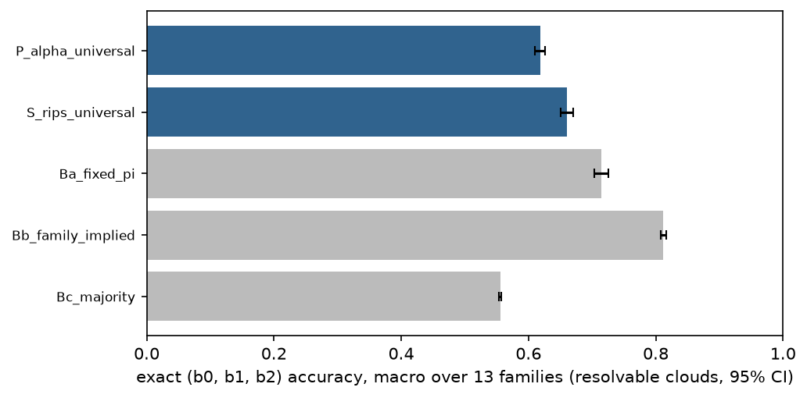
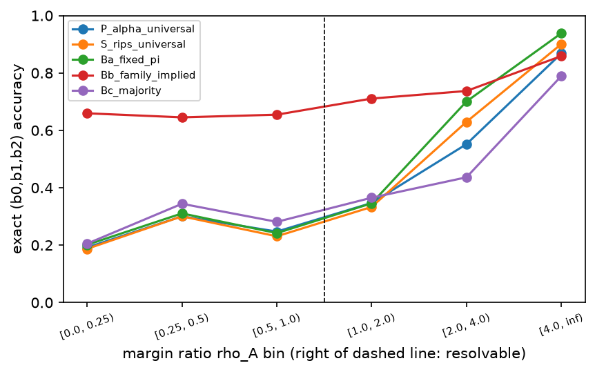

# Exp1: validation of the persistent-homology Betti estimators (H5)

Date: 2026-11-15. Code: `src/neurotopo/experiments/exp1_synthetic.py`, `src/neurotopo/tda/estimators.py`. Results: `results/exp1/`.

## Question

How well do persistent-homology estimators recover the exact topology of noisy point clouds? How does that compare with reading topology off the source fitter's predicted family?

## Data

- The source's fixed synthetic test set: 39,000 clouds, 13 families × 4 N-bins (5–1024 points) × 3 noise bins. Each cloud comes with its **exact ground-truth parameters**, regenerated bit-exactly on CUDA.
- Ground truth is Method A on those parameters. Only resolvable clouds are scored (ρ_A ≥ 1): 30114 clouds, a fraction of 0.772.

## Estimators

- **P (preregistered):** alpha-complex universal null (Bobrowski & Skraba 2023, A = ½, Bonferroni) for b1 and b2, plus single-linkage b0 (τ = 12.0, minimum component fraction 0.02, tuned on validation).
- **S (D1):** Rips-H1 universal null (A = 1).
- **Ba:** fixed thresholds, π > 3.0 for H1 and π > 1.4 for H2, tuned on validation.
- **Bb:** the source method's predicted family mapped to its modal ground-truth Betti vector (validation).
- **Bc:** the majority vector.
- **MC:** a 3D matched-Gaussian Monte Carlo null, 99 draws, on the 3,120-cloud subset.

**Metric:** exact (b0, b1, b2) accuracy, macro-averaged over families. Polytope is scored on b0 only. CIs are a cluster bootstrap over generator chunks of 25 clouds, with 2,000 resamples.

## Results

- **P:** 0.618 [0.610, 0.626]
- **S:** 0.660 [0.651, 0.670]
- **Ba:** 0.714 [0.703, 0.725]
- **Bb:** 0.812 [0.807, 0.816]
- **Bc:** 0.555 [0.553, 0.557]
- **MC (subset):** 0.594 [0.561, 0.629]
- **Paired differences (P minus comparator):**
  - vs Ba: -0.096 [-0.108, -0.084]
  - vs Bb: -0.194 [-0.203, -0.185]
  - vs Bc: 0.063 [0.055, 0.071]
- **H5:** the preregistered estimator is significantly *worse* than the fixed-threshold and family-implied baselines, and better than the majority vector.
- **Well-resolved topology (ρ_A ≥ 4):** P 0.87, S 0.90, Ba 0.94, Bb 0.86.
- **False positives** (any hole on resolvable contractible shapes): 0.019–0.054 per N-bin for P.

<!-- BEGIN:exp1 -->
| estimator | macro exact accuracy | 95% CI | n clouds |
|---|---|---|---|
| P_alpha_universal | 0.618 | [0.610, 0.626] | 30114 |
| S_rips_universal | 0.660 | [0.651, 0.670] | 30114 |
| Ba_fixed_pi | 0.714 | [0.703, 0.725] | 30114 |
| Bb_family_implied | 0.812 | [0.807, 0.816] | 30114 |
| Bc_majority | 0.555 | [0.553, 0.557] | 30114 |
| MC_gaussian3d (subset) | 0.594 | [0.561, 0.629] | 2427 |
| P_alpha_universal (subset) | 0.615 | [0.588, 0.644] | 2427 |
| S_rips_universal (subset) | 0.674 | [0.640, 0.703] | 2427 |

Paired differences (primary minus comparator):

| comparison | difference | 95% CI |
|---|---|---|
| P - S_rips_universal | -0.042 | [-0.051, -0.033] |
| P - Ba_fixed_pi | -0.096 | [-0.108, -0.084] |
| P - Bb_family_implied | -0.194 | [-0.203, -0.185] |
| P - Bc_majority | 0.063 | [0.055, 0.071] |

False-positive rate (b1 >= 1 or b2 >= 1) on resolvable contractible clouds, by N-bin:

| estimator | N-bin 0 | N-bin 1 | N-bin 2 | N-bin 3 |
|---|---|---|---|---|
| P_alpha_universal | 0.019 | 0.039 | 0.054 | 0.038 |
| S_rips_universal | 0.003 | 0.051 | 0.084 | 0.077 |
| Ba_fixed_pi | 0.000 | 5.0e-04 | 0.010 | 0.047 |
| Bb_family_implied | 0.110 | 0.020 | 0.004 | 0.003 |
| Bc_majority | 0.000 | 0.000 | 0.000 | 0.000 |

Universal-null calibration on blobs (FWER = fraction with any significant alpha H1 bar):

| N-bin | fwer_alpha_universal | ks_uniform_D | n_pvalues |
|---|---|---|---|
| 0 | 0.003 | 0.118 | 1133.000 |
| 1 | 0.003 | 0.074 | 12182.000 |
| 2 | 0.000 | 0.048 | 77109.000 |
| 3 | 0.000 | 0.035 | 444404.000 |

Per-family exact accuracy (resolvable clouds):

| family | P_alpha_universal | S_rips_universal | Ba_fixed_pi | Bb_family_implied | Bc_majority |
|---|---|---|---|---|---|
| arc | 0.651 | 0.753 | 0.788 | 0.576 | 0.582 |
| blob | 0.990 | 0.986 | 0.998 | 0.945 | 1.000 |
| clusters | 0.340 | 0.339 | 0.341 | 0.328 | 0.000 |
| cone | 0.007 | 0.334 | 0.534 | 0.943 | 0.000 |
| disc | 0.974 | 0.963 | 0.985 | 0.954 | 1.000 |
| ellipse | 0.257 | 0.546 | 0.509 | 0.990 | 0.000 |
| helix | 0.783 | 0.654 | 0.861 | 0.987 | 1.000 |
| line | 0.953 | 0.952 | 0.963 | 0.991 | 1.000 |
| paraboloid | 0.968 | 0.956 | 0.984 | 0.911 | 1.000 |
| polytope | 0.500 | 0.500 | 0.500 | 0.351 | 0.000 |
| ringing | 0.928 | 0.927 | 0.947 | 0.970 | 1.000 |
| sphere | 0.687 | 0.675 | 0.761 | 0.609 | 0.638 |
| torus | 0.000 | 0.000 | 0.111 | 1.000 | 0.000 |

Resolvable fraction of test clouds: 0.772.
<!-- END:exp1 -->

## Interpretation

- **Where persistent homology adds information beyond the family label:** whenever the label does not fix the topology. Open vs closed arcs: 0.79 vs 0.58. Caps vs full spheres: 0.76 vs 0.61.
- **Where it loses:** wherever the label fixes the topology but the hole is thin or two-dimensional. Ellipses: 0.51 vs 0.99. Tori: 0.11 vs 1.00. Frusta: 0.53 vs 0.94.
- **The alpha-complex universal null is calibrated but conservative.** Its family-wise error on blobs is about 0. This is why it loses to a tuned threshold (deviation D1).

## Learnings

- At N ≤ 1024 the universal null of Bobrowski & Skraba is too conservative for alpha complexes in ℝ³. A Rips complex (A = 1) or a tuned threshold is more powerful.
- Resolvability (ρ_A) is the main determinant of accuracy, so reporting accuracy against ρ_A is essential.
- The tuned b0 rule chose the largest τ in the grid (deviation note A1). The clusters family is the weakest b0 case.
