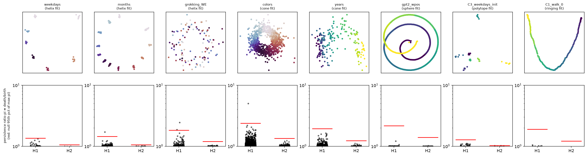
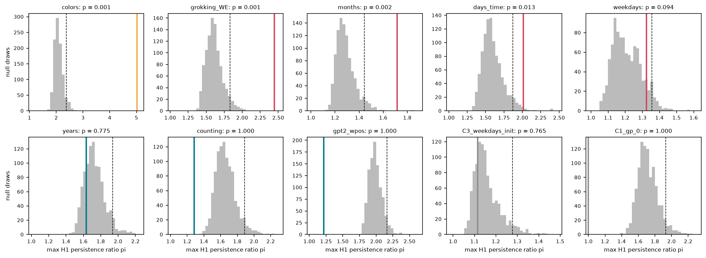

# Exp2: persistent-homology invariants of the 44 real clouds (Method B)

Date: 2026-11-15; wording corrected 2026-11-22 (independent audit, D14). Code: `src/neurotopo/experiments/exp2_invariants.py`, `realdata.py`. Results: `results/exp2/`, with nulls cached in `results/nulls/`.

## Method

- **Alpha diagrams** (H0–H2, radius units) of each source-identical, RMS-normalised top-3 PCA cloud. The recomputed clouds match the source's stored points to better than 1e-3 of their scale.
- **Significance:** the maximum persistence ratio π = death/birth is compared with 999 draws of a design-matched null.
  - Cluster-centre null for prompt-template designs: weekdays, months, days_time, colours (concept = hue), and the random-init weekday and month controls.
  - Full-dimensional matched-covariance Gaussian for everything else.
  - Every null draw passes through the same top-3 PCA normalisation.
- **Descriptive extras:**
  - universal-null counts for alpha (A = ½) and Rips (A = 1);
  - b0 by the tuned single-linkage rule;
  - all three Betti numbers, χ and a Betti label at the characteristic scale r_c (b0 is read at r_c too since deviation D12; the label is not a homotopy class, because Betti numbers do not determine one);
  - genus, reported only for closed surfaces;
  - stability: the fraction of 200 subsamples of 80% (source seeds) whose top π exceeds the full cloud's null threshold.

## Results

- **8 clouds have a significant loop and 6 a significant void.** The loops:
  - colours: π = 5.02 vs 2.38, p = 0.001, stable in 1.00 of subsamples;
  - grokked residues: 2.45 vs 1.83, p = 0.001, stability 0.26;
  - months: 1.72 vs 1.44, p = 0.002, stability 0.90;
  - month means: p = 0.001;
  - days with times: 2.01 vs 1.87, p = 0.013, stability 0.03; a small loop inside one day's cluster (bar [0.022, 0.045], clusters first touch at 0.160; audit D8);
  - the grokking model at initialisation (p = 0.046, borderline);
  - the toy-model clouds of superposition (5–8 points).
- **Weekdays have no significant loop** (π = 1.32 vs 1.36, p = 0.094). That most persistent bar is a small loop inside one day's cluster (it dies at 0.032; clusters first touch at 0.192), and the 7 day centres alone have no loop (π = 1.05).
- **No ordinal concept has a loop** (0/6), and neither do the 20 random-process controls (0/20; max π 1.37). These open curves were never at risk: their top π (1.00–1.63) is far below the Gaussian null's 95th percentile (1.79–2.16), because a blob of the same spread has more loops than a curve.
- **GPT-2 W_pos:** fitted as a closed sphere (Method A void), but there is no significant void in the data (H2 π = 1.02). The positions trace a spiral curve, not a surface.
- **Truth cities (exploratory prediction, preregistration section 6: b0 = 2, true vs false statements):** not supported. The tuned single-linkage rule gives b0 = 1, and b0 at the characteristic scale (the pieces of the alpha complex there) is 1. Its Betti label is acyclic.
- **Agreement between Method A and Method B (b1, b2):** 0.705.
- **Benjamini–Hochberg over the 44 loop tests (post hoc, D6):** 6 loops at q < 0.05: C3_tms_dense, R2_grokking_WE, R3_tms_n8, R5b_llama_months, R5b_llama_months_means, R7_llama_colors.

<!-- BEGIN:exp2 -->
| id | N | design | top_pi1 | null_q95_pi1 | p_top_loop | top_pi2 | null_q95_pi2 | p_top_void | b0_rc | b1_rc | b2_rc | chi_rc | genus_rc | betti_label_rc | b1_alpha_univ | b1_rips_univ | loop_freq | family | A_b1 | A_b2 |
|---|---|---|---|---|---|---|---|---|---|---|---|---|---|---|---|---|---|---|---|---|
| C1_gp_0 | 200 | gaussian | 1.000 | 1.931 | 1.000 | 1.000 | 1.205 | 1.000 | 1 | 0 | 0 | 1 | - | acyclic | 0 | 0 | 0.000 | helix | 0 | 0 |
| C1_gp_1 | 200 | gaussian | 1.159 | 1.948 | 1.000 | 1.009 | 1.245 | 1.000 | 1 | 0 | 0 | 1 | - | acyclic | 2 | 0 | 0.000 | ringing | 0 | 0 |
| C1_gp_2 | 200 | gaussian | 1.088 | 1.923 | 1.000 | 1.011 | 1.236 | 1.000 | 1 | 0 | 0 | 1 | - | acyclic | 2 | 0 | 0.000 | helix | 0 | 0 |
| C1_gp_3 | 200 | gaussian | 1.164 | 1.941 | 1.000 | 1.093 | 1.243 | 0.955 | 1 | 0 | 0 | 1 | - | acyclic | 3 | 0 | 0.000 | helix | 0 | 0 |
| C1_gp_4 | 200 | gaussian | 1.002 | 1.948 | 1.000 | 1.004 | 1.197 | 1.000 | 1 | 0 | 0 | 1 | - | acyclic | 1 | 0 | 0.000 | ringing | 0 | 0 |
| C1_gp_5 | 200 | gaussian | 1.369 | 1.928 | 1.000 | 1.054 | 1.244 | 1.000 | 1 | 0 | 0 | 1 | - | acyclic | 1 | 0 | 0.000 | helix | 0 | 0 |
| C1_gp_6 | 200 | gaussian | 1.133 | 1.955 | 1.000 | 1.064 | 1.239 | 0.996 | 1 | 0 | 0 | 1 | - | acyclic | 2 | 0 | 0.000 | helix | 0 | 0 |
| C1_gp_7 | 200 | gaussian | 1.046 | 1.938 | 1.000 | 1.047 | 1.234 | 1.000 | 1 | 0 | 0 | 1 | - | acyclic | 3 | 0 | 0.000 | helix | 0 | 0 |
| C1_gp_8 | 200 | gaussian | 1.005 | 1.941 | 1.000 | 1.005 | 1.205 | 1.000 | 1 | 0 | 0 | 1 | - | acyclic | 1 | 0 | 0.000 | helix | 0 | 0 |
| C1_gp_9 | 200 | gaussian | 1.020 | 1.924 | 1.000 | 1.001 | 1.216 | 1.000 | 1 | 0 | 0 | 1 | - | acyclic | 2 | 0 | 0.000 | helix | 0 | 0 |
| C1_walk_0 | 200 | gaussian | 1.053 | 1.901 | 1.000 | 1.000 | 1.215 | 1.000 | 1 | 0 | 0 | 1 | - | acyclic | 0 | 0 | 0.000 | ringing | 0 | 0 |
| C1_walk_1 | 200 | gaussian | 1.118 | 1.914 | 1.000 | 1.000 | 1.213 | 1.000 | 1 | 0 | 0 | 1 | - | acyclic | 0 | 0 | 0.000 | ringing | 0 | 0 |
| C1_walk_2 | 200 | gaussian | 1.065 | 1.916 | 1.000 | 1.000 | 1.212 | 1.000 | 1 | 0 | 0 | 1 | - | acyclic | 0 | 0 | 0.000 | ringing | 0 | 0 |
| C1_walk_3 | 200 | gaussian | 1.101 | 1.905 | 1.000 | 1.000 | 1.213 | 1.000 | 1 | 0 | 0 | 1 | - | acyclic | 0 | 0 | 0.000 | ringing | 0 | 0 |
| C1_walk_4 | 200 | gaussian | 1.180 | 1.922 | 1.000 | 1.003 | 1.215 | 1.000 | 1 | 0 | 0 | 1 | - | acyclic | 0 | 0 | 0.000 | ringing | 0 | 0 |
| C1_walk_5 | 200 | gaussian | 1.104 | 1.917 | 1.000 | 1.002 | 1.214 | 1.000 | 1 | 0 | 0 | 1 | - | acyclic | 0 | 0 | 0.000 | ringing | 0 | 0 |
| C1_walk_6 | 200 | gaussian | 1.065 | 1.956 | 1.000 | 1.006 | 1.216 | 1.000 | 1 | 0 | 0 | 1 | - | acyclic | 0 | 0 | 0.000 | ringing | 0 | 0 |
| C1_walk_7 | 200 | gaussian | 1.074 | 1.932 | 1.000 | 1.000 | 1.220 | 1.000 | 1 | 0 | 0 | 1 | - | acyclic | 0 | 0 | 0.000 | ringing | 0 | 0 |
| C1_walk_8 | 200 | gaussian | 1.086 | 1.904 | 1.000 | 1.000 | 1.216 | 1.000 | 1 | 0 | 0 | 1 | - | acyclic | 0 | 0 | 0.000 | ringing | 0 | 0 |
| C1_walk_9 | 200 | gaussian | 1.352 | 1.923 | 1.000 | 1.000 | 1.213 | 1.000 | 1 | 0 | 0 | 1 | - | acyclic | 0 | 0 | 0.000 | ringing | 0 | 0 |
| C3_gpt2_wpos_init | 1023 | gaussian | 2.028 | 2.169 | 0.299 | 1.437 | 1.397 | 0.020 | 1 | 0 | 1 | 2 | 0.000 | sphere-like | 0 | 0 | 0.060 | blob | 0 | 0 |
| C3_grokking_WE_init | 113 | gaussian | 1.841 | 1.830 | 0.046 | 1.149 | 1.192 | 0.191 | 2 | 1 | 0 | 1 | - | other (2,1,0) | 0 | 0 | 0.015 | blob | 0 | 0 |
| C3_grokking_WE_memorised | 113 | gaussian | 1.502 | 1.829 | 0.831 | 1.098 | 1.188 | 0.612 | 1 | 0 | 0 | 1 | - | acyclic | 0 | 0 | 0.050 | blob | 0 | 0 |
| C3_llama_counting_init | 150 | gaussian | 1.536 | 1.871 | 0.881 | 1.033 | 1.208 | 1.000 | 1 | 0 | 0 | 1 | - | acyclic | 0 | 0 | 0.005 | clusters | 0 | 0 |
| C3_llama_months_init | 144 | cluster | 1.430 | 1.463 | 0.074 | 1.013 | 1.058 | 0.863 | 4 | 0 | 0 | 4 | - | 4 components | 0 | 0 | 0.045 | clusters | 0 | 0 |
| C3_llama_weekdays_init | 49 | cluster | 1.114 | 1.277 | 0.765 | 1.030 | 1.029 | 0.045 | 17 | 0 | 1 | 18 | - | other (17,0,1) | 0 | 0 | 0.020 | polytope | 0 | 0 |
| C3_tms_dense | 5 | gaussian | 1.235 | 1.118 | 0.001 | 1.001 | 1.000 | 0.019 | 1 | 1 | 0 | 0 | - | circle-like | 0 | 0 | 0.410 | polytope | 0 | 0 |
| R1_gpt2_wpos | 1023 | gaussian | 1.217 | 2.163 | 1.000 | 1.025 | 1.393 | 1.000 | 1 | 0 | 0 | 1 | - | acyclic | 2 | 1 | 0.000 | sphere | 0 | 1 |
| R2_grokking_WE | 113 | gaussian | 2.446 | 1.830 | 0.001 | 1.049 | 1.199 | 0.990 | 1 | 2 | 0 | -1 | - | other (1,2,0) | 0 | 0 | 0.260 | helix | 0 | 0 |
| R3_tms_n20 | 20 | gaussian | 1.339 | 1.437 | 0.191 | 1.470 | 1.062 | 0.001 | 1 | 0 | 1 | 2 | 0.000 | sphere-like | 0 | 0 | 0.350 | sphere | 0 | 0 |
| R3_tms_n6 | 6 | gaussian | 1.155 | 1.183 | 0.087 | 1.224 | 1.013 | 0.001 | 1 | 0 | 1 | 2 | 0.000 | sphere-like | 0 | 0 | 0.000 | polytope | 0 | 0 |
| R3_tms_n8 | 8 | gaussian | 1.409 | 1.244 | 0.004 | 1.176 | 1.021 | 0.001 | 1 | 0 | 1 | 2 | 0.000 | sphere-like | 0 | 1 | 0.735 | polytope | 0 | 0 |
| R4_llama_counting | 150 | gaussian | 1.285 | 1.888 | 1.000 | 1.018 | 1.192 | 1.000 | 1 | 0 | 0 | 1 | - | acyclic | 0 | 0 | 0.000 | ringing | 0 | 0 |
| R4b_pythia_counting | 150 | gaussian | 1.323 | 1.869 | 1.000 | 1.026 | 1.184 | 1.000 | 1 | 0 | 0 | 1 | - | acyclic | 0 | 0 | 0.000 | ringing | 0 | 0 |
| R5a_llama_weekdays | 49 | cluster | 1.324 | 1.356 | 0.094 | 1.006 | 1.054 | 0.518 | 5 | 0 | 0 | 5 | - | 5 components | 0 | 0 | 0.010 | helix | 0 | 0 |
| R5a_llama_weekdays_means | 7 | gaussian | 1.052 | 1.190 | 0.731 | 1.017 | 1.020 | 0.072 | 1 | 0 | 0 | 1 | - | acyclic | 0 | 0 | 0.125 | sphere | 0 | 0 |
| R5b_llama_months | 144 | cluster | 1.717 | 1.443 | 0.002 | 1.019 | 1.059 | 0.743 | 1 | 1 | 0 | 0 | - | circle-like | 0 | 1 | 0.900 | helix | 0 | 0 |
| R5b_llama_months_means | 12 | gaussian | 1.712 | 1.334 | 0.001 | 1.025 | 1.040 | 0.152 | 1 | 1 | 0 | 0 | - | circle-like | 0 | 0 | 0.340 | helix | 0 | 0 |
| R5c_llama_days_time | 336 | cluster | 2.011 | 1.873 | 0.013 | 1.061 | 1.093 | 0.268 | 8 | 1 | 0 | 7 | - | other (8,1,0) | 0 | 0 | 0.030 | ringing | 0 | 0 |
| R6_llama_years | 199 | gaussian | 1.635 | 1.937 | 0.775 | 1.124 | 1.234 | 0.739 | 1 | 0 | 0 | 1 | - | acyclic | 0 | 0 | 0.080 | cone | 1 | 0 |
| R7_llama_colors | 900 | cluster | 5.025 | 2.379 | 0.001 | 1.244 | 1.346 | 0.480 | 1 | 1 | 0 | 0 | - | circle-like | 0 | 1 | 1.000 | cone | 1 | 0 |
| R8a_llama_temperature | 150 | gaussian | 1.334 | 1.889 | 1.000 | 1.020 | 1.190 | 1.000 | 1 | 0 | 0 | 1 | - | acyclic | 0 | 0 | 0.000 | ringing | 0 | 0 |
| R8b_llama_age | 99 | gaussian | 1.580 | 1.792 | 0.449 | 1.001 | 1.166 | 1.000 | 1 | 0 | 0 | 1 | - | acyclic | 0 | 0 | 0.045 | clusters | 0 | 0 |
| R9_llama_truth_cities | 1496 | gaussian | 1.931 | 2.202 | 0.861 | 1.287 | 1.411 | 0.672 | 1 | 0 | 0 | 1 | - | acyclic | 0 | 0 | 0.030 | ringing | 0 | 0 |
<!-- END:exp2 -->

Grey: Monte Carlo null distribution of the largest H1 persistence ratio (999 design-matched draws). Dashed: its 95th percentile. Solid: the observed largest ratio.

## Interpretation

- Topology detects loops through the concept clusters in three cyclic sets (hue, residues mod 113, months). The days_time loop lies inside one day's cluster. Topology detects no loop in weekdays, ordinal concepts or random-process controls, and a borderline one in the random-init grokking embedding.
- **The hue loop is in the stimuli.** The colour prompts' own RGB values have the loop too (π = 8.01 vs null 2.76, p = 0.001; [exp7_audit.md](exp7_audit.md)). The model reads hex codes, so its loop is not trivial, but any continuous encoding of the stimulus colour would have it.
- **A loop is not traversal.** The days_time loop is not a ring of days at all. The residue loop is unstable under subsampling (stability 0.26; 0.33 against a size-matched threshold), most likely because its top PCA eigenvalues are nearly equal (0.099 vs 0.096 for the 3rd and 4th), so subsamples rotate the top-3 view.
- **Weekdays are the exception.** The 7 day centres form no loop in the top-3 PCs, and the most persistent loop of the cloud lies inside one cluster. For 7 evenly spaced point-like centres the polygon's loop has π = 1/sin(π/7) ≈ 2.3 (spread within the clusters can raise it), and the power simulation shows that the loop test has limited power at 7 clusters, but here there is no polygon loop to detect.
- **A loop is not a hole (third audit, D9).** Both nulls are Gaussian, so a significant loop means "more persistent than a covariance-matched Gaussian". On synthetic clouds of known topology, the design-(b) null flags loops on 0.17 of hole-free clouds (spheres and caps 0.73, paraboloids 0.37). Hole claims need independent evidence: the traversal, the localisation, and the concept centres alone ([exp8_audit3.md](exp8_audit3.md)).
- **Caveats:** among the random-init controls, the grokking embedding's loop (p = 0.046, q = 0.25) and the GPT-2 and weekday voids (p = 0.020 and 0.045) cross the 5% line; with 44 tests per dimension about 2 chance hits each are expected, and none survives Benjamini–Hochberg. The dense toy model's loop does survive (q = 0.011): it is a 4-cycle of its 5-point polytope ([loops.md](loops.md)), real geometry rather than a chance hit. The days_time loop is unstable under subsampling. For prompt-template designs, the maximum-π statistic does not say *where* a loop lives; the audit's localisation check (D8) is needed to tell a ring of concepts from a loop inside one cluster.

## Learnings

- The cluster-centre null matters. With a plain Gaussian null, any arrangement of tight clusters would look "loopy".
- Stability under subsampling separates robust loops (colours 1.00, months 0.90) from fragile ones (days_time 0.03). The threshold should be computed at the subsample size, and near-equal PCA eigenvalues make any top-3 view unstable (audit, D8).
- A significant maximum-π loop in a clustered design must be localised: check whether it dies before the clusters touch.
