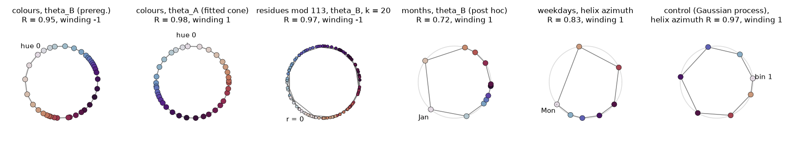

# Exp3: do semantically cyclic concepts travel around a hole? (H1–H4; post hoc D5)

Date: 2026-11-15. Code: `src/neurotopo/experiments/exp3_cyclic.py`, `exp3_posthoc.py`, `alignment.py`. Results: `results/exp3/`. Inspired by manifold steering ([Wurgaft et al. 2026](https://arxiv.org/abs/2605.05115)).

## Preregistered tests

- **H1-A** (Method A): the fitted shape has a resolvable hole, and θ_A alignment passes (Holm) with winding ±1.
- **H1-B** (Method B):
  - (a) a significant alpha loop;
  - (b) θ_B (DREiMac, `standard_range=True`) alignment, Holm-corrected over 6 tests;
  - (c) |winding| = 1;
  - (d) the same in the top-10 PCs.
- **H2:** the conjunctions fail on the 6 ordinal sets (7 and 12 bins), the 3 random-init controls and the 20 random-process controls.
- **H3:** days_time, day phase.
- **H4:** balanced accuracy of three criteria for separating cyclic from ordinal sets.

## Results

- **H1-A: 0/3.** All three primary fits are helices.
- **H1-B: 0/3.**
  - Weekdays: (a) no.
  - Months: (a) yes, but (b)–(d) no. DREiMac built no coordinate, because the Rips class's death is less than twice its birth.
  - Residues: (a) yes, (b) yes (Holm p = 6.0e-05), (c) yes, (d) no.
- **H2:** Method A not falsified, Method B not falsified. Ordinal sets passing: 0/6. Init controls: 0/3. Random-process controls: 0/20.
- **H3:** Method A fail, Method B fail.
- **H4:** balanced accuracy 0.50 (hole only, Method A), 0.50 (conjunction A), 0.50 (conjunction B). No criterion identified any cyclic set under the strict conjunctions.
- **Exploratory, colours:** a loop with hue alignment R = 0.949, winding -1.

## Post hoc (deviation D5): θ_B with `standard_range=False`

This changes no verdict.
- **Months:** 3D R = 0.72 (p = 1.0e-05), winding 1; top-10 R = 0.31, winding 0.
- **Residues:** 3D R = 0.96, winding -1; top-10 R = 0.20, winding 0.
- **Colours:** 3D R = 0.94, winding -1; top-10 R = 0.97, winding -1.
- **Weekdays:** 3D R = 0.06, winding 0.
- **Days with times (day):** 3D R = 0.18, winding 0. Its Rips class [0.40, 0.43] does not overlap the significant alpha bar (overlap: no; audit D8), so this coordinate does not describe the significant loop, which lies inside one day's cluster.
- **Overlap of the relaxed-range class with the significant alpha bar (audit D8):** months yes, residues yes, colours yes, weekdays no, days_time no.
- **Month means (12 points):** 3D R = 0.83, winding 1; top-10 winding 1.
- **Non-cyclic records with |winding| = 1** (ordinal sets and random-process controls, 3D and top-10): 1.

<!-- BEGIN:exp3 -->
H1 (co-primary): Method A: 0/3 datasets pass, Method B: 0/3 datasets pass

| dataset | method | p raw | p Holm | pass | hole_resolvable | traversal | a_loop | b_align | c_wind1 | d_top10 |
|---|---|---|---|---|---|---|---|---|---|---|
| R5a_llama_weekdays | A | 1.000 | 1.000 | no | no | no | - | - | - | - |
| R5a_llama_weekdays | B | 1.000 | 1.000 | no | - | - | no | no | no | no |
| R5b_llama_months | A | 1.000 | 1.000 | no | no | no | - | - | - | - |
| R5b_llama_months | B | 1.000 | 1.000 | no | - | - | yes | no | no | no |
| R2_grokking_WE | A | 1.000 | 1.000 | no | no | no | - | - | - | - |
| R2_grokking_WE | B | 1.0e-05 | 6.0e-05 | no | - | - | yes | yes | yes | no |

H2 (specificity):

| method | ordinal sets passing (of 6) | init controls passing (of 3) | C1 controls passing (of 20) | C1 rate 95% CI | falsified |
|---|---|---|---|---|---|
| A | 0 | 0 | 0 | [0.00, 0.17] | no |
| B | 0 | 0 | 0 | [0.00, 0.17] | no |

H3 (R5c day phase): Method A: fail, Method B: fail

H4 balanced accuracy (cyclic vs ordinal): hole_only_A 0.500, conj_A 0.500, conj_B 0.500; exact McNemar: hole_only_A vs conj_A p = 1.000, hole_only_A vs conj_B p = 1.000, conj_A vs conj_B p = 1.000

Exploratory alignment records (BH q-values):

| id | method | variable | R | p | q_bh | winding | loop | kind |
|---|---|---|---|---|---|---|---|---|
| R7_llama_colors | B | hue | 0.949 | 1.0e-05 | 1.3e-05 | -1 | yes | - |
| R7_llama_colors | A | hue | 0.984 | 1.0e-05 | 1.3e-05 | 1 | - | hole |
| R5b_llama_months_means | A | month | 0.927 | 1.0e-05 | 1.3e-05 | 1 | - | axial winding (descriptive) |
| R6_llama_years | A | value mod 10 | 0.561 | 0.002 | 0.002 | 0 | - | hole |
| R6_llama_years | A | value mod 100 | 0.351 | 1.0e-05 | 1.3e-05 | 0 | - | hole |
<!-- END:exp3 -->

Each dot is one concept, placed at the circular mean of its points' hole angle and coloured by its position in the semantic cycle. Chords join consecutive concepts. Going round once in order gives a single non-crossing polygon (winding ±1).

## Interpretation

- **The strict preregistered answer is negative.** No primary cyclic set passes all conditions.
  - The residues come closest, failing only the top-10-PC check.
  - Months fail at the coordinate-construction step, not at the alignment.
  - Weekdays fail at the loop step: the 7 day centres form no loop, and the cloud's most persistent loop lies inside one day's cluster (audit D8).
- **Specificity holds, but it is weakly informative.**
  - No ordinal or control set passes any conjunction.
  - Sensitivity is zero, though: H4 balanced accuracy is 0.5 for every criterion.
  - The ordinal and random-process controls are open curves, whose loop statistics never approach the null threshold, so they barely exercise the test. The random-init networks are the informative calibration (1 of 3 below 0.05).
- **Post hoc,** the semantic order goes around the loop once in 3D for colours, residues and months. Days_time has no ring of days to go around. Only colours keep a winding loop in the top-10 PCs, so in 10 dimensions winding separates 1 of 5 cyclic sets from the ordinal sets, not the cyclic concepts as a group.
- **The colour result is confounded by the input.** The colour prompts' RGB values already have the hue loop, and hue winds once around it (audit D8). The colour traversal therefore shows that the model preserves the input's hue circle.
- **The alignment R and its permutation p measure ordering, not looping.** For example, nearly constant coordinates of random-process controls give small p with tiny R. Only winding ±1 carries the cyclic claim. The cyclic-order check was fixed to require a single winding (D6).
- **DREiMac class vs alpha bar overlap** (preregistration §4.6): colours yes, residues yes.

## Learnings

- **DREiMac's `standard_range` matters for clustered designs.** A loop of 12 tight clusters can be significant yet have a Rips death/birth ratio below 2. A preregistration should state what happens in that case; here it counted as a failure (D3).
- **The top-10-PC check is demanding.** Grokked embeddings carry several Fourier frequencies, so in 10 dimensions the single top-3 circle is no longer the dominant loop.
