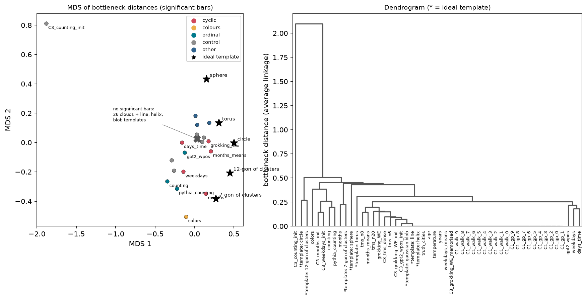
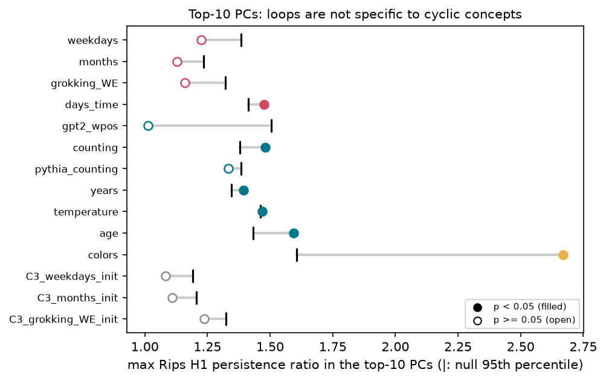

# Exp4 (similarity) and Exp5 (robustness)

Date: 2026-11-15. Code: `src/neurotopo/experiments/exp4_similarity.py`, `exp5_robustness.py`. Results: `results/exp4/`, `results/exp5/`.

## Exp4: topological similarity (exploratory)

**Method.** The distance between two clouds is the bottleneck distance between their diagrams of significant bars (H0 from the b0 cut; H1 and H2 under the design-matched null), summed over dimensions. It is computed for the 44 clouds and 8 ideal templates (circle, rings of 7 and 12 clusters, helix, sphere, torus, line, blob), followed by MDS, a dendrogram, the nearest template, and an exact cohesion test of the cyclic group against all 4-subsets of the 10 cyclic and ordinal sets.

**Result.**
- The cyclic group is not cohesive: exact p = 0.581.
- Almost every cloud is nearest to the topologically trivial templates (helix / line / blob, tied). Only months is nearest a ring of clusters.
- Even colours, with π ≈ 5, is closest to the trivial templates. Its loop bar is short in absolute radius units, and the bottleneck distance works in absolute units.

**Learning.** Bottleneck distance in absolute radius units is dominated by bar length, not by π. A scale-free variant, for example log-coordinates of bars, is listed in the to-do. This exploratory analysis is reported as uninformative.

## Exp5: robustness

- **Projection** (top Rips H1 π in 3D → top-5 → top-10 → full-dimensional cosine):
  - colours: 4.97 → 3.61 → 2.67 → 4.22;
  - residues: 2.31 → 1.63 → 1.16 → 1.31;
  - months: 1.57 → 1.21 → 1.13 → 1.24;
  - weekdays: 1.30 → 1.19 → 1.22 → 1.45.
- **Offset removal** (subtract the per-offset means of "k days from"): the months loop stays significant (p = 0.003); weekdays still show none (p = 0.391).
- **Monte Carlo seeds 1 and 2:**
  - months loop p = 0.001 and 0.001;
  - residues 0.001 and 0.001;
  - weekdays 0.116 and 0.122.
- **Noise-scale definition of Method A:** resolvable fits number 27 under the main definition, 41 with the median term only, and 24 with doubled coverage. The three cyclic helices stay unresolvable under all three.

- **Top-10-PC loop test with a design-matched Monte Carlo null** (post hoc, D6; 199 draws; Rips π vs null 95th percentile):
  - colours: 2.67 vs 1.61 (p = 0.005);
  - residues: 1.16 vs 1.32 (p = 1.000);
  - months: 1.13 vs 1.23 (p = 0.550);
  - weekdays: p = 0.945;
  - significant overall: R5c_llama_days_time, R4_llama_counting, R6_llama_years, R8a_llama_temperature, R8b_llama_age, R7_llama_colors.

  

- **DTM filtration (preregistered conditional):** not required. P's false-positive rate on outlier clouds is 0.065, below the 0.10 threshold (deviation D7; `reports/exp1_synthetic.md`).

**Interpretation.**
- Raw persistence ratios are not comparable across dimensions and sample sizes. The top-10 statement therefore rests on the matched null above, which was added post hoc.
- **In 10 dimensions, loops are not specific to cyclic concepts.** Years, age, counting and temperature have significant top-10 loops, as expected from PCA Lissajous and Fourier features of numbers. Months and residues do not.
- The post hoc traversal test shows that ordinal values do not wind around those loops. Only colours keep both a loop and a single winding in 10D.
- The months and residue loops are strongest in the top-3 PCs and fade in higher dimensions. For residues this is expected, because several Fourier circles coexist in other PC pairs.
- None of the conclusions depends on the Monte Carlo seed or on the offset nuisance factor.
