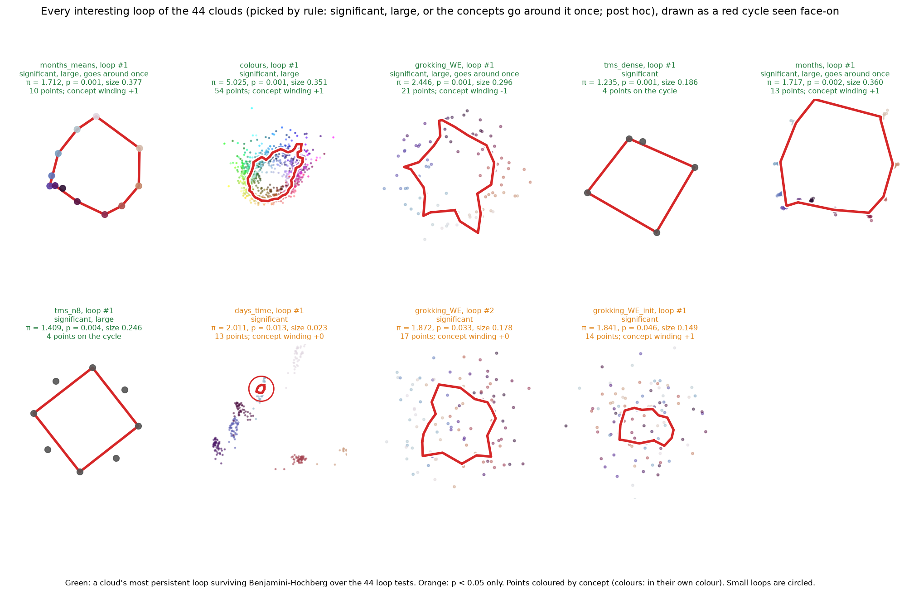

# Loops: every loop scored, the interesting ones shown (post hoc, deviation D11)

Date: 2026-11-16. Author: Libor "Burny" Burian.
- Every number is generated from `results/loops/`, `results/exp2/` and `results/exp7_audit/` by `run.py report`.
- Code: `src/neurotopo/experiments/loop_search.py` (`run.py loops`); representative cycles: `diagrams.alpha_h1_cycles`; figure: `report/figures.py` (`fig_loop_gallery`).
- No model inference and no training. Everything uses the stored clouds and the stored Exp2 nulls.

## Why

Exp2 tests only each cloud's most persistent loop, and the README's detected-loops figure shows that loop for six example clouds. This phase lists all 10729 loops of the 44 clouds and picks the ones worth showing by fixed rules, as the void search does for voids ([voids.md](voids.md)). The rules were written after the void search, so they are post hoc.

## Method

For every loop: its bar (birth, death), persistence ratio π = death / birth, and one birth path (the edge that creates the loop, closed by the shortest path through earlier edges; [glossary](../docs/glossary.md#representative-loop)).
- **p:** against the cloud's design-matched Exp2 null of the largest loop π. For a cloud's most persistent loop this is exactly Exp2's p (largest difference over the 44 clouds: 0.000). For other loops it is conservative.
- **Size:** death − birth, how much the balls must still grow (in radius) to fill the loop once it has closed.
- **Span of the cloud:** the bounding-box diagonal of the cycle's points divided by the cloud's.
- **Concept winding:** for a cyclic concept variable, how many times the concepts' phases go around as one walks along the cycle. The residues are ordered by their Fourier frequency k, as θ_B orders them. Winding ±1 mirrors the project's ring criterion, but read off one drawn cycle. The criterion behind every verdict is the preregistered traversal along the circular coordinate θ_B (Exp3), so this winding is a post hoc check for display.

**Rules:**
1. **significant:** p < 0.05. By chance about 5% of clouds have such a loop, so about 2 of 44.
2. **large:** the 5 largest loops over all clouds, by size.
3. **goes around once:** in a cloud with a cyclic concept variable, concept winding ±1 along a cycle that spans at least half the cloud; the most significant such loop per cloud, kept if p < 0.5.

## Results

9 loops have p < 0.05, and 9 loops pass at least one rule. Rule 2 adds 0 loops of its own: the 5 largest loops are also significant.

<!-- BEGIN:loops -->
| id | loop # (by pi) | reasons | birth | death | pi | p | size (death - birth) | cycle points | span of cloud | concepts on cycle | concept winding |
|---|---|---|---|---|---|---|---|---|---|---|---|
| R5b_llama_months_means | 1 | significant, large, goes around once | 0.530 | 0.907 | 1.712 | 0.001 | 0.377 | 10 | 0.936 | 10 of 12 | +1 |
| R7_llama_colors | 1 | significant, large | 0.087 | 0.438 | 5.025 | 0.001 | 0.351 | 54 | 0.418 | 34 of 36 | +1 |
| R2_grokking_WE | 1 | significant, large, goes around once | 0.204 | 0.500 | 2.446 | 0.001 | 0.296 | 21 | 0.633 | 21 of 113 | -1 |
| C3_tms_dense | 1 | significant | 0.794 | 0.980 | 1.235 | 0.001 | 0.186 | 4 | 0.965 | 4 of 7 | - |
| R5b_llama_months | 1 | significant, large, goes around once | 0.502 | 0.861 | 1.717 | 0.002 | 0.360 | 13 | 0.849 | 10 of 12 | +1 |
| R3_tms_n8 | 1 | significant, large | 0.602 | 0.849 | 1.409 | 0.004 | 0.246 | 4 | 0.708 | 4 of 7 | - |
| R5c_llama_days_time | 1 | significant | 0.022 | 0.045 | 2.011 | 0.013 | 0.023 | 13 | 0.055 | 1 of 7 | +0 |
| R2_grokking_WE | 2 | significant | 0.204 | 0.382 | 1.872 | 0.033 | 0.178 | 17 | 0.511 | 17 of 113 | +0 |
| C3_grokking_WE_init | 1 | significant | 0.178 | 0.327 | 1.841 | 0.046 | 0.149 | 14 | 0.290 | 14 of 113 | +1 |
<!-- END:loops -->

- **The concepts wind once along a significant loop's drawn cycle.**
  - Months and the 12 month centres: 10 and 10 of the 12 months lie on the cycle, and they wind once around it (winding 1 and 1).
  - Grokked residues: the 21 residues on the cycle wind once (winding -1) in the order of the Fourier frequency θ_B found.
  - **This check does not change any verdict.** These are the loops Exp2 found, and their verdicts come from the preregistered traversal (Exp3, θ_B):
    - residues: "ring: yes", but not significant in 10 dimensions;
    - colours: "ring: yes, but the RGB stimuli have it too" (D8);
    - months: "loop: yes; ring: suggestive", because they go around once only with a setting relaxed after the first results (D9).
  - The strict preregistered test passed for none of weekdays, months and residues (0 of 3).
- **Colours:** the hue loop is the most persistent loop of all (π = 5.02), 34 of the 36 hues lie on its cycle, and they wind once (1). It misses rule 3 only on span: its cycle spans 0.42 of the cloud's bounding-box diagonal, which a few far-out points of the cloud stretch.
- **Significant, but not a ring of concepts:**
  - The toy models' loops are 4-cycles of their polytopes. With 8 features the cycle is close to a square: π = 1.409, against 1/sin(π/4) = √2 ≈ 1.414 for a regular square.
  - Days with times: a small loop inside one day's cluster (1 of 7 days on the cycle; audit D8).
  - The random-init grokking embedding: p = 0.046, about what chance gives among 44 clouds.
- **A second loop in the grokked residues** (p = 0.001 for the first, 0.033 for the second). In the order of θ_B's frequency its residues do not wind (0). In the order of the network's five Fourier frequencies (exp7 audit: 20, 21, 3, 15, 31), loop 1 winds once for frequencies 20, 21, 3, 15 and loop 2 for 21, 3. On cycles this short (21 and 17 of the 113 residues), several frequencies can give winding ±1, so the winding alone does not tell which frequency a loop belongs to.

## Limitations

- The rules are post hoc, and the per-loop p-values are not corrected over the 10729 loops. The Benjamini–Hochberg correction applies to Exp2's top loops only.
- Each path uses a shortest route through earlier edges together with its birth edge. 329 paths carry an older class past the assigned death. All selected gallery paths pass the boundary test. Their semantic winding still depends on the chosen representative. [Every certificate](../results/science/representatives.csv.gz)
- A significant loop is not by itself a hole: the Gaussian null also flags many hole-free shapes (audit D9).
