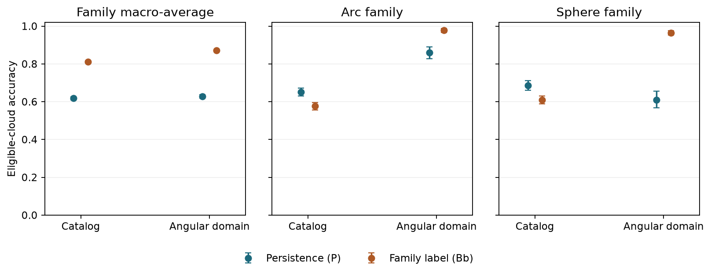

# Independent scientific audit of the neural geometry study

**Libor “Burny” Burian · 26 November 2026**

The registered H1 result reproduces. Neither method meets the full criterion for any primary dataset. H4 agreement decreases when components are included, and the H5 false-positive estimate increases when eligible open arcs and caps enter its denominator. The synthetic performance comparison changes direction in two families when their unrounded domains define the target. Neither steering experiment has observations. [Decisions](../../results/science/hypotheses.json) · [Paired benchmark](../../results/science/benchmark.csv) · [False-positive counts](../../results/science/false_positives.csv)

## Record of specification and execution

| Evidence as of 15 November 2026 (UTC+1) | What was knowable |
|---|---|
| [08:22, initial registration](https://github.com/BurnyCoder/topology-of-neural-geometry-in-llm-mechanistic-interpretability/blob/b6cc417/reports/preregistration.md) | H1–H5, the three primary datasets, controls, synthetic estimators and comparison rules were specified. |
| [09:31, amendments A1–A2](https://github.com/BurnyCoder/topology-of-neural-geometry-in-llm-mechanistic-interpretability/blob/70171c9/reports/preregistration.md) | The author disclosed the fitted-shape outcomes and a power-simulation design issue. H6 became primary before the recorded real Method B and steering experiments. |
| [10:35, results deposit](https://github.com/BurnyCoder/topology-of-neural-geometry-in-llm-mechanistic-interpretability/commit/26b5a32) and [11:06, strict and relaxed analyses](https://github.com/BurnyCoder/topology-of-neural-geometry-in-llm-mechanistic-interpretability/commit/f82dfe1) | The deposits and logs document runs. The relaxed coordinate analysis was introduced after the strict refusal. |
| [26 November audit protocol](2026-11-26-protocol.md) | The auditor already knew the H4 and H5 discrepancies. Their corrections are retrospective. Nested calibration, analytic controls and boundary-chain checks were specified before their audit runs. |

The replay starts with 52 SHA-256-verified exports and the pinned generator. It independently computes PCA scores from the smaller scatter eigensystem, evaluates alpha persistence directly in radius units, and draws fresh samples for all 50 deposited dataset/seed arrays. Every top-loop and top-void exceedance count reproduces. A match with stored simulations checks reproducibility of the fitted reference model. For each dataset the evidence table gives the sample size, fitted family, measured 3D statistics, raw and BH-adjusted values, conditional Monte Carlo tail intervals, subsampling frequencies and available higher-dimensional checks. [Input hashes](../../results/science/inputs.json) · [Fresh draws versus deposit](../../results/science/null_replay.csv) · [Projection evidence per dataset](../../results/science/dataset_assessment.csv)

[Machine-readable commit timestamps and H6 artifact search](../../results/science/chronology.json)

## Hypotheses and missing observations

| Hypothesis | Decision under the stated rule | Interpretation |
|---|---|---|
| H1, three primary concepts | A 0/3, B 0/3 | Negative registered conjunctions. Weekday loop evidence falls below threshold, the month coordinate is unavailable, and residues lose the required strict coordinate in ten PCs. |
| H2, specificity | Neither method reaches the falsification rule | Both ordinal binnings, the initialization controls and the process controls are tabulated separately. Low sensitivity to the studied alternatives limits specificity claims. |
| H3, secondary calendar task | Both conjunctions fail | The focal semantic variable is day. Time-of-day exploration has a different status. |
| H4, descriptive comparison | Full vector 27/44, loop/void only 31/44 | Balanced accuracy is 0.50 for each rule. All predict negative on the ten labeled datasets. With no discordant predictions every two-sided exact McNemar p is one. |
| H5, synthetic instrument | P underperforms the tuned threshold and fitted-family baseline, and outperforms the majority baseline on catalog macro accuracy | A two-sided comparison has an observed direction for each comparator. An independently specified equivalence or minimum-accuracy threshold would be needed to declare the instrument valid in general. |
| H6, amended primary | Simulated and model steering both untested | The planned readouts include random-loop comparisons, prompt-wise winding and on-manifold or vocabulary criteria. A significant observational loop supplies none of those measurements. |

| id | method | hole | p_loop | strict 3D coordinate | p_holm | winding | strict top-ten coordinate | status |
|---|---|---|---|---|---|---|---|---|
| R5a_llama_weekdays | A | no | - | unavailable | 1.000 | - | inapplicable | failed conjunction |
| R5a_llama_weekdays | B | no | 0.094 | unavailable | 1.000 | - | unavailable | failed conjunction |
| R5b_llama_months | A | no | - | unavailable | 1.000 | - | inapplicable | failed conjunction |
| R5b_llama_months | B | yes | 0.002 | unavailable | 1.000 | - | unavailable | failed conjunction |
| R2_grokking_WE | A | no | - | unavailable | 1.000 | - | inapplicable | failed conjunction |
| R2_grokking_WE | B | yes | 0.001 | available | 6.0e-05 | -1.000 | unavailable | failed conjunction |
| R5c_llama_days_time | A | no | - | unavailable | - | - | inapplicable | failed conjunction |
| R5c_llama_days_time | B | yes | 0.013 | unavailable | - | - | unavailable | failed conjunction |

A blank numeric field denotes an unmeasured or inapplicable statistic. For the six H1 alignment tests Holm adjustment assigns one to unavailable coordinates for the decision. This assignment supplies no observed angle. Method B uses unadjusted loop and top-ten gates. H2 fails its specificity prediction if two or more ordinal datasets, or any of the designated initialization controls, pass. The independent re-evaluation checks both binnings on each eligible control. H4 compares A's catalog vector to B's component estimator and its counts of detected bars across scales. These counts need not equal the Betti numbers of one offset. [Eligibility matrix for every H1–H6 dataset](../../results/science/matrix.csv) · [Condition-level H1–H3 records](../../results/science/decisions.csv) · [H4 vectors and predictions](../../results/science/h4_datasets.csv) · [H6 eligibility and missing readouts](../../results/science/h6_datasets.csv)

The unexecuted steering code also differed from amendment A2 in residue binning, the simulated manifold-distance threshold and the model's random-loop prompt subset. These paths now follow the written definition. With one embedding per residue the registered training-centroid radius is zero. Held-out decoder predictions would still condition on a loop and residue frequency estimated from the full cloud. The checkpoint controls and each missing readout are explicit. [Steering implementation review](../exp6_steering.md) · [Steering matrix](../../results/science/h6_datasets.csv)

## What the synthetic target measures

The arc and sphere generators draw angles using an unrounded fraction. Both generators explicitly assign fraction 0.999 to a branch called full. Their descriptions call fractions at or above 0.98 closed. This explains why a method can match the intended family convention even when its predicted topology differs from that of the unrounded domain. Real fits expose canonical descriptions, so the unrounded sensitivity is confined to the synthetic export. All 1236 test arcs and 979 test sphere-family examples that change target retain a positive gap in the underlying domain. Of these, 1042 arcs and 767 caps pass the catalog margin rule. The sensitivity analysis changes only the target. A second analysis that retuned the classifier, recomputed margins or sampled a new test set would answer a different question. The other catalog targets are carried over, including centre counts for mixtures and vertex counts for polytopes. [Arc generator](https://github.com/BurnyCoder/shape-fitting-in-neural-geometry-in-llm-mechanistic-interpretability/blob/4c5f3b665381380c81af22827bb3959032dac417/src/neurogeom/shapes/curves.py#L68-L105) · [Sphere generator](https://github.com/BurnyCoder/shape-fitting-in-neural-geometry-in-llm-mechanistic-interpretability/blob/4c5f3b665381380c81af22827bb3959032dac417/src/neurogeom/shapes/surfaces.py#L63-L98) · [Affected rows](../../results/science/angular_domains.csv) · [Raw closure counts in validation and test](../../results/science/closure_counts.csv)

| Cohort | Target | Persistence (P) | Family label (Bb) | Paired P − Bb (95% CI) |
|---|---|---|---|---|
| macro | catalog | 0.618 | 0.812 | -0.194 [-0.203, -0.185] |
| macro | angular | 0.628 | 0.870 | -0.242 [-0.252, -0.232] |
| arc | catalog | 0.651 | 0.576 | +0.075 [+0.055, +0.094] |
| arc | angular | 0.859 | 0.978 | -0.120 [-0.153, -0.086] |
| sphere | catalog | 0.687 | 0.609 | +0.077 [+0.046, +0.107] |
| sphere | angular | 0.610 | 0.965 | -0.355 [-0.402, -0.302] |

[Paired change in accuracy and in P’s advantage when switching targets](../../results/science/sensitivity_differences.csv)

The estimators use identical eligible test clouds. A bootstrap draw resamples whole generator chunks, computes paired cloud successes within each family, then weights families equally in the macro estimate. Intervals are marginal 95% percentile intervals. The learned family label is an in-distribution comparator. Tuning uses the validation export. Hashing the ordered arrays gives 0 exact duplicate clouds across the exported splits. The test detects byte-identical arrays in the same point order. Permuted or approximate duplicates and overlap with unavailable model-training records remain possible. [All methods, families and intervals](../../results/science/benchmark.csv) · [Split data](../../results/science/splits.json) · [Cluster bootstrap](https://doi.org/10.1111/j.1467-9868.2007.00593.x)

The Monte Carlo baseline covers the first 20 rows of each family-by-size-by-noise cell, all from one generator chunk per cell. The matched-subset table scores all comparators on the same eligible rows and reports paired chunk intervals and valid resample counts. On the catalog subset the macro accuracy difference P minus the Monte Carlo baseline is 0.021, with a paired 95% interval [-0.021, 0.060]. The interval includes zero. One sampled chunk per cell leaves within-cell between-chunk variability unidentified. The fixed-threshold baseline stores the twelve highest finite ratios in each degree. Larger counts can exceed the stored ceiling, but both counts exceed the maximum target loop or void count and yield the same exact-vector and false-positive decisions. [Selection by cell](../../results/science/mc_selection.csv) · [Paired subset scores](../../results/science/mc_subset.csv) · [Implementation](../../src/neurotopo/tda/estimators.py)

### False positives and noise

The contractible cohort includes all eligible connected catalog targets with zero loops and voids, including 1450 open arcs and 1353 caps omitted by the six-family calculation. The flag counts clouds with at least one point beyond the configured multiple of the median point-to-shape distance. Known injection identities were unavailable. The corrected count is 350/4144 among flagged clouds, compared with 230/3547 in the six-family calculation. The observed flagged risk remains below the registered 10% point-estimate trigger for a distance-to-measure ablation. The flagged-minus-unflagged contrast is observational and can reflect cloud size or family. Its interval jointly resamples the two groups by generator chunk. [Individual flags](../../results/science/false_positive_rows.csv.gz) · [Conditional ablation rule](../preregistration.md)

| cohort | comparison | Detections | Clouds | Estimate | 95% lower | 95% upper |
|---|---|---|---|---|---|---|
| catalog | flagged | 350 | 4144 | 0.084 | 0.071 | 0.098 |
| catalog | unflagged | 672 | 15086 | 0.045 | 0.038 | 0.051 |
| catalog | flagged minus unflagged | - | - | 0.040 | 0.030 | 0.051 |
| six families | flagged | 230 | 3547 | 0.065 | 0.053 | 0.079 |
| six families | unflagged | 401 | 12880 | 0.031 | 0.026 | 0.037 |
| six families | flagged minus unflagged | - | - | 0.034 | 0.023 | 0.045 |

[False-positive counts for each estimator, including the measured MC subset, by sample size, noise and flag status](../../results/science/false_positive_strata.csv)

Each entry below is the fraction of blobs with any selected alpha H1 bar under P, with a chunk-bootstrap interval. A zero-event empirical bootstrap can give a degenerate interval and leaves positive population risks plausible. For both H1 and H2, the full calibration table gives the cloud detection interval, the number of valid bars and the pooled bar-score KS distance within each size and noise cell. Bar scores from a single cloud are dependent, so the KS distance is descriptive. [Degree-by-size-by-noise results](../../results/science/blob_score_strata.csv) The original paper proposed a strong empirical law. Weak universality fixes dimension, degree and complex type. A subsequent preprint gives degree-one Čech counterexamples to the left-Gumbel form in dimensions two and three. These results restrict theoretical claims for P. [Stratified blob results](../../results/science/blobs.csv) · [Original score](https://doi.org/10.1038/s41598-023-37842-2) · [Weak universality](https://arxiv.org/html/2406.05553v1) · [Counterexamples, Corollary 1.4](https://arxiv.org/html/2610.08257v1)

| n_bin | noise_bin | n | hits | rate | low | high |
|---|---|---|---|---|---|---|
| 0 | 0 | 250 | 1 | 0.004 | 0.000 | 0.012 |
| 0 | 1 | 250 | 2 | 0.008 | 0.000 | 0.020 |
| 0 | 2 | 250 | 4 | 0.016 | 0.000 | 0.036 |
| 1 | 0 | 250 | 1 | 0.004 | 0.000 | 0.012 |
| 1 | 1 | 250 | 1 | 0.004 | 0.000 | 0.012 |
| 1 | 2 | 250 | 1 | 0.004 | 0.000 | 0.012 |
| 2 | 0 | 250 | 0 | 0.000 | 0.000 | 0.000 |
| 2 | 1 | 250 | 0 | 0.000 | 0.000 | 0.000 |
| 2 | 2 | 250 | 0 | 0.000 | 0.000 | 0.000 |
| 3 | 0 | 250 | 0 | 0.000 | 0.000 | 0.000 |
| 3 | 1 | 250 | 0 | 0.000 | 0.000 | 0.000 |
| 3 | 2 | 250 | 0 | 0.000 | 0.000 | 0.000 |

### Analytically specified controls

The following noiseless points sample unit analytic domains. The radius is in unit-shape coordinates. For the exact circle and full sphere it lies between the sampling gaps and the central filling radius. The open cases have specified missing angular regions. The observed column measures offsets at that radius. The estimator columns run the same RMS normalization, persistence selection and validation-tuned thresholds used on the catalog. Bb requires an upstream classifier prediction, which is unavailable for these four designs. P and S discard the circle loop and sphere void even on these noiseless designs. Ba recovers the offset vector in all four cases. The score centres log-log persistence within each diagram. A single valid bar therefore has the same score regardless of its persistence ratio. The finite point sets, their offsets and their ideal generating domains are distinct mathematical objects. [Control construction](../../src/neurotopo/science/cycles.py) · [Within-diagram score](../../src/neurotopo/tda/nulls.py) · [GUDHI alpha definition](https://gudhi.inria.fr/python/latest/delaunay_complex_user.html)

| shape | n | radius | expected | observed | agrees | Bb_family_implied | P_alpha_universal | S_rips_universal | Ba_fixed_pi | Bc_majority |
|---|---|---|---|---|---|---|---|---|---|---|
| circle | 96 | 0.300 | (1, 1, 0) | (1, 1, 0) | yes | - | (1, 0, 0) | (1, 0, 0) | (1, 1, 0) | (1, 0, 0) |
| open arc, 120-degree gap | 65 | 0.300 | (1, 0, 0) | (1, 0, 0) | yes | - | (1, 0, 0) | (1, 0, 0) | (1, 0, 0) | (1, 0, 0) |
| sphere | 400 | 0.300 | (1, 0, 1) | (1, 0, 1) | yes | - | (1, 0, 0) | (1, 0, 0) | (1, 0, 1) | (1, 0, 0) |
| spherical cap, z >= -0.5 | 300 | 0.300 | (1, 0, 0) | (1, 0, 0) | yes | - | (1, 0, 0) | (1, 0, 0) | (1, 0, 0) | (1, 0, 0) |

## Fitted reference distributions and coordinate tests

Calendar reference draws condition on observed within-concept residuals and estimate a covariance from the concept centres. Other designs draw from a Gaussian with the observed covariance spectrum. Reprojecting every draw accounts for PCA in the statistic. Finite-sample Monte Carlo exactness requires exchangeable observed and simulated statistics under the tested null. Estimating nuisance parameters from the observation can break that condition. The nested experiment generates independent outer datasets at the observed sample sizes and refits the null for every one. At 99 inner draws, strict p < 0.05 admits four ranks out of 100 without ties. Each interval below includes 0.04. Those intervals cover a range of rejection probabilities and describe only the simulated spectrum and templates. [Protocol](2026-11-26-protocol.md) · [Replicate-level results](../../results/science/calibration_draws.csv) · [Dufour on nuisance parameters](https://doi.org/10.1016/j.jeconom.2005.06.007)

| design | n | dimension | hits | replicates | rate | low | high | exchangeable_rank_rate |
|---|---|---|---|---|---|---|---|---|
| weekdays | 49 | 1 | 4 | 128 | 0.031 | 0.009 | 0.078 | 0.040 |
| weekdays | 49 | 2 | 3 | 128 | 0.023 | 0.005 | 0.067 | 0.040 |
| months | 144 | 1 | 5 | 128 | 0.039 | 0.013 | 0.089 | 0.040 |
| months | 144 | 2 | 5 | 128 | 0.039 | 0.013 | 0.089 | 0.040 |
| residues | 113 | 1 | 2 | 128 | 0.016 | 0.002 | 0.055 | 0.040 |
| residues | 113 | 2 | 4 | 128 | 0.031 | 0.009 | 0.078 | 0.040 |

GUDHI's default alpha filtration uses squared radii. The replay cross-checks its direct-radius API. The alpha bar maximizing death/birth over F₂ differs in selection rule and coefficient field from the longest additive-lifetime landmark Rips H¹ class over F₄₇. Rips edge lengths are halved for radius comparisons. Interval overlap alone cannot identify a generator. For every returned strict coordinate we check open-ball coverage at the chosen landmark radius. The residues and colour coordinates cover their samples in 3D. A short class gives a recorded refusal. Relaxed coordinates have a weaker topological interpretation. [Coordinate records](../../results/exp3/method_b.json) · [Relaxed coordinates](../../results/exp3/posthoc_relaxed_range.json) · [GUDHI filtration](https://gudhi.inria.fr/python/latest/delaunay_complex_ref.html) · [DREiMac assumptions](https://dreimac.scikit-tda.org/en/latest/theory.html)

The alignment test permutes entire semantic labels at fixed concept angles, uses both orientations and repeats the Fourier-frequency search for every residue permutation. Its null assumes exchangeability of these label assignments. Calendars and consecutive ordinal bins are designed objects, so the resulting p-value measures agreement relative to that conditional relabeling model. Smooth order is an alternative source of alignment. Winding sums principal angular increments including the prescribed last-to-first step. An observed absolute winding of one allows backwards steps and supplies no continuous on-manifold path. The exact-order indicator additionally requires consistent steps. A nonmatch gives p=1. A fixed-label match has the rotation/reflection upper bound, with an additional search correction for selected frequencies. [Circular statistics](../../src/neurotopo/stats/circular.py) · [Permutation ranks](https://doi.org/10.2202/1544-6115.1585)

## Do the illustrated chains represent their intervals?

For each alpha birth path or triangulated shell, we tested mod-two closure, support by birth, non-membership in the boundary span immediately before the paired death simplex, and membership after adding its boundary. All 4759 shells pass. Of 10729 shortest birth paths, 329 retain an older class at the indicated death. The explorer identifies them at selection and hover. Every one of the 9 selected loop-gallery examples passes. Even a certified path is nonunique, and its label composition depends on the chosen representative. [Certificates for every displayed bar](../../results/science/representatives.csv.gz) · [Boundary reduction](../../src/neurotopo/science/cycles.py) · [Persistence pairs](https://doi.org/10.1007/s00454-002-2885-2)

## Material claim dispositions

The files below map each scientific conclusion to the evidence used to retain, narrow, correct or withdraw it. The file inventory identifies source, generated and historical artifacts. The original registration and dated run records retain their historical text. The present report supersedes earlier interpretations where they differ. [Machine-readable claims](../../results/science/claims.csv) · [File inventory](../../results/science/inventory.csv) · [Previous published version](https://github.com/BurnyCoder/topology-of-neural-geometry-in-llm-mechanistic-interpretability/tree/880e7a353c2172f019ef449cc0ff3666a39955b3)

[Bibliographic identities checked against source metadata](../../results/science/bibliography.csv) · [Claim occurrence index by file and line](../../results/science/claim_occurrences.csv). The index locates repeated terminology. The dispositions below document the scientific judgments.

**Registration dates and amendment** (verified with qualification). Git orders the specification and result deposits. A1/A2 disclose exposure to Method A. Local logs and commits cannot independently establish when an author first saw a result. [Local evidence](../../reports/preregistration.md) · [Primary source](https://github.com/BurnyCoder/topology-of-neural-geometry-in-llm-mechanistic-interpretability/blob/70171c9/reports/preregistration.md)

**Identity of inputs and source** (reproduced). The pinned snapshot, its manifest digest and the source revision fix the inputs. The source export compared regenerated clouds with its cache. This audit starts with those exported files. [Local evidence](../../results/science/inputs.json) · [Primary source](https://huggingface.co/datasets/BurnyCoder/topology-of-neural-geometry/tree/02e4d50b62d75cbf689f6df3d9ec608d2acd6315/inputs)

**H1 fitted-shape test** (reproduced). All primary fits are open helices. Angular order about their axes is descriptive. These fit objects cannot supply the hole coordinate required by A. [Local evidence](../../results/exp0/real_topology.csv) · [Primary source](https://github.com/BurnyCoder/topology-of-neural-geometry-in-llm-mechanistic-interpretability/blob/b6cc417/reports/preregistration.md)

**H1 persistent-homology test** (reproduced). All primary B conjunctions fail. The failure occurs at different steps in different datasets. An unavailable coordinate leaves its alignment and winding unmeasured. [Local evidence](../../results/science/decisions.csv) · [Primary source](https://github.com/BurnyCoder/topology-of-neural-geometry-in-llm-mechanistic-interpretability/blob/70171c9/reports/preregistration.md)

**H2 specificity** (qualified). Neither method triggered the prespecified falsification rule. The process controls cover particular generators and the strict test also passed none of the primary sets. [Local evidence](../../results/science/hypotheses.json) · [Primary source](https://github.com/BurnyCoder/topology-of-neural-geometry-in-llm-mechanistic-interpretability/blob/b6cc417/reports/preregistration.md)

**H3 days with times** (reproduced). The secondary day-phase conjunction fails. The leading 3D birth path lies within a day cluster. This leaves full-space representations open. [Local evidence](../../results/science/decisions.csv) · [Primary source](https://github.com/BurnyCoder/topology-of-neural-geometry-in-llm-mechanistic-interpretability/blob/b6cc417/reports/preregistration.md)

**H4 full-vector vs loop/void agreement** (corrected). Including components changes four agreement decisions. Both endpoints are reported with the exact two vectors for every cloud. [Local evidence](../../results/science/h4_datasets.csv) · [Primary source](https://github.com/BurnyCoder/topology-of-neural-geometry-in-llm-mechanistic-interpretability/blob/b6cc417/reports/preregistration.md)

**H4 classifier comparison** (reproduced). All classifiers return the negative class on this ten-dataset comparison. The exact paired tests have no discordances and the balanced accuracies coincide. [Local evidence](../../results/science/hypotheses.json) · [Primary source](https://github.com/BurnyCoder/topology-of-neural-geometry-in-llm-mechanistic-interpretability/blob/b6cc417/reports/preregistration.md)

**H5 catalog scores** (reproduced with qualification). The unit is an eligible cloud, weighted equally within each family, then averaged across families. Polytope uses components alone. Fixed threshold and learned family label outperform P on this target. [Local evidence](../../results/science/benchmark.csv) · [Primary source](https://github.com/BurnyCoder/topology-of-neural-geometry-in-llm-mechanistic-interpretability/blob/b6cc417/reports/preregistration.md)

**H5 arc and cap recovery** (reinterpreted). The source describes near-complete domains as complete. Scoring the unsnapped domains with fixed eligibility and predictions reverses P versus the family baseline in both families. [Local evidence](../../results/science/angular_domains.csv) · [Primary source](https://github.com/BurnyCoder/shape-fitting-in-neural-geometry-in-llm-mechanistic-interpretability/blob/4c5f3b665381380c81af22827bb3959032dac417/src/neurogeom/shapes/curves.py#L68-L105)

**Sphere-family topology** (corrected). A cap with positive missing polar angle is a disk. Its thresholded target can be a sphere even when the generating sample excludes a cap. [Local evidence](../../results/science/benchmark.csv) · [Primary source](https://github.com/BurnyCoder/shape-fitting-in-neural-geometry-in-llm-mechanistic-interpretability/blob/4c5f3b665381380c81af22827bb3959032dac417/src/neurogeom/shapes/surfaces.py#L63-L98)

**Point-set and mixture targets** (qualified). The cluster and polytope targets count latent centres or vertices. Gaussian mixture components with nonzero covariance overlap in support. A catalog centre count describes a different object from this support. [Local evidence](../../docs/analytic_topology.md) · [Primary source](https://pi.math.cornell.edu/~hatcher/AT/AT.pdf)

**Resolvability and generalization** (qualified). The engineered margin combines selected feature sizes and empirical sample-to-shape distances. It is an eligibility rule, with no established lower bound on reach or guarantee of topological reconstruction. [Local evidence](../../results/exp5/nu_variants.csv) · [Primary source](https://doi.org/10.1007/s00454-008-9053-2)

**Known clean domains** (tested post hoc). The four noiseless designs yield their prescribed offset Betti vectors at the stated unit-shape radius. P and S filter out the exact circle loop and sphere void. The validation-tuned fixed threshold retains both. These examples do not establish accuracy on noisy or nearly closed samples. [Local evidence](../../results/science/analytic_controls.csv) · [Primary source](https://gudhi.inria.fr/python/latest/delaunay_complex_ref.html)

**H5 false-positive and DTM rule** (corrected). Eligible open arcs and caps enter the denominator. The flagged-cloud estimate increases and remains below the registered point-estimate trigger. Injection identity is unavailable. [Local evidence](../../results/science/false_positives.csv) · [Primary source](https://github.com/BurnyCoder/topology-of-neural-geometry-in-llm-mechanistic-interpretability/blob/b6cc417/reports/preregistration.md)

**Clustered uncertainty** (corrected). Sample generator chunks jointly for every matched comparison. A Fisher test treating clouds as independent cannot establish a clustered contrast or an outlier intervention effect. [Local evidence](../../results/science/false_positive_rows.csv.gz) · [Primary source](https://doi.org/10.1111/j.1467-9868.2007.00593.x)

**Universal-null calibration** (qualified). The empirical left-Gumbel approximation is a working score. The pooled KS distance is descriptive because bars within a cloud are dependent. Report family-wise hits on blobs for each size and noise cell. [Local evidence](../../results/science/blobs.csv) · [Primary source](https://doi.org/10.1038/s41598-023-37842-2)

**Scope of universality** (corrected). The weak universality theorem concerns a limiting distribution under regularity assumptions. It does not identify a finite-sample Gumbel null for these data. [Local evidence](../../src/neurotopo/tda/nulls.py) · [Primary source](https://arxiv.org/html/2406.05553v1)

**Design-matched Gaussian reference** (qualified). Rebuilding PCA and null draws reproduces ranks. Drawing from a covariance estimated on the tested observations yields a plug-in comparison. The plus-one formula alone gives no exact level guarantee here. [Local evidence](../../results/science/null_replay.csv) · [Primary source](https://doi.org/10.1016/j.jeconom.2005.06.007)

**Finite-sample fitted-null calibration** (tested post hoc). Outer Gaussian datasets are independent conditional on the specified design. Marginal exact binomial intervals quantify simulation precision for one spectrum and residual template per calendar design. [Local evidence](../../results/science/calibration.csv) · [Primary source](https://doi.org/10.1016/j.jeconom.2005.06.007)

**Alpha and Rips units** (verified). GUDHI squared radii are converted to ball radii. Independent direct-radius computation recovers the observed maxima. Rips uses edge lengths, halved when putting the two intervals on a radius scale. [Local evidence](../../results/science/null_replay.csv) · [Primary source](https://gudhi.inria.fr/python/latest/delaunay_complex_ref.html)

**Landmarks, fields and interval overlap** (qualified). The alpha analysis uses F2, the selected Rips cohomology class uses F47. DREiMac selects by additive persistence. Temporal overlap with the maximum-ratio alpha bar does not establish a common generator. [Local evidence](../../results/exp3/method_b.json) · [Primary source](https://dreimac.scikit-tda.org/en/latest/theory.html)

**Restricted permutations, alignment and order** (corrected). Permute labels at the concept level. Redo both orientations and the residue frequency search. A nonmatching exact-order indicator has p=1. A selected matching frequency needs a multiplicity bound. Winding closes the observed sequence by convention. [Local evidence](../../results/exp3/method_b.json) · [Primary source](https://doi.org/10.2202/1544-6115.1585)

**H6 simulated and causal steering** (untested). The amendment specifies path, controls, decoder, winding and on-manifold or vocabulary criteria. The dataset-by-dataset register contains no observed steering outcomes. The dormant residue implementation differed on bins, manifold distances and random-loop prompts. Amendment A2 gives a degenerate zero centroid radius for singletons. See reports/exp6_steering.md. [Local evidence](../../results/science/h6_datasets.csv) · [Primary source](https://github.com/BurnyCoder/topology-of-neural-geometry-in-llm-mechanistic-interpretability/blob/70171c9/reports/preregistration.md)

**Projection sensitivity and seed sensitivity** (qualified). All design-specific Monte Carlo seeds are inventoried. Subsample frequencies depend on the full-sample threshold. A change across PC projections concerns the measured point cloud. Neither experiment varies neural training seeds. [Local evidence](../../results/science/dataset_assessment.csv) · [Primary source](https://doi.org/10.1073/pnas.2311420120)

**Months and weekdays** (qualified). Monthly 3D significance and post hoc relaxed alignment differ from a registered traversal. The weekday run has weak evidence and finite power. Negative tests do not establish absence of other calendar codes. [Local evidence](../../results/exp3/posthoc_relaxed_range.json) · [Primary source](https://arxiv.org/html/2405.14860)

**Modular residues** (qualified). Significant 3D alignment is in frequency-reordered residue order. The strict top-ten coordinate is unavailable. The observed PCA spectrum alone cannot identify the cause of subsample instability. [Local evidence](../../results/exp3/method_b.json) · [Primary source](https://arxiv.org/abs/2301.05217)

**Colour stimuli and representations** (qualified). The activation and RGB clouds both have hue-aligned coordinates. Their association leaves the mechanism and the effect of stimulus encoding unresolved. [Local evidence](../../results/exp7_audit/summary.json) · [Primary source](https://arxiv.org/abs/2505.18235)

**Ordinal PC results and negative controls** (qualified). Some ordinal loops pass the higher-dimensional reference. Their semantic conjunction fails. Finite smooth-control simulations constrain those designs only. [Local evidence](../../results/exp5/topk_null.csv) · [Primary source](https://arxiv.org/abs/1806.08805)

**Representative cycles and shells** (corrected). Check closed chains before and at the paired death, over F2. Some shortest birth paths carry older homology across death. All selected loop-gallery paths and all shells pass the stated test. [Local evidence](../../results/science/representatives.csv.gz) · [Primary source](https://doi.org/10.1007/s00454-002-2885-2)

**Voids, triangulations and scale invariants** (qualified). The shell is one representative. A cavity can occur in an offset of a projected finite sample. Euler characteristic and genus computed from filtered counts require the stated conventions and surface assumptions. [Local evidence](../../results/voids/summary.json) · [Primary source](https://pi.math.cornell.edu/~hatcher/AT/AT.pdf)

**Exploratory similarity, power and selection** (qualified). Template similarity, toy power grids and named galleries are descriptive. A simulation detects alternatives it generates. Selection from many bars prevents treating gallery appearance as confirmatory evidence. [Local evidence](../../results/exp4/summary.json) · [Primary source](https://github.com/BurnyCoder/topology-of-neural-geometry-in-llm-mechanistic-interpretability/blob/b6cc417/reports/preregistration.md)

**Exact duplicate leakage and comparators** (checked with limits). Hash ordered float arrays across the validation and test exports. Validation selects thresholds and family mappings. Lack of exact duplicate arrays does not exclude other dependence or overlap with fitter training. [Local evidence](../../results/science/splits.json) · [Primary source](https://arxiv.org/abs/2108.02497)

**Clock and Pizza attribution** (corrected). Zhong et al. describe distinct modular-addition computations that can use circular input embeddings. Pizza does not designate a disk-shaped embedding family. [Local evidence](../../reports/literature-review.md) · [Primary source](https://arxiv.org/abs/2306.17844)

**Steering and novelty in prior work** (bounded). Published steering interventions motivate H6. Their results belong to their models and designs. The contribution here is a registered comparison on a pinned corpus. A field-wide claim of priority is unwarranted. [Local evidence](../../reports/state-of-the-art-review.md) · [Primary source](https://arxiv.org/html/2605.05115v1)

**Strong universality** (qualified by later result). A 2026 preprint derives distinct degree-one Čech limits in two and three dimensions and rules out the proposed left-Gumbel form in its models. Finite benchmark performance remains an empirical question. [Local evidence](../../reports/literature-review.md) · [Primary source](https://arxiv.org/html/2610.08257v1)

**Resolved bibliography and estimator displays** (corrected rendering). A stale local BibTeX file left citations unresolved. An isolated build and a cross-check of PDF text and pages verify the corrected attribution. The figures and tables use the same estimator order in both checkouts. [Local evidence](../../paper/main.pdf) · [Primary source](https://arxiv.org/abs/2306.17844)

## Reproduction

From a recursive checkout with the locked Python environment and a LaTeX toolchain, run `uv run --frozen python run.py science`. This reconstructs the target tables, thresholds, per-cloud estimators, alignments, independent null replay, calibration and certificates. It also reruns the supplementary power, coordinate, similarity, projection, control and gallery calculations before rebuilding all current displays. `uv run --frozen pytest -q` includes regression cases for the denominator, target definition, full-vector comparison, searched-frequency test and boundary certificates. Observed activations and fitter predictions come from the pinned export. The [clean-replay comparison](../../results/science/reproduction.json) records the source revision, input manifest and row counts. Re-extraction of the neural networks and causal steering remain outside this observational replay. [Entry point](../../run.py) · [Pinned inputs](https://huggingface.co/datasets/BurnyCoder/topology-of-neural-geometry/tree/02e4d50b62d75cbf689f6df3d9ec608d2acd6315/inputs)

A cross-build comparison exposed unresolved citations from an older local BibTeX file. The paper now compiles in an isolated source directory. The two-checkout comparison checks the published text, tables, figures, explorer data and PDF text. When Poppler is available it also compares the rendered pages. [Build](../../src/neurotopo/report/pdf.py) · [Verification](../../src/neurotopo/report/check_publication.py) · [Paper](../../paper/main.pdf)
