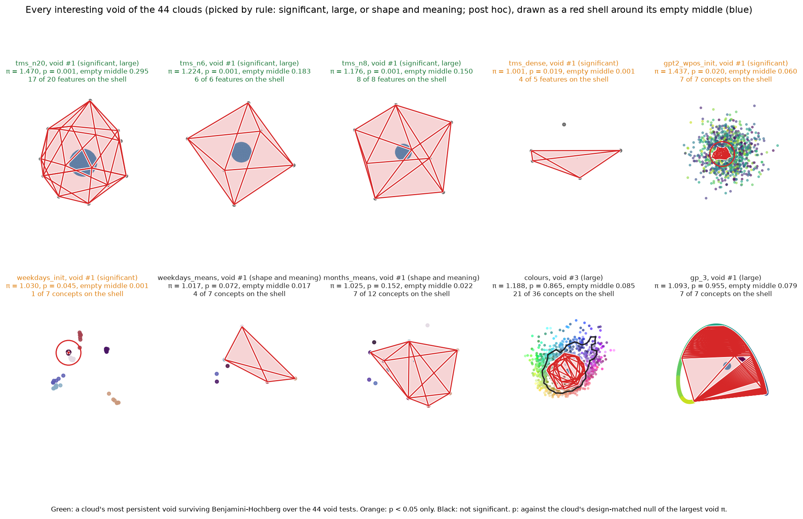
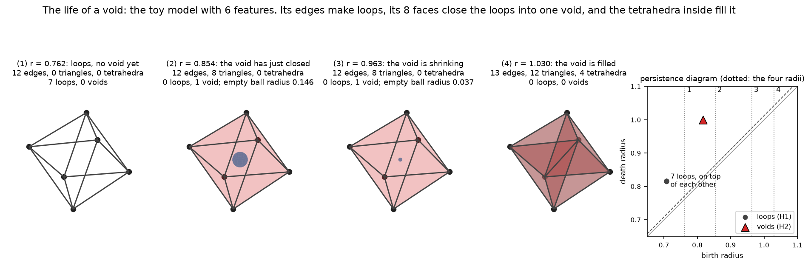

# Voids: every void scored, the interesting ones shown (post hoc, deviation D10)

Date: 2026-11-16. Author: Libor "Burny" Burian.
- Every number is generated from `results/voids/` and `results/exp2/` by `run.py report`.
- Code: `src/neurotopo/experiments/void_search.py` (`run.py voids`); representative shells and centres: `diagrams.alpha_h2_voids`; figures: `report/figures.py` (`fig_void_gallery`, `fig_void_life`, `fig_detected_voids`).
- No model inference and no training. Everything uses the stored clouds and the stored Exp2 nulls.

## Why

A void is an empty region walled in by a closed surface, like the inside of a hollow ball: an H2 bar of the alpha complex ([glossary](../docs/glossary.md#representative-void)). Exp2 tests only each cloud's most persistent void. This phase lists all 4759 voids of the 38 clouds that have any (of 44) and picks the ones worth showing by fixed rules, so the README's void figures do not rest on picking by eye. The rules were written after browsing the explorer, so they are post hoc.

The independent audit verified the displayed mod-two shell against its paired death for all 4759 positive intervals. The shell represents a cavity of an offset in the measured projection. [Certificates](../results/science/representatives.csv.gz)

## Method

For every void: its bar (birth, death), persistence ratio π = death / birth, representative shell (a closed surface of triangles, present at the birth radius and filled exactly at the death radius) and centre (the circumcentre of the tetrahedron that fills it; no point is closer to it than the death radius).
- **p:** (1 + the number of null clouds whose largest void π is at least this void's π) / (M + 1), against the cloud's design-matched Exp2 null. For a cloud's most persistent void this is exactly Exp2's p (largest difference over the 44 clouds: 0.000). For other voids it is conservative.
- **Empty middle:** death − birth, the radius of the ball around the centre that is still uncovered when the void closes.
- **Span of the cloud:** the bounding-box diagonal of the shell's corners divided by the cloud's.
- **Concepts on the shell:** how many of the cloud's concepts have a point among the shell's corners.

**Rules:**
1. **significant:** p < 0.05. By chance about 5% of clouds have such a void, so about 2 of 44.
2. **large:** the 5 largest empty middles over all clouds.
3. **shape and meaning:** in a trained model's concept cloud, a shell spanning at least half the cloud with at least half its concepts on the corners; the most significant such void per cloud, kept if p < 0.5.

## Results

6 voids have p < 0.05, and 10 voids pass at least one rule.

<!-- BEGIN:voids -->
| id | void # (by pi) | reasons | birth | death | pi | p | empty middle (death - birth) | faces | shell corners | span of cloud | concepts on shell |
|---|---|---|---|---|---|---|---|---|---|---|---|
| R3_tms_n20 | 1 | significant, large | 0.628 | 0.923 | 1.470 | 0.001 | 0.295 | 30 | 17 of 20 points | 0.999 | 7 of 7 |
| R3_tms_n6 | 1 | significant, large | 0.817 | 1.000 | 1.224 | 0.001 | 0.183 | 8 | 6 of 6 points | 1.000 | 6 of 7 |
| R3_tms_n8 | 1 | significant, large | 0.849 | 0.998 | 1.176 | 0.001 | 0.150 | 12 | 8 of 8 points | 1.000 | 7 of 7 |
| C3_tms_dense | 1 | significant | 0.986 | 0.987 | 1.001 | 0.019 | 7.8e-04 | 4 | 4 of 5 points | 0.959 | 4 of 7 |
| C3_gpt2_wpos_init | 1 | significant | 0.137 | 0.198 | 1.437 | 0.020 | 0.060 | 74 | 39 of 1023 points | 0.169 | 7 of 7 |
| C3_llama_weekdays_init | 1 | significant | 0.033 | 0.034 | 1.030 | 0.045 | 9.8e-04 | 4 | 4 of 49 points | 0.024 | 1 of 7 |
| R5a_llama_weekdays_means | 1 | shape and meaning | 1.023 | 1.040 | 1.017 | 0.072 | 0.017 | 4 | 4 of 7 points | 0.927 | 4 of 7 |
| R5b_llama_months_means | 1 | shape and meaning | 0.910 | 0.932 | 1.025 | 0.152 | 0.022 | 10 | 7 of 12 points | 0.846 | 7 of 12 |
| R7_llama_colors | 3 | large | 0.451 | 0.535 | 1.188 | 0.865 | 0.085 | 58 | 31 of 900 points | 0.314 | 21 of 36 |
| C1_gp_3 | 1 | large | 0.853 | 0.932 | 1.093 | 0.955 | 0.079 | 174 | 89 of 200 points | 0.974 | 7 of 7 |
<!-- END:voids -->

- **The toy models of superposition are the only clouds whose voids pass every check** (they are exploratory sets of 6–20 points).
  - Their voids are significant (they survive Benjamini–Hochberg over Exp2's 44 tests, q = 0.015).
  - They are the 3 largest, the shell spans the whole cloud, and every feature (or nearly every one) is a corner.
  - The features sit on or near the corners of a polytope, and nothing lies inside it.
  - Significant means more void persistence than in Gaussian clouds of the same spread (D9). With so few points, such clouds rarely have any void at all.
- **The other significant voids are what chance and degenerate inputs give:**
  - GPT-2 positions at random init: p = 0.020, q = 0.18, back in 1% of subsamples;
  - the dense toy model: with only 5 points, null clouds almost never have a void at all (the null's 95th percentile of the largest void π is 1.000), so a sliver of a void with π = 1.0008 gets p = 0.019;
  - the random-init weekdays: a tiny void inside one day's cluster.
- **Shape and meaning without significance:** the 7 weekday centres and the 12 month centres each wall in a void spanning most of the cloud, with 4 of 7 days and 7 of 12 months on its shell, but neither is significant.
- **Large without significance:**
  - The colours cloud's largest void (#3 of 785 by π) sits inside the hue ring, which winds around its centre once. It closes at radius 0.451, right after the ring is filled in (0.438). But p = 0.865.
  - A Gaussian-process control (C1_gp_3) has the 5th-largest empty middle: a thin pocket between two sheets of triangles spanning a loop of the random curve. Big, cloud-spanning voids with every concept on the shell arise in random curves too.

## The life of a void (toy model, 6 features)

The 6 features of this toy model sit near the corners of an octahedron.
1. At radius 0.708 its 12 edges have entered and made 7 loops.
2. Between 0.816 and 0.817 its 8 faces enter. They fill all 7 loops and close one void (Euler characteristic 6 − 12 + 8 = 2 = 1 − 0 + 1: one piece, no loops, one void).
3. The blue ball is the part of the void the balls of radius r do not reach yet. It shrinks as r grows.
4. At 1.000 the inner diagonal, its triangles and the 4 tetrahedra enter and fill the void.

For a regular octahedron the void lives from √(2/3) ≈ 0.816 (the faces' circumradius) to 1, a persistence ratio of √(3/2) ≈ 1.225. The toy model gives π = 1.224.

## Limitations

- The rules are post hoc, and the per-void p-values are not corrected over the 4759 voids. Only the toy models' voids survive a correction (Exp2's BH over the 44 top voids).
- "Concepts on the shell" for the toy models counts equal-width bins of feature index, which carry no meaning. The features themselves are what matters there: each point is one feature.
- The shell and centre are one representative of each void, for display. The statistics never use them.
